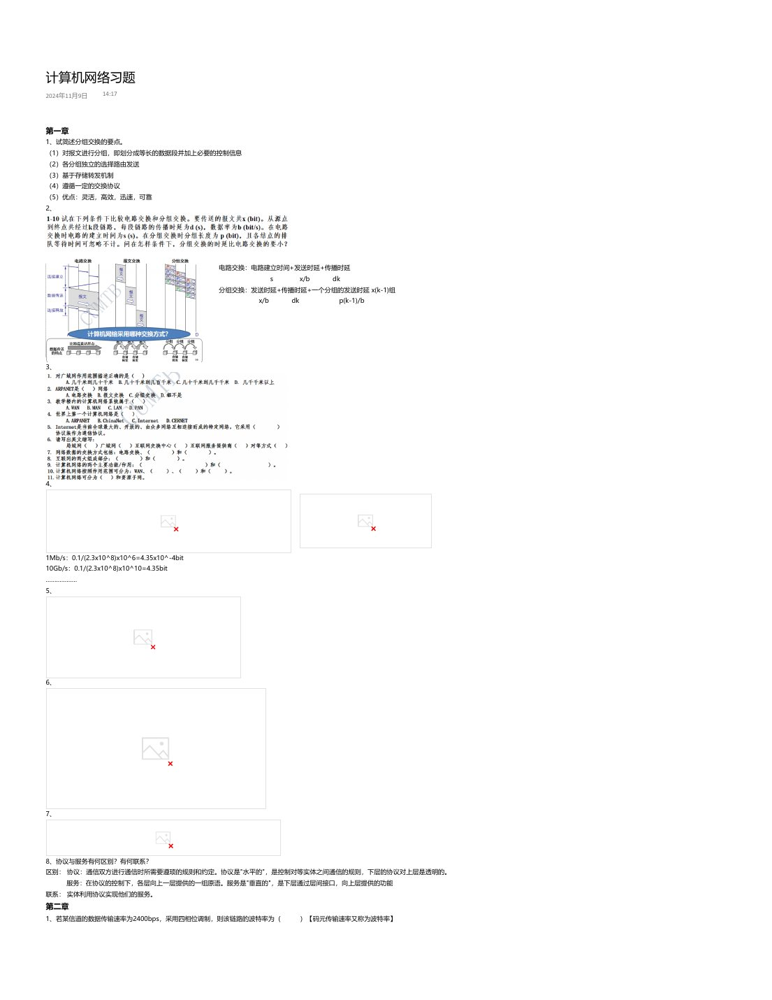
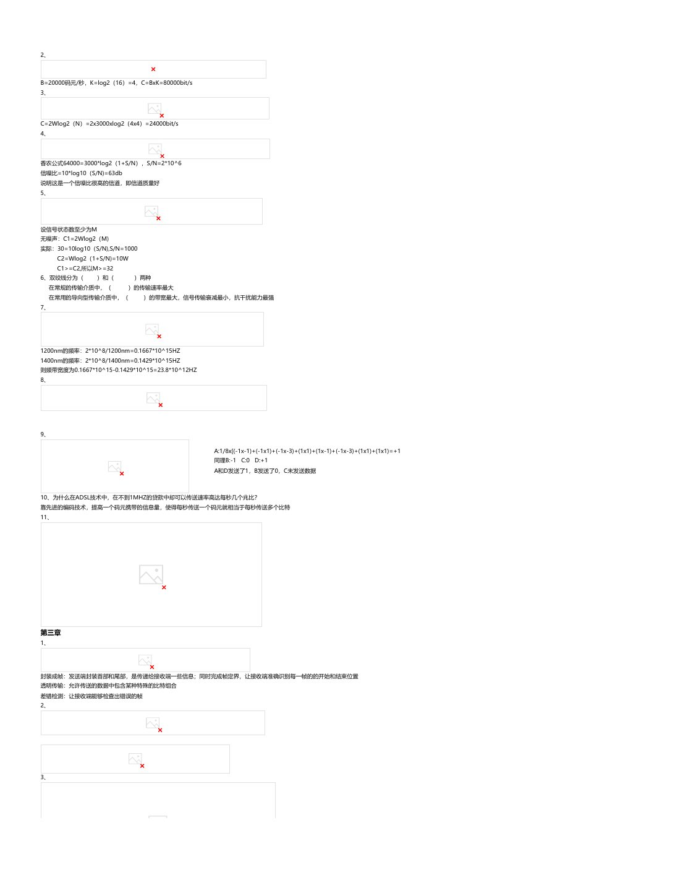
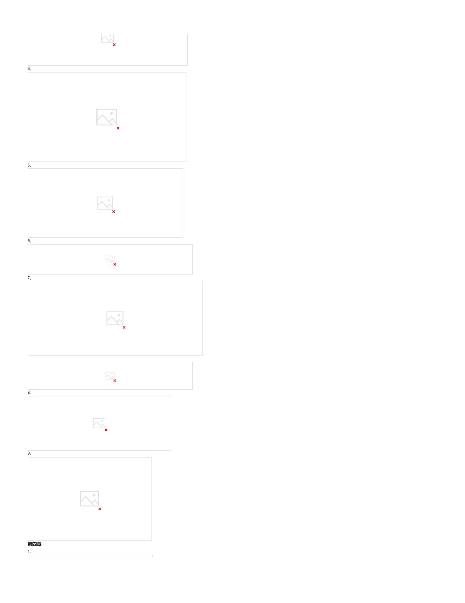
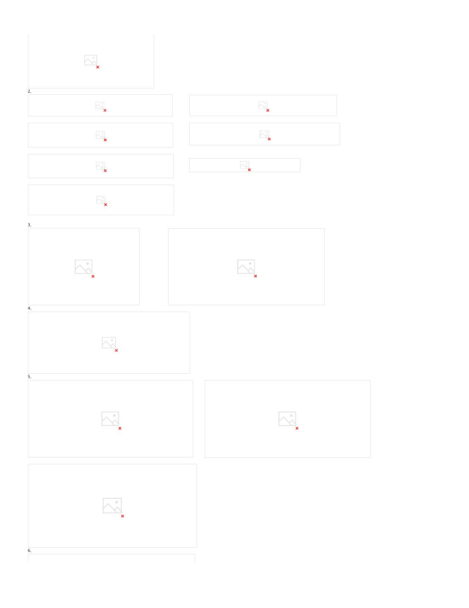
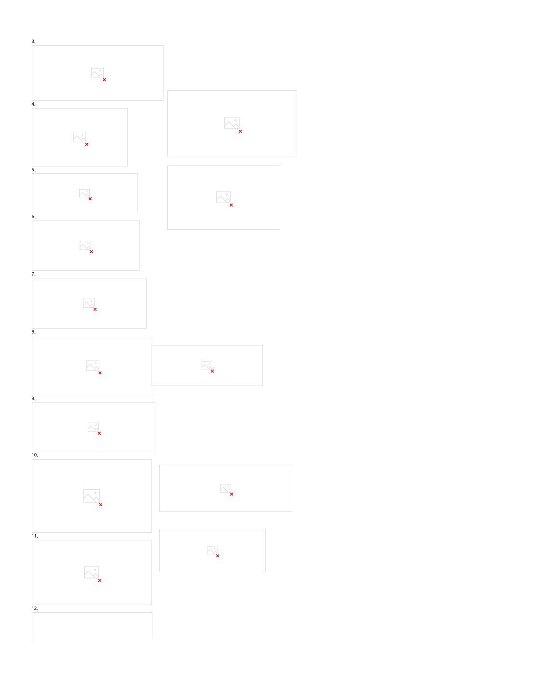
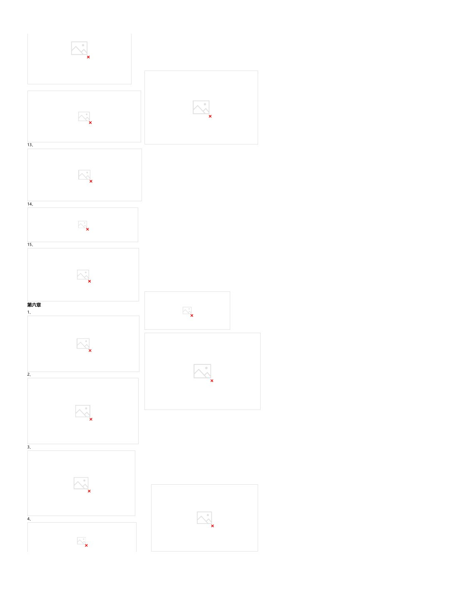
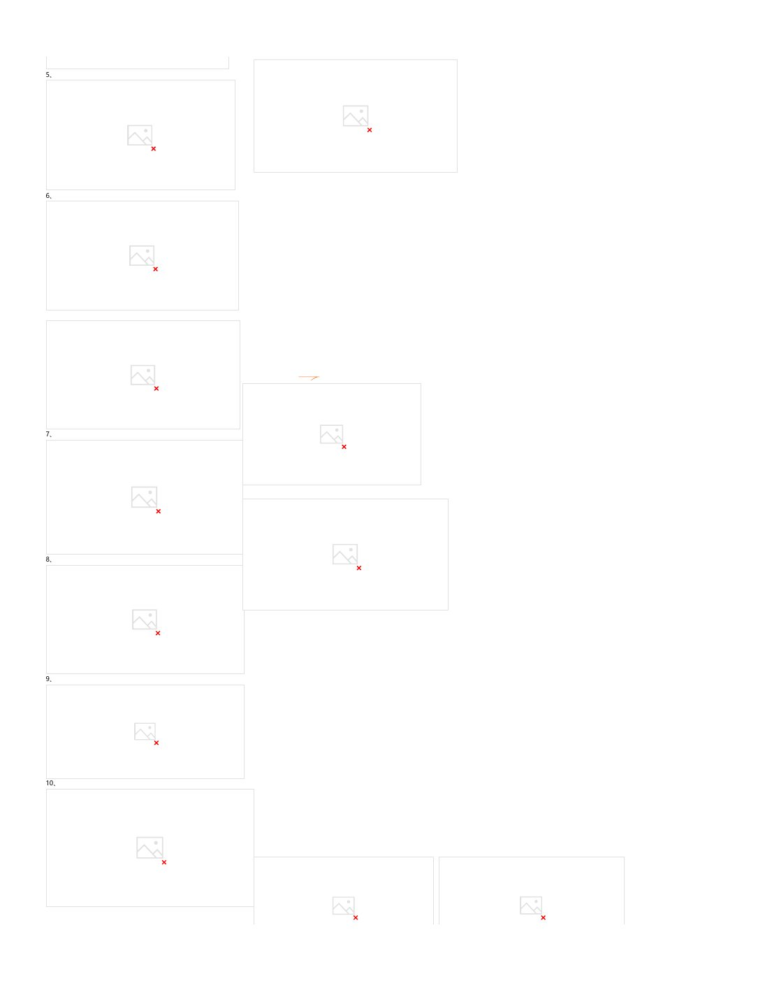

# 计算机网络：习题

[下载本课程 PDF](../../../assets/downloads/computer-networks.pdf)

## 文字版

计算机网络习题
2024年11月9日      14:17

### 第一章
1、试简述分组交换的要点。
（1）对报文进行分组，即划分成等长的数据段并加上必要的控制信息
（2）各分组独立的选择路由发送
（3）基于存储转发机制
（4）遵循一定的交换协议
（5）优点：灵活，高效，迅速，可靠
2、

电路交换：电路建立时间+发送时延+传播时延
s        x/b   dk
分组交换：发送时延+传播时延+一个分组的发送时延 x(k-1)组
x/b       dk          p(k-1)/b

3、

4、

1Mb/s：0.1/(2.3x10^8)x10^6=4.35x10^-4bit
10Gb/s：0.1/(2.3x10^8)x10^10=4.35bit
………………
5、
时序

6、

7、

8、协议与服务有何区别？有何联系？
区别： 协议：通信双方进行通信时所需要遵顼的规则和约定。协议是"水平的"，是控制对等实体之间通信的规则，下层的协议对上层是透明的。
服务：在协议的控制下，各层向上一层提供的一组原语。服务是"垂直的"，是下层通过层间接口，向上层提供的功能
联系： 实体利用协议实现他们的服务。
### 第二章
1、若某信道的数据传输速率为2400bps，采用四相位调制，则该链路的波特率为（                          ）【码元传输速率又称为波特率】
2、

B=20000码元/秒，K=log2（16）=4，C=BxK=80000bit/s
3、

---

区别： 协议：通信双方进行通信时所需要遵顼的规则和约定。协议是"水平的"，是控制对等实体之间通信的规则，下层的协议对上层是透明的。
服务：在协议的控制下，各层向上一层提供的一组原语。服务是"垂直的"，是下层通过层间接口，向上层提供的功能
联系： 实体利用协议实现他们的服务。
### 第二章
1、若某信道的数据传输速率为2400bps，采用四相位调制，则该链路的波特率为（                        ）【码元传输速率又称为波特率】
2、

B=20000码元/秒，K=log2（16）=4，C=BxK=80000bit/s
3、

C=2Wlog2（N）=2x3000xlog2（4x4）=24000bit/s
4、

香农公式64000=3000*log2（1+S/N），S/N=2*10^6
信噪比=10*log10（S/N)=63db
说明这是一个信噪比很高的信道，即信道质量好
5、

设信号状态数至少为M
无噪声：C1=2Wlog2（M)
实际：30=10log10（S/N),S/N=1000
C2=Wlog2（1+S/N)=10W
C1>=C2,所以M>=32
6、双绞线分为（        ）和（         ）两种
在常规的传输介质中，（            ）的传输速率最大
在常用的导向型传输介质中，（              ）的带宽最大，信号传输衰减最小，抗干扰能力最强
7、

1200nm的频率：2*10^8/1200nm=0.1667*10^15HZ
1400nm的频率：2*10^8/1400nm=0.1429*10^15HZ
则频带宽度为0.1667*10^15-0.1429*10^15=23.8*10^12HZ
8、

9、

A:1/8x[(-1x-1)+(-1x1)+(-1x-3)+(1x1)+(1x-1)+(-1x-3)+(1x1)+(1x1)=+1
同理B:-1 C:0 D:+1
A和D发送了1，B发送了0，C未发送数据

10、为什么在ADSL技术中，在不到1MHZ的贷款中却可以传送速率高达每秒几个兆比？
靠先进的编码技术，提高一个码元携带的信息量，使得每秒传送一个码元就相当于每秒传送多个比特
11、

### 第三章
1、

封装成帧：发送端封装首部和尾部，是传递给接收端一些信息；同时完成帧定界，让接收端准确识别每一帧的的开始和结束位置
透明传输：允许传送的数据中包含某种特殊的比特组合
差错检测：让接收端能够检查出错误的帧
2、

3、

4、

---

3、

4、

5、

6、

7、

8、

9、

### 第四章
1、

---

### 第四章
1、

2、

3、

4、

5、

6、

---

6、

7、

8、

9、

10、

---

10、

11、

12、

13、

### 第五章
1、

2、

3、

---

3、

4、

5、

6、

7、

8、

9、

10、

11、

12、

---

12、

13、

14、

15、

### 第六章
1、

2、

3、

4、

5、

---

4、

5、

6、

7、

8、

9、

10、

---

## 原版页面

### 第 1 页

### 第 2 页

### 第 3 页

### 第 4 页

### 第 5 页

### 第 6 页

### 第 7 页

### 第 8 页

### 第 9 页

