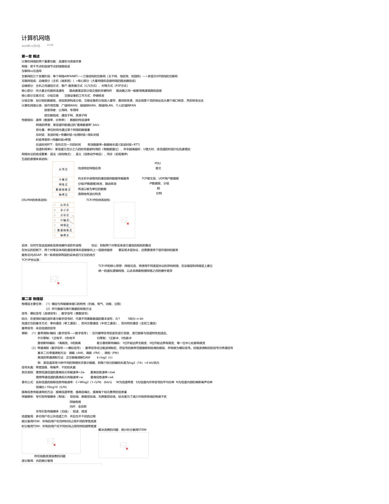
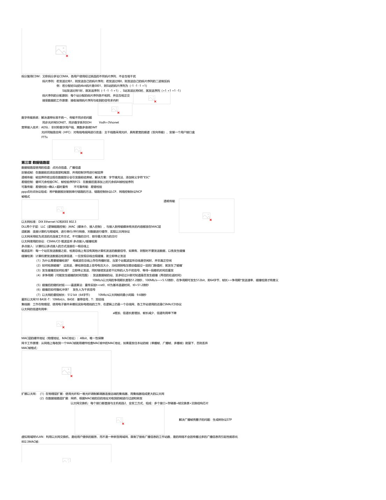
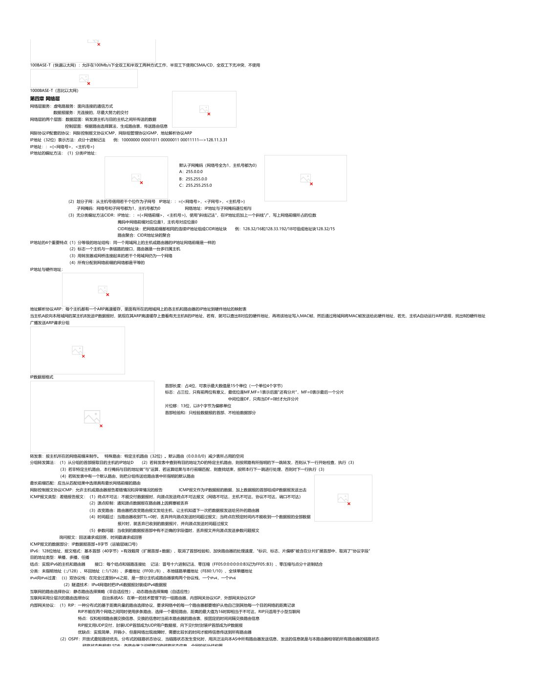
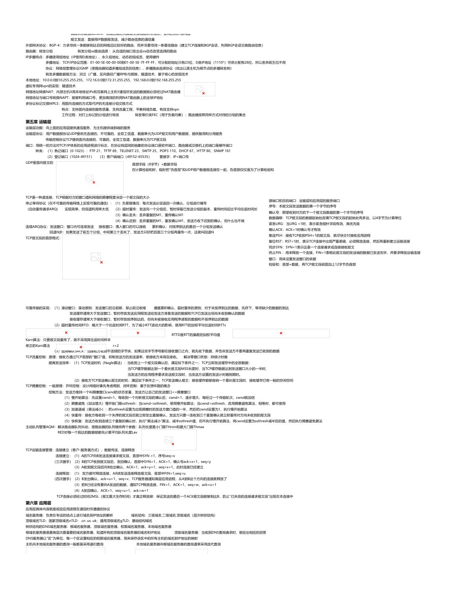
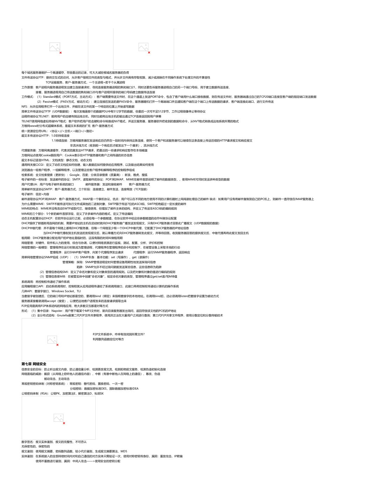

# 计算机网络：课堂笔记

[下载本课程 PDF](../../../assets/downloads/computer-networks.pdf)

## 文字版

计算机网络
2024年11月9日   12:09

### 第一章 概述
计算机网络的两个重要功能：连通性与资源共享
网络：若干节点和连接节点的链路组成
互联网vs互连网
互联网的三个发展阶段：单个网络ARPANRT—>三级结构的互联网（主干网，地区网，校园网）—>多层次ISP结构的互联网
互联网组成：边缘部分（主机（端系统））+核心部分（大量网络和连接网络的路由器组成）
边缘部分：主机之间通信方式：客户-服务器方式（C/S方式）、对等方式（P2P方式）
核心部分：向大量主机提供连通性           路由器是实现分组交换的关键构件         路由器之间一般都用高速链路相连接
核心部分交换方式：分组交换        交换设备的工作方式：存储转发
分组交换：划分短的数据段，添加首部构成分组，交换设备把分组放入缓存，查找转发表，找出到某个目的地址应从哪个端口转发，然后转发出去
计算机网络分类：按作用范围：广域网WAN，城域网MAN，局域网LAN，个人区域网PAN
按使用者：公用网，专用网
按功能组成：通信子网，资源子网
性能指标：速率（数据率，比特率）：数据的传送速率
网络的带宽：某信道所能通过的"最高数据率",bit/s
吞吐量：单位时间内通过某个网络的数据量
总时延：发送时延+传播时延+处理时延+排队时延
时延带宽积=传播时延x带宽
往返时间RTT：双向交互一次的时间           有效数据率=数据帧长度/(发送时延+RTT)
信道利用率U：某信道又百分之几的时间是被利用的（有数据通过），并非越高越好，U增大时，该信道的时延D也迅速增加
网络协议的组成要素：语法（结构格式），语义（信息动作响应），同步（实现顺序）
五层的原理体系结构：
PDU
完成特定网络应用                               报文

向主机中进程间的通信提供数据传输服务               TCP报文段，UDP用户数据报
分组(IP数据报)转发，路由转发                     IP数据报，分组
传送以帧为单位的数据                              帧
透明地传送比特流                               比特

OSI/RM的体系结构：                     TCP/IP的体系结构：

实体：任何可发送或接收信息地硬件或软件进程               协议：控制两个对等实体进行通信的规则的集合
在协议的控制下，两个对等实体间的通信使得本层能够向上一层提供服务                  要实现本层协议，还需要使用下层所提供的服务
服务访问点SAP：同一系统相邻两层的实体进行交互的地方
TCP/IP协议族：

TCP/IP的核心思想：网络互连，将使用不同底层协议的异构网络，在运输层和网络层上建立
统一的虚拟逻辑网络，以此来屏蔽物理网络之间的硬件差异

### 第二章 物理层
物理层主要任务：（1）确定与传输媒体接口的特性（机械，电气，功能，过程）
（2）并行数据与串行数据的转换方法
信号：模拟信号（连续信号）、数字信号（离散信号）
码元：在使用时域的波形表示数字信号时，代表不同离散数值的基本波形，0/1                  1码元=n bit
信道交互的基本方式：单向通信（单工通信）、双向交替通信（半双工通信）、双向同时通信（全双工通信）
基带信号：来自信源的信号
调制：（1）基带调制/编码（数字信号—>数字信号）：仅对基带信号的波形进行变换，使它能够与信道特性相适应。
不归零制：1正电平，0负电平                归零制：1正脉冲，0负脉冲
曼彻斯特编码：1高跳低，0低跳高              差分曼彻斯特编码：1位开始边界无跳变，0位开始边界有跳变，每一位中心处都有跳变
（2）带通调制（数字信号—>模拟信号）：基带信号经过载波调制后，把信号的频率范围搬移到较高的频段，并转换为模拟信号。经载波调制后的信号为带通信号
基本二元带通调制方法：调幅（AM)、调频（FM）、调相（PM）
高效的带通调制方法：正交振幅调制QAM           k=log2（n）
例：某信道采用16种不同的物理状态表示数据，则每个码元的编码长度为log2（16）=4 bit/码元
信号失真：带宽受限、有噪声、干扰和失真
奈氏准则：理想低通信道的最高码元传输速率=2w             最高信息速率=2wk
理想带通信道的最高码元传输速率=w            最高信息速率=wk
香农公式：实际信道的极限信息传输速率：C=Wlog2（1+S/N) (bit/s)         W为信道带宽 S为信道内所传信号的平均功率 N为信道内部的高斯噪声功率
信噪比=10log10（S/N）
提高信息传输速率的方法：提高信道带宽、提高信噪比、提高每个码元携带的信息量
传输媒体：导引型传输媒体（有线）：双绞线：屏蔽双绞线、无屏蔽双绞线，绞合是为了减少对相邻导线的电磁干扰
同轴电缆
光纤：全反射
非导引型传输媒体（无线）：短波、微波
信道复用：多对用户在公共信道工作，并且互不干扰的过程
频分复用FDM：所有的用户在同样时间占用不同的带宽资源
时分复用TDM：所有的用户在不同时间占用同样的频带宽度
解决浪费的问题：统计时分复用STDM

存在线路资源浪费的问题
波分复用：光的频分复用

---

存在线路资源浪费的问题
波分复用：光的频分复用

码分复用CDM：又称码分多址CDMA，各用户使用经过挑选的不同码片序列，不会互相干扰
码片序列：若发送比特1，则发送自己的码片序列；若发送比特0，则发送自己的码片序列的二进制反码
例：若分配给S站的4bit码片是0001，则S站的码片序列为（-1 -1 -1 +1）
S站发送比特1时，就发送序列（-1 -1 -1 +1），S站发送比特0时，就发送序列（+1 +1 +1 -1）
码片序列的分配原则：每个站分配的码片序列各不相同，并且互相正交
接受数据的工作原理：接收端用码片序列与收到的信号求内积

数字传输系统：解决速率标准不统一、传输不同步的问题
同步光纤网SONET、同步数字系列SDH      Vsdh=3Vsonet
宽带接入技术：ADSL：非对称数字用户线，离散多音调DMT
光纤同轴混合网（HFC)：对有线电视网进行改造：主干线路采用光纤、具有更宽的频谱（双向传输）、安装一个用户接口盒
FTTx

### 第三章 数据链路层
数据链路层使用的信道：点对点信道、广播信道
封装成帧：在数据前后添加首部和尾部，并用控制字符进行帧定界
透明传输：帧定界符若出现在数据部分会引发提前结束帧，解决方案：字节填充法，添加转义字符"ESC"
差错控制：循环冗余检验CRC，帧检验序列FCS：在数据后面添加上的冗余码叫帧检验序列
可靠传输：差错检验+确认+超时重传             不可靠传输：差错检验
ppp点对点协议组成：将IP数据报封装到串行链路的方法、链路控制协议LCP、网络控制协议NCP
帧格式
透明传输

以太网标准：DIX Ethernet V2和IEEE 802.3
DLL两个子层：LLC（逻辑链路控制）,MAC（媒体介、接入控制），与接入到传输媒体有关的内容都放在MAC层
适配器：连接计算机与局域网，进行串行/并行转换，对数据进行缓存，实现以太网协议
以太网采用较为灵活的无连接工作方式，不可靠的交付，即尽最大努力的交付
以太网使用的协议：CSMA/CD 载波监听 多点接入/碰撞检测
多点接入：计算机以多点接入的方式连接在一根总线上
载波监听：每一个站在发送数据之前，检测总线上有没有其他计算机发送的数据信号，如果有，则暂时不要发送数据，以免发生碰撞
碰撞检测：计算机便发送数据边检测信道，一旦发现总线出现碰撞，就立即停止发送
（1）为什么需要碰撞检测？ 电磁波在总线上存在传播时延，当某个站载波监听总线是空闲时，并非真正空闲
（2）如何检测碰撞？ 边发送，便检测信道上信号电压大小，当检测到电压摆动值超过一定的门限值时，就发生了碰撞’
（3）发生碰撞后如何处理？ 立即停止发送，同时继续发送若干比特的人为干扰信号，等待一段随机时间后重发
（4）求争用期（可能发生碰撞的时间范围）：发送数据帧的站，至多经过2r就可知道是否发生碰撞（两倍的往返时间）
10Mb/s以太网的争用期长度取51.2微秒，100Mb/s—>5.12微秒，在争用期可发生512bit，即64字节，帧长>=争用期*发送速率，碰撞检测才有意义
（5）碰撞后的随机时延——逼退算法：重传实验t=rxt0，t0为基本退避时间，t0=51.2微秒
（6）碰撞后如何强化冲突？ 发生人为干扰信号
（7）以太网的最短帧长：512 bit（64字节）       10Mb/s以太网帧间最小间隔：9.6微秒
星形以太网10 BASE-T：10Mbit/s，BASE：基带信号，T：双绞线
集线器：工作在物理层，使用电子器件来模拟实际电缆线的工作，在逻辑上仍是一个总线网，各工作站使用的还是CSMA/CD协议
以太网的信道利用率：
a增加，信道长度增加，帧长减少，信道利用率下降

MAC层的硬件地址（物理地址，MAC地址）：48bit，唯一性保障
网卡工作原理：从网络上每收到一个MAC帧就用硬件检查MAC帧中的MAC地址，如果是发往本站的帧（单播帧，广播帧，多播帧）就留下，否则丢弃
MAC帧格式：

扩展以太网：（1）在物理层扩展：使用光纤和一堆光纤调制解调器连接远端的集线器，用集线器组成更大的以太网
（2）在数据链路层扩展：网桥，根据MAC帧的目的地址对收到的帧进行过滤和转发
以太网交换机：每个接口都直接与主机相连2，全双工方式，组成：多个接口+存储器+帧交换表+交换结构芯片

解决广播帧兜圈子的问题：生成树协议STP

虚拟局域网VLAN：利用以太网交换机，是给用户提供的服务，而不是一种新型局域网，限制了接收广播信息的工作站数，是的网络不会因传播过多的广播信息而引起性能恶化
802.3MAC帧：

100BASE-T（快速以太网）：允许在100Mb/s下全双工和半双工两种方式工作，半双工下使用CSMA/CD，全双工下无冲突，不使用

1000BASE-T（吉比以太网）

---

虚拟局域网VLAN：利用以太网交换机，是给用户提供的服务，而不是一种新型局域网，限制了接收广播信息的工作站数，是的网络不会因传播过多的广播信息而引起性能恶化
802.3MAC帧：

100BASE-T（快速以太网）：允许在100Mb/s下全双工和半双工两种方式工作，半双工下使用CSMA/CD，全双工下无冲突，不使用

1000BASE-T（吉比以太网）

### 第四章 网络层
网络层服务：虚电路服务：面向连接的通信方式
数据报服务：无连接的，尽最大努力的交付
网络层的两个层面：数据层面：转发源主机与目的主机之间所传送的数据
控制层面：根据路由选择算法，生成路由表，传送路由信息
网际协议IP配套的协议：网际控制报文协议ICMP，网际组管理协议IGMP，地址解析协议ARP
IP地址（32位）表示方法：点分十进制记法         例：10000000 00001011 00000011 00011111—>128.11.3.31
IP地址：：={<网络号>，<主机号>}
IP地址的编址方法：（1）分类IP地址：

默认子网掩码（网络号全为1，主机号都为0）
A：255.0.0.0
B：255.255.0.0
C：255.255.255.0

（2）划分子网：从主机号借用若干个位作为子网号 IP地址：：={<网络号>，<子网号>，<主机号>}
子网掩码：网络号和子网号都为1，主机号都为0                     网络地址：IP地址与子网掩码逐位相与
（3）无分类编址方法CIDR：IP地址：：={<网络前缀>，<主机号>}，使用"斜线记法"，在IP地址后加上一个斜线"/"，写上网络前缀所占的位数
掩码中网络前缀对应位是1，主机号对应位是0
CIDR地址块：把网络前缀都相同的连续IP地址组成CIDR地址块                     例：128.32/16和128.33.192/18可组成地址块128.32/15
路由聚合：CIDR地址块的聚合
IP地址的4个重要特点（1）分等级的地址结构：同一个局域网上的主机或路由器的IP地址网络前缀是一样的
（2）标志一个主机与一条链路的接口，路由器是一台多归属主机
（3）用转发器或网桥连接起来的若干个局域网仍为一个网络
（4）所有分配到网络前缀的网络都是平等的
IP地址与硬件地址：

地址解析协议ARP：每个主机都有一个ARP高速缓存，里面有所在的局域网上的各主机和路由器的IP地址到硬件地址的映射表
当主机A欲向本局域网的某主机B发送IP数据报时，就现在其ARP高速缓存上查看有无主机B的IP地址，若有，就可以查出B对应的硬件地址，再将该地址写入MAC帧，然后通过局域网将MAC帧发送给此硬件地址，若无，主机A自动运行ARP进程，找出B的硬件地址
广播发送ARP请求分组

IP数据报格式

首部长度：占4位，可表示最大数值是15个单位（一个单位4个字节）
标志：占三位，只有前两位有意义，最低位是MF,MF=1表示后面"还有分片"，MF=0表示最后一个分片
中间位是DF，只有当DF=0时才允许分片
片位移：13位，以8个字节为偏移单位
首部检验和：只检验数据报的首部，不检验数据部分

转发表：按主机所在的网络前缀来制作。 特殊路由：特定主机路由（32位）。默认路由（0.0.0.0/0）减少表所占用的空间
分组转发算法：（1）从分组的首部提取目的主机的IP地址D             （2）若转发表中查到有目的地址为D的特定主机路由，则按照路有所指明的下一跳转发，否则从下一行开始检查，执行（3）
（3）若非特定主机路由，本行掩码与目的地址做"与"运算，若运算结果与本行前缀匹配，则查找结束，按照本行下一跳进行处理，否则对下一行执行（3）
（4）若转发表中有一个默认路由，则把分组传送给路由表中所指明的默认路由
最长前缀匹配：应当从匹配结果中选择具有最长网络前缀的路由
网际控制报文协议ICMP：允许主机或路由器报告差错情况和异常情况的报告                       ICMP报文作为IP数据报的数据，加上数据报的首部组成IP数据报发送出去
ICMP报文类型：差错报告报文：（1）终点不可达：不能交付数据报时，向源点发送终点不可达报文（网络不可达，主机不可达，协议不可达，端口不可达）
（2）源点抑制：通知源点数据报在路由器上因拥塞被丢弃
（3）改变路由：路由器把改变路由报文发给主机，让主机知道下一次把数据报发送给另外的路由器
（4）时间超过：当路由器收到TTL=0时，丢弃并向源点发送时间超过报文；当终点在预定时间内不能收到一个数据报的全部数据
报片时，就丢弃已收到的数据报片，并向源点发送时间超过报文
（5）参数问题：当收到的数据报首部中有不正确的字段值时，丢弃报文并向源点发送参数问题报文
询问报文：回送请求或回答、时间戳请求或回答
ICMP报文的数据部分：IP数据报首部+8字节（运输层端口号）
IPv6：128位地址，报文格式：基本首部（40字节）+有效载荷（扩展首部+数据），取消了首部检验和，加快路由器的处理速度，"标识、标志、片偏移"被含在分片扩展首部中，取消了"协议字段"
目的地址类型：单播，多播，任播
结点：实现IPv6的主机和路由器       接口：每个结点和链路连接处          记法：冒号十六进制记法、零压缩（FF05:0:0:0:0:0:0:B3记为FF05::B3）、零压缩与点分十进制结合
分类：未指明地址（::/128）、环回地址（::1/128）、多播地址（FF00::/8）、本地链路单播地址（FE80:1/10）、全球单播地址
IPv4向IPv6过渡：（1）双协议栈：在完全过渡到IPv6之前，是一部分主机或路由器装有两个协议栈，一个IPv4，一个IPv6
（2）隧道技术：IPv4网络时把IPv6数据报封装成IPv4数据报
互联网的路由选择协议：静态路由选择策略（非自适应性）、动态路由选择策略（自适应性）
互联网采用分层次的路由选择协议           自治系统AS：在单一的技术管理下的一组路由器，内部网关协议IGP，外部网关协议EGP
内部网关协议：（1）RIP：一种分布式的基于距离向量的路由选择协议，要求网络中的每一个路由器都要维护从他自己到其他每一个目的网络的距离记录
RIP不能在两个网络之间同时使用多条路由，选择一个最短路由，距离的最大值为16时即相当于不可达，RIP只适用于小型互联网
特点：仅和相邻路由器交换信息、交换的信息时当前本路由器的路由表、按固定的时间间隔交换路由信息
RIP报文用UDP交付，封装UDP首部成为UDP用户数据报，向下交付时封装IP首部成为IP数据报
优缺点：实现简单，开销小，但是网络出现故障时，需要比较长的时间才能将信息传送到所有路由器
（2）OSPF：开放式最短路径优先，分布式的链路状态协议，当链路状态发生变化时，用洪泛法向本AS中所有路由器发送信息，发送的信息就是与本路由器相邻的所有路由器的链路状态
链路状态数据库LSDB：各路由器之间频繁交换链路状态信息，全网的拓扑结构图
报文发送：直接用IP数据报发送，减少路由信息的通信量
外部网关协议：BGP-4：力求寻找一条能够到达目的网络且比较好的路由，而并非要寻找一条最佳路由（建立TCP连接和BGP会话，利用BGP会话交换路由信息）
路由器：转发分组              转发分组vs路由选择 ：从合适的端口发出去vs动态改变选择的路由
IP多播特点：多播使用组地址（IP使用D类地址）、永久组地址、动态的组成员、使用硬件
多播地址：TCP/IP协议范围：01-00-5E-00-00-00到01-00-5E-7F-FF-FF，可分配的地址只有23位，D类IP地址（1110*）可供分配有28位，所以舍弃前五位不用
协议：网络组管理协议IGMP（使路由器知道多播组成员的信息）、多播路由选择协议（找出以源主机为根节点的多播转发树）
转发多播数据报方法：洪泛（广播，反向路径广播RPB)与剪除、隧道技术、基于核心的发现技术

---

内部网关协议：（1）RIP：一种分布式的基于距离向量的路由选择协议，要求网络中的每一个路由器都要维护从他自己到其他每一个目的网络的距离记录
RIP不能在两个网络之间同时使用多条路由，选择一个最短路由，距离的最大值为16时即相当于不可达，RIP只适用于小型互联网
特点：仅和相邻路由器交换信息、交换的信息时当前本路由器的路由表、按固定的时间间隔交换路由信息
RIP报文用UDP交付，封装UDP首部成为UDP用户数据报，向下交付时封装IP首部成为IP数据报
优缺点：实现简单，开销小，但是网络出现故障时，需要比较长的时间才能将信息传送到所有路由器
（2）OSPF：开放式最短路径优先，分布式的链路状态协议，当链路状态发生变化时，用洪泛法向本AS中所有路由器发送信息，发送的信息就是与本路由器相邻的所有路由器的链路状态
链路状态数据库LSDB：各路由器之间频繁交换链路状态信息，全网的拓扑结构图
报文发送：直接用IP数据报发送，减少路由信息的通信量
外部网关协议：BGP-4：力求寻找一条能够到达目的网络且比较好的路由，而并非要寻找一条最佳路由（建立TCP连接和BGP会话，利用BGP会话交换路由信息）
路由器：转发分组                   转发分组vs路由选择 ：从合适的端口发出去vs动态改变选择的路由
IP多播特点：多播使用组地址（IP使用D类地址）、永久组地址、动态的组成员、使用硬件
多播地址：TCP/IP协议范围：01-00-5E-00-00-00到01-00-5E-7F-FF-FF，可分配的地址只有23位，D类IP地址（1110*）可供分配有28位，所以舍弃前五位不用
协议：网络组管理协议IGMP（使路由器知道多播组成员的信息）、多播路由选择协议（找出以源主机为根节点的多播转发树）
转发多播数据报方法：洪泛（广播，反向路径广播RPB)与剪除、隧道技术、基于核心的发现技术
本地地址：10.0.0.0到10.255.255.255、172.16.0.0到172.31.255.255、192.168.0.0到192.168.255.255
虚拟专用网vpn的实现：隧道技术
网络地址转换NAT：内部主机X用本地地址IPx和互联网上主机Y通信所发送的数据报必须经过NAT路由器
网络地址与端口号转换NAPT：能够利用端口号，更加高效的利用NAT路由器上的全球IP地址
多协议标记交换MPLS：用面向连接的方式取代IP的无连接分组交换方式
特点：支持面向连接的服务质量、支持流量工程，平衡网络负载、有效支持vpn
工作过程：对打上标记的分组进行转发                      转发等价类FEC（用于负载均衡）：路由器按照同样方式对待的分组的集合

### 第五章 运输层
运输层功能：向上面的应用层提供通信服务，为主机提供端到端的服务
运输层协议：用户数据报协议UDP提供无连接的，不可靠的，全双工信道，数据单元为UDP报文和用户数据报，提供复用和分用服务
传输控制协议TCP提供面向连接的，可靠的，全双工信道，数据单元为TCP报文段
端口：用统一的方法对TCP/IP体系的应用进程进行标志，在协议栈层间的抽象的协议端口是软件端口，路由器或交换机上的端口是硬件端口
种类：（1）熟记端口（0-1023）：FTP 21，TFTP 69，TELENET 23，SWTP 25，POP3 110，DHCP 67，HTTP 80，SNMP 161
（2）登记端口（1024-49151）         （3）客户端端口（49152-65535）           套接字：IP+端口号
UDP是面向报文的                                               首部字段（8字节）+数据字段
在计算检验和时，临时把"伪首部"和UDP用户数据报连接在一起，伪首部仅仅是为了计算检验和

TCP是一种虚连接，TCP根据对方的窗口值和网络的拥塞程度决定一个报文段的大小
源端口和目的端口：运输层和应用层的服务端口
停止等待协议（在不可靠的传输网络上实现可靠的通信）：（1）无差错情况：每次发送必定返回一次确认，分组进行编号
序号：本报文段发送数据的第一个字节的序号
（自动重传请求ARQ)         实现简单，但信道利用率太低             （2）超时重传：发送完一个分组后，暂时保留已发送分组的副本，重传时间应比平均往返时间长
确认号：期望收到对方的下一个报文段数据的第一个字节的序号
（3）确认丢失：丢弃重复的M1，重传确认M1
数据偏移：TCP报文段的数据起始处距离TCP报文段的起始处有多远，以4字节为计算单位
（4）确认迟到：丢弃重复的M1，重发确认M1，发送方收下迟到的确认，但什么也不做
紧急URG：当URG =1时，表示紧急指针字段有效，高优先级
连续ARQ协议：发送窗口：窗口内可连续发送                 接收窗口：落入窗口的可以接收              累积确认：对按序到达的最后一个分组发送确认
确认ACK：ACK=1时确认号才有效
回退N步：如果发送了前五个分组，中间第三个丢失了，发送方只好把后面三个分组再重传一次，这就叫回退N
推送PSH：接收TCP收到PSH=1的报文段，就尽快交付接收应用进程
TCP报文段的首部格式：
复位RST：RST=1时，表示TCP连接中出现严重差错，必须释放连接，然后再重新建立运输连接
同步SYN：SYN=1表示这是一个连接请求或连接接收报文
终止FIN ：用来释放一个连接，FIN=1表明此报文段的发送端的数据已发送完毕，并要求释放运输连接
窗口：用来设置发送窗口的依据
检验和：首部+数据，再TCP报文段前面加上12字节伪首部

可靠传输的实现：（1）滑动窗口：滑动原则：发送窗口后沿前移，禁止前沿收缩                               遵循累积确认、超时重传的原则，对于未按序到达的数据，先存下，等待缺少的数据的到达
发送缓存通常大于发送窗口，暂时存放发送应用程发送给发送方准备发送的数据和TCP已发送出但尚未收到确认的数据
接收缓存通常大于接收窗口，暂时存放按序到达的，但尚未被接收应用程序读取的数据和不按序到达的数据
（2）超时重传时间RTO：略大于一个往返时间RTT，为了减小RTT波动大的影响，使用RTT的加权平均往返时间RTTs

RTTD是RTT的偏差的加权平均值
Karn算法：只要报文段重传了，就不采用其往返时间样本
修正的Karn算法                                     r=2
（3）选择确认SACK：当接收方收到不连续的字节块，如果这些字节序号都在接收窗口之内，就先收下数据，并告诉发送方不要再重复发送已收到的数据
TCP流量控制：原理：接收方通过TCP首部的"窗口"值，抑制发送方的发送速率，使接收方来得及接收。                                    解决零窗口死锁：持续计时器
提高发送效率：（1）TCP发送时机（Nagle算法）：当收到上一个报文段确认后，满足如下条件之一，TCP立即发送缓存中的全部数据：
当TCP缓存数据达到一个最长报文段MSS长度时、当TCP缓存数据达到发送窗口大小的一半时、
当发送方的应用程序要求发送报文段时、当发送方设置的发送计时器到期时。
（2）接收方TCP发送确认报文的时机：满足如下条件之一，TCP发送确认报文：接收缓存能够容纳一个最长报文段时、接收缓存已有一般的空闲空间
TCP拥塞控制：一般原理：开环控制：设计网络时事先考虑周到、闭环控制：基于反馈环路的概念
控制方法：发送方维持一个叫拥塞窗口cwnd的状态变量，发送方让自己的发送窗口<=拥塞窗口
（1）慢开始算法：先设置cwnd=1，每收到一个对新报文段的确认后，cwnd+1，逐步增大，每经过一个传输轮次，cwnd就加倍
（2）拥塞避免（加法增大）慢开始门限ssthresh：当cwnd<ssthresh，使用慢开始算法；当cwnd>ssthresh，改用拥塞避免算法，相等时，都可使用
（3）加速递减（乘法减小）：把ssthresh设置为出现拥塞时的发送方窗口值的一半，然后把cwnd设置为1，执行慢开始算法
（4）快重传：接收方每收到一个失序的报文段后就立即发出重复确认，发送方只要一连收到三个重复确认就立即重传对方尚未收到的报文段
（5）快恢复：发送方收到连续三个重复的确认时，执行"乘法减小"算法，减半ssthresh值，但不执行慢开始算法，将cwnd设置为ssthresh减半后的值，然后执行拥塞避免算法
主动队列管理AQM：解决路由器队列抖动，使路由器的队列维持两个参数：队列长度最小门限THmin和最大门限Thmax
RED对每一个到达的数据报都先计算平均队列长度Lav

TCP运输连接管理：连接建立（客户-服务器方式），数据传送，连接释放
连接建立：（1）A的TCP向B发送连接请求报文段，首部中SYN =1，序号seq=x
（三次握手）（2）B的TCP收到报文段后，发回确认，首部中SYN=1，ACK=1，确认号ack=x+1，seq=y
（3）A收到报文段后向B给出确认，ACK=1，ack=y+1，seq=x+1，此时连接已经建立
连接释放：（1） 双方都可释放连接，A向B发送连接释放报文段，首部中FIN=1,seq=u
（四次握手）（2）B发出确认，ack=u+1，seq=v，TCP服务器通知高层应用进程，从A到B这个方向的连接就释放了
（3）若B已经没有要向A发送的数据，通知TCP释放连接，FIN=1，ACK=1，seq=w，ack=u+1
（4）A发回确认，ACK=1，seq=u+1，ack=w+1
TCP连接必须经过时间2MSL（报文最大生存时间）才真正释放掉：保证发送的最后一个ACK报文段能够到达B、防止"已失效的连接请求报文段"出现在本连接中
### 第六章 应用层
应用层具体内容就是规定应用进程在通信时所遵循的协议
域名服务器：负责在专设的结点上进行域名到IP地址的解析                            域名结构：三级域名.二级域名.顶级域名（层次树状结构）
顶级域名TLD：国家顶级域名nTLD：.cn .us .uk；通用顶级域名gTLD；基础结构域名
树状结构的DNS域名服务器：根域名服务器、顶级域名服务器、权限域名服务器、本地域名服务器
根域名服务器是最高层次最重要的域名服务器，知道所有的顶级域名服务器的域名和IP地址                                     顶级域名服务器：当收到DNS查询请求时，就给出相应的回答
DNS服务器以"区"为单位，每一个区设置相应的权限域名服务器，用来保存该区中的所有主机的域名到IP地址的映射
主机向本地域名服务器的查询一般都是采用递归查询                                   本地域名服务器向根域名服务器的查询通常采用迭代查询

---

顶级域名TLD：国家顶级域名nTLD：.cn .us .uk；通用顶级域名gTLD；基础结构域名
树状结构的DNS域名服务器：根域名服务器、顶级域名服务器、权限域名服务器、本地域名服务器
根域名服务器是最高层次最重要的域名服务器，知道所有的顶级域名服务器的域名和IP地址                 顶级域名服务器：当收到DNS查询请求时，就给出相应的回答
DNS服务器以"区"为单位，每一个区设置相应的权限域名服务器，用来保存该区中的所有主机的域名到IP地址的映射
主机向本地域名服务器的查询一般都是采用递归查询                    本地域名服务器向根域名服务器的查询通常采用迭代查询

每个域名服务器维护一个高速缓存，存放最近的记录，可大大减轻根域名服务器的负荷
文件传送协议FTP：提供交互式的访问，允许客户指明文件的类型与格式，并允许文件具有存取权限，减少或消除在不同操作系统下处理文件的不兼容性
TCP运输服务，客户-服务器方式，一个主进程+若干个从属进程
工作原理：客户进程向服务器进程发出建立连接请求时，寻找连接服务器进程的熟知端口21，同时还要告诉服务器进程自己的另一个端口号码，用于建立数据传送连接，
接着，服务器进程用自己传送数据的熟知端口20与客户进程所提供的端口号码建立数据传送连接
工作模式：（1）Standard模式（PORT方式，主动方式）：客户端需要传送文件时，在这个通道上发送PORT命令，包含了客户端用什么端口接收数据，则在传送文件时，服务器端通过自己的TCP20端口连接至客户端的指定端口发送数据
(2）Passive模式（PASV方式，被动方式）：建立连接后发送的是PASV命令，服务器随机打开一个高端端口并且通知客户端在这个端口上传送数据的请求，客户端连接此端口，进行文件传送
NFS：允许应用程序打开一个远地文件，并能在该文件的某一个特定的位置上开始读写数据
简单文件传送协议TFTP（UDP数据报）：每次发哦是那个的数据PDU中有512字节的数据，但最后一次可不足512字节，工作过程很像停止等待协议
远程终端协议TELNET：能将用户的击键传到远地主机，同时也能将远地主机的输出通过TCP连接返回到用户屏幕
TELNET使用网络虚拟终端NVT格式：客户软件把用户的击键和命令转换成NVT格式，并送交服务器，服务器软件把收到的数据和命令，从NVT格式转换成远地系统所需的格式
万维网www时分布式超媒体系统，是超文本系统的扩充 客户-服务器方式
统一资源定位符URL：<协议>://<主机>:<端口>/<路径>
超文本传送协议HTTP：1.0非持续连接
1.1持续连接：万维网服务器在发送响应后仍然在一段时间内保持这条连接，使同一个客户和该服务器可以继续在这条连接上传送后续的HTTP请求报文和响应报文
非流水线方式（收到前一个响应后才能发出下一个请求）、流水线方式
代理服务器：万维网高速缓存，代表浏览器发出HTTP请求，把最近的一些请求和响应暂存在本地磁盘
万维网站点使用Cookie跟踪用户：Cookie表示在HTTP服务器和客户之间传递的状态信息
超文本标记语言HTML：文档类型：静态文档、动态文档
通用网关接口CGI：定义了动态文档应如何创建，输入数据应如何提供给应用程序，以及输出结果如何使用
浏览器由一组客户程序，一组解释程序，以及管理这些客户程序和解释程序的控制程序组成
检索系统：全文检索搜索（更新快）：Google，百度；分类目录搜索（质量高）：新浪，雅虎，搜狐
电子邮件的一些标准：发送邮件的协议：SMTP，读取邮件的协议：POP3和IMAP，MIME在邮件首部说明了邮件的数据类型，，使用MIME可同时发送多种类型的数据
用户代理UA：用户与电子邮件系统的接口              邮件服务器：发送和接收邮件     客户-服务器方式
简单邮件发送协议SMTP：客户-服务器方式，三个阶段：连接建立，邮件发送，连接释放（TCP连接）
电子邮件：信封+内容
邮件读取协议POP3和IMAP：客户-服务器方式，IMAP是一个联机协议，优点：用户可以在不同的地方使用不同的计算机随时上网阅读处理自己的邮件 缺点：如果用户没有将邮件复制到自己的PC机上，则邮件一直存放在IMAP服务器上
为什么需要MIME：SWTP不能传送可执行文件或其他的二进制对象、SWTP限于传送7位的ASCII码、SWTP拒绝超过一定长度的邮件
MIME的特点：MIME并没有改动SWTP或取代它，继续使用，但增加了邮件主体的结构，并定义了传送非ASCII码的编码规则
MIME的三个部分：5个新的邮件首部字段、定义了许多邮件内容的格式、定义了传送编码
动态主机配置协议DHCP：在软件协议运行之前，必须给每一个参数赋值，在协议软件中给这些参数赋值的动作叫做协议配置
DHCP提供了即插即用连网的机制，需要IP地址的主机在启动时就向DHCP服务器广播发送发现报文，只有DHCP服务器才回答此广播报文（UDP数据报的数据）
DHCP中继代理：并不是每个网络上都有DHCP服务器，但每一个网络至少有一个DHCP中继代理，它配置了DHCP服务器的IP地址信息
当DHCP中继代理收到主机发送的发现报文后，就以单播方式向DHCP服务器转发此报文，并等待回答。收到服务器回答的提供报文后，中继代理再将此报文发回主机
租用期：DHCP服务器分配给用户的IP地址是临时的，这段有限的时间叫做租用期
网络管理：对硬件，软件和人力的使用、综合与协调，以便对网络资源进行监视、测试、配置、分析、评价和控制
网络管理的一般模型：管理程序在运行时就成为管理进程，代理程序在管理程序的命令和控制下，在被管设备上采取本地的行动
管理程序：运行SNMP客户程序，向某个代理程序发出请求           代理程序：运行SNMP服务器程序，返回响应
简单网络管理协议SNMP组成（UDP）：（1）SNMP本身：基本功能：set（写操作）、get（读操作）
管理策略：探询：SNMP管理进程定时向管理设备周期性地发送探询问信息
陷阱：SNMP允许不经过询问就能发送某些信息，这些信息称为陷阱
（2）管理信息结构SMI：定义了命名对象和定义对象类型的通用规则。以及把对象和对象的值进行编码的规则
（3）管理信息库MIB：在被管实体中创建"命名对象"，规定命名对象的类型，管理程序通过get/set读/写MIB值
系统调用：将控制权传递给了操作系统
应用编程接口API：启动系统调用时，控制权就从应用进程传递给了系统调用接口，此接口再将控制权传递给计算机的操作系统
几种API：套接字接口、Windows Socket、TLI
当套接字被创建后，它的端口号和IP地址都是空的，要调用bind（绑定）来指明套接字的本地地址。在调用bind后，还必须调用listen把套接字设置为被动方式
服务器紧接着就调用accept（接受），以便把远地客户进程发来的连接请求提取出来
P2P应用是具有P2P体系结构的网络应用，绝大多数交互都是对等方式
形式：（1）集中目录：Napster：用户想下载某个MP3文件时，就向目录服务器发出询问，返回存放该文档的PC机的IP地址
（2）全分布式结构：Gnutella是第二代P2P文件共享程序，使用洪泛法在大量用户之间进行查询；第三代P2P共享文件程序，使用分散定位和分散传输技术

P2P文件系统中，咋样有效找到所需文件？
利用散列函数定位对等方

### 第七章 网络安全
信息安全的目标：防止析出报文内容、防止通信量分析、检测更改报文流、检测拒绝报文服务、检测伪造初始化连接
网络面临的威胁：截获（从网络上窃听他人的通信内容）、中断（有意中断他人在网络上的通信）、篡改、伪造
被动攻击、主动攻击
常规密钥密码体制（对称密钥系统）：常规密钥：替代密码，置换密码，一次一密
分组密码：数据加密标准DES，国际数据加密标准IDEA
公钥密码体制（RSA)：公钥PK，加密算法E，解密算法D，私钥SK

数字签名：报文实体鉴别、报文的完整性、不可否认
无保密性的，保密性的
报文鉴别：使用报文摘要、密码散列函数，较小代价鉴别，生成报文摘要算法，MD5
实体鉴别：在系统接入的全部持续时间内对和自己通信的对方实体只需验证一次，使用对称密钥传身份，漏洞：重放攻击，IP欺骗
使用不重数进行鉴别，漏洞：中间人攻击——>使用安全的密钥分配
对称密钥分配：设立密钥分配中心KDC，通过KDC分配，Kerberos算法
公钥分配：CA将公钥与对应实体绑定

---

数字签名：报文实体鉴别、报文的完整性、不可否认
无保密性的，保密性的
报文鉴别：使用报文摘要、密码散列函数，较小代价鉴别，生成报文摘要算法，MD5
实体鉴别：在系统接入的全部持续时间内对和自己通信的对方实体只需验证一次，使用对称密钥传身份，漏洞：重放攻击，IP欺骗
使用不重数进行鉴别，漏洞：中间人攻击——>使用安全的密钥分配
对称密钥分配：设立密钥分配中心KDC，通过KDC分配，Kerberos算法
公钥分配：CA将公钥与对应实体绑定

ICMPv6：反馈差错信息，包含了ARP和IGMP的功能

---

## 原版页面

### 第 1 页

### 第 2 页

### 第 3 页

### 第 4 页

### 第 5 页

### 第 6 页

