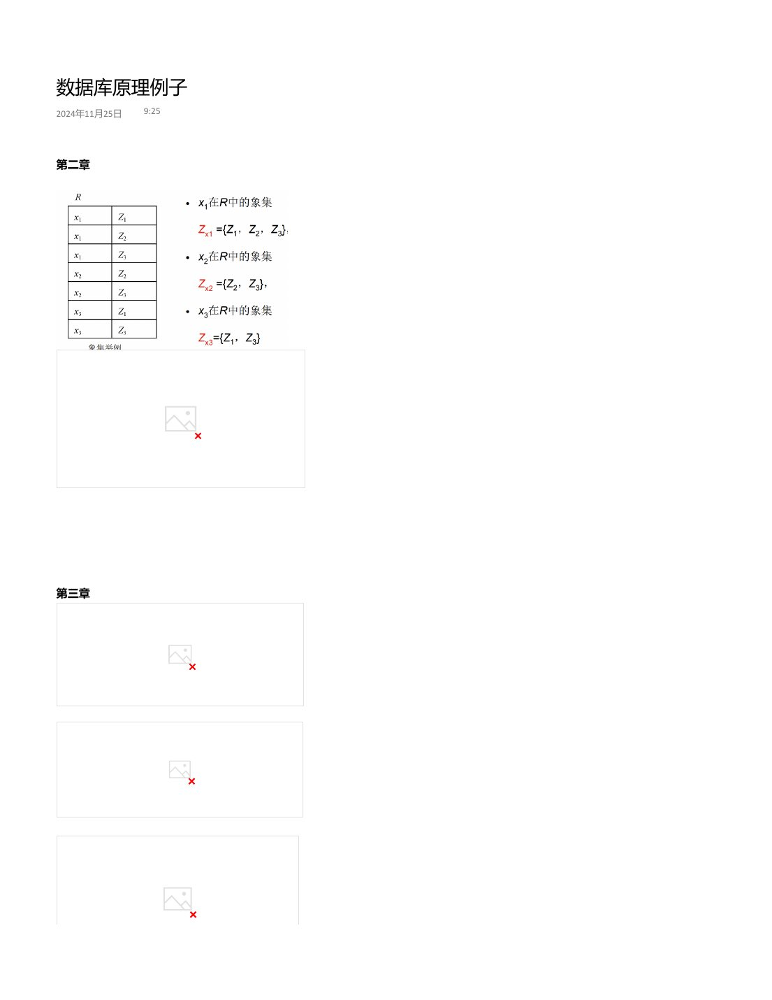
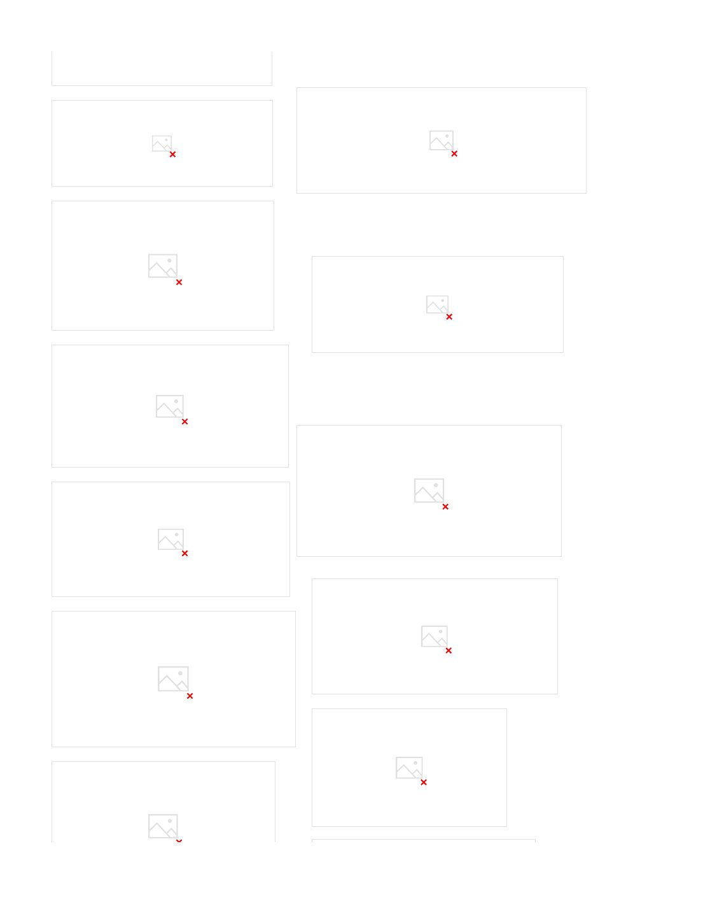
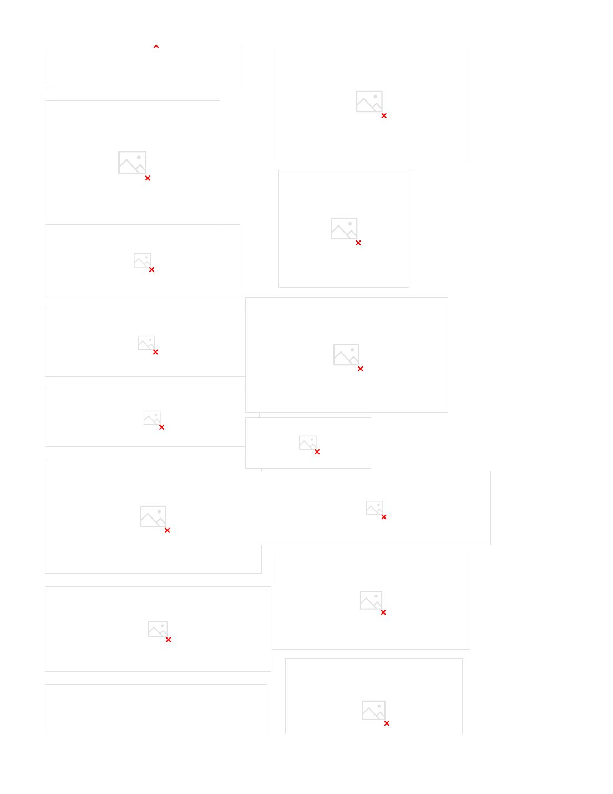
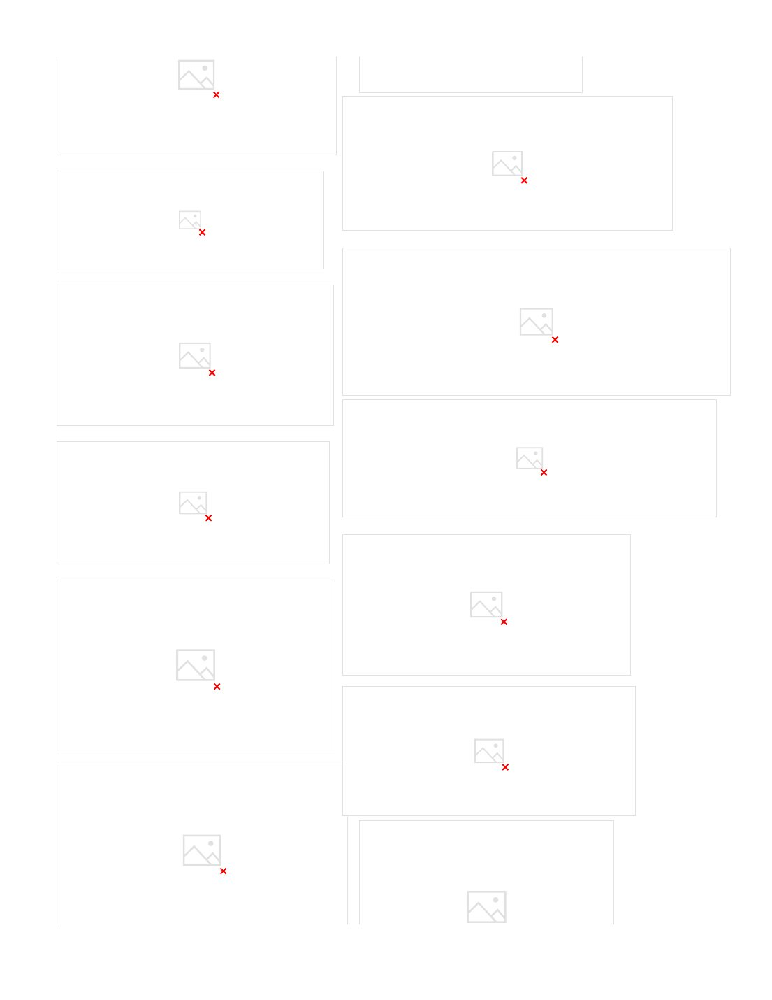
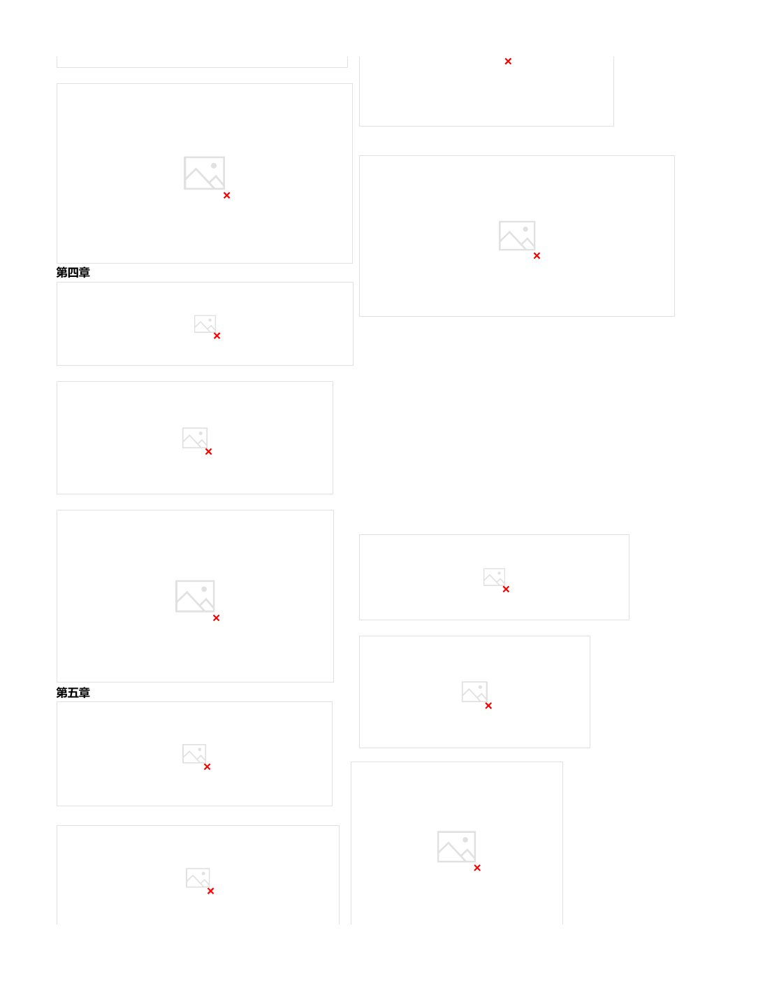
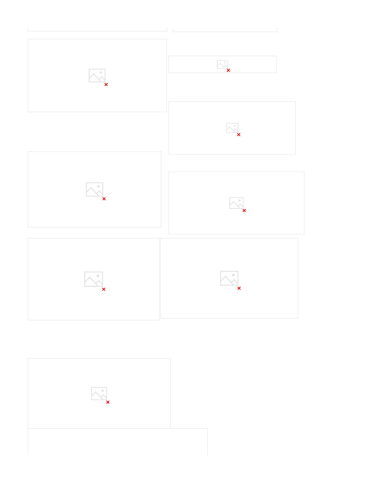
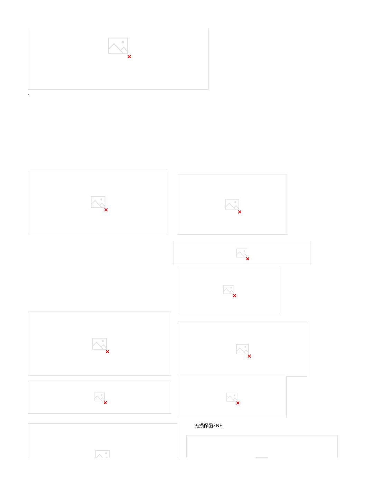

# 数据库原理：例题

[下载本课程 PDF](../../../assets/downloads/database-systems.pdf)

## 文字版

这一部分以图片内容为主，请直接浏览下方页面或下载 PDF。

## 原版页面

### 第 1 页

### 第 2 页

### 第 3 页

### 第 4 页

### 第 5 页

### 第 6 页

### 第 7 页

### 第 8 页

