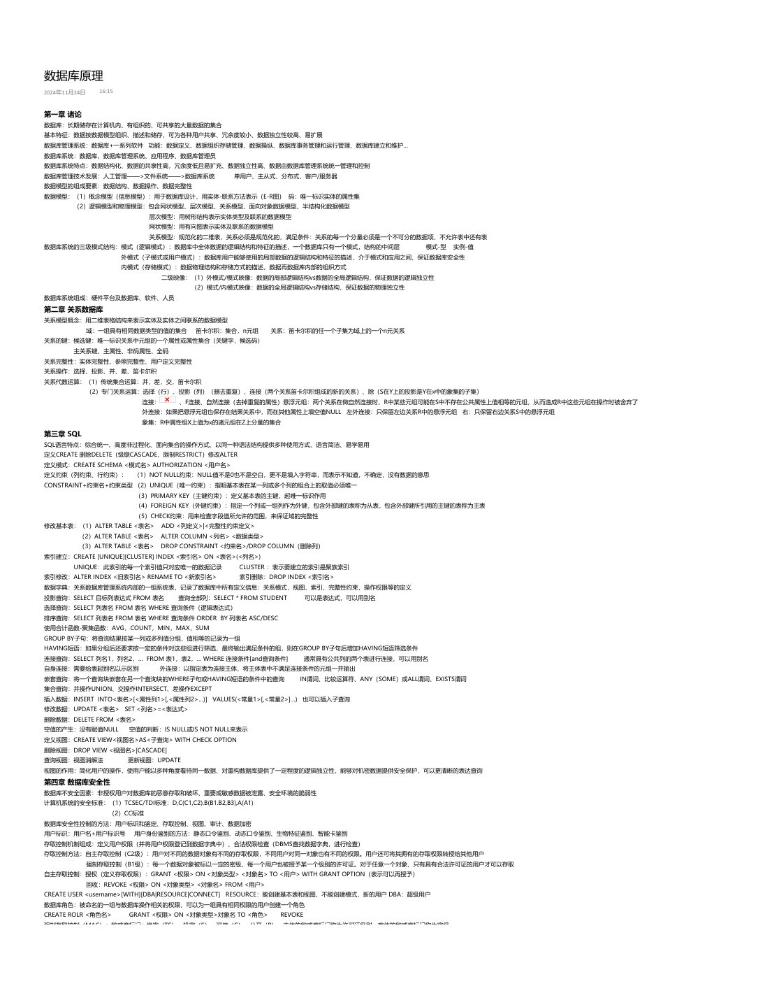
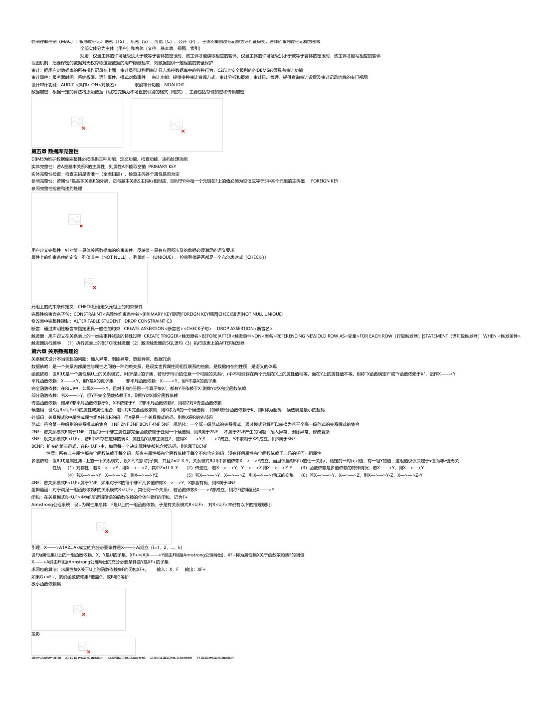
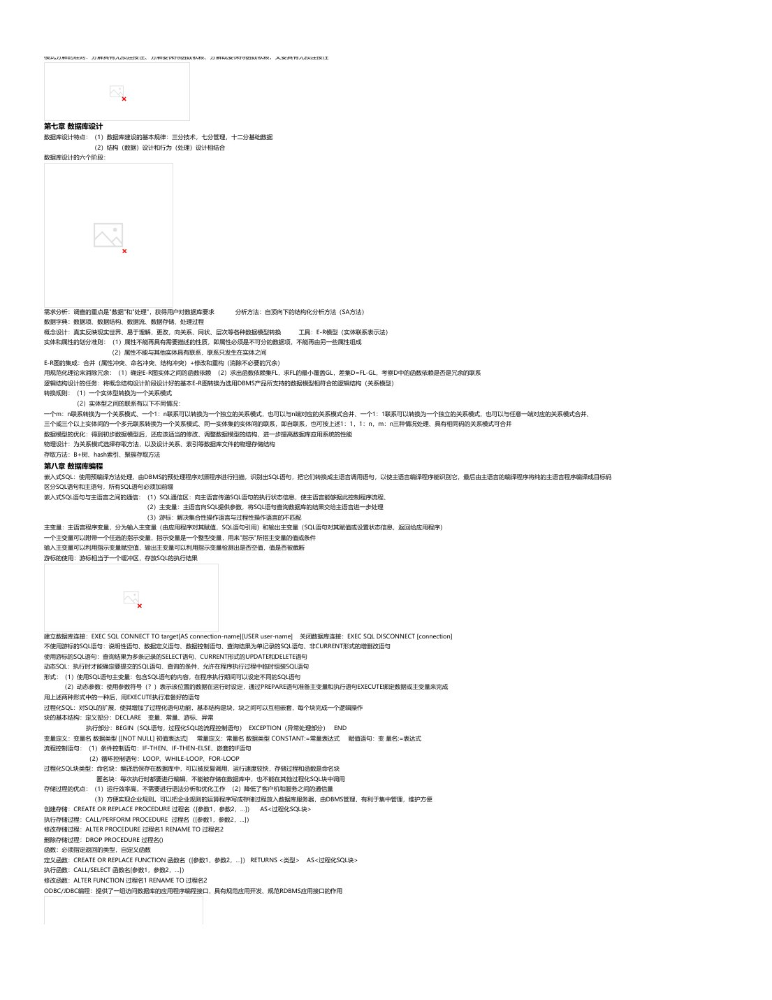
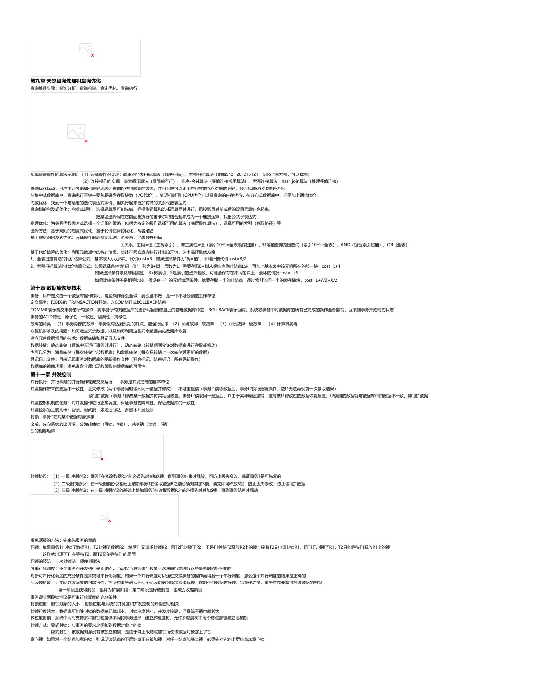
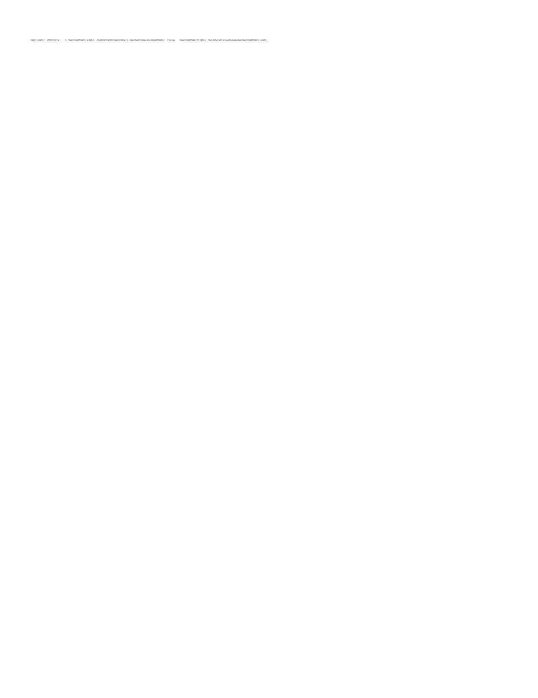
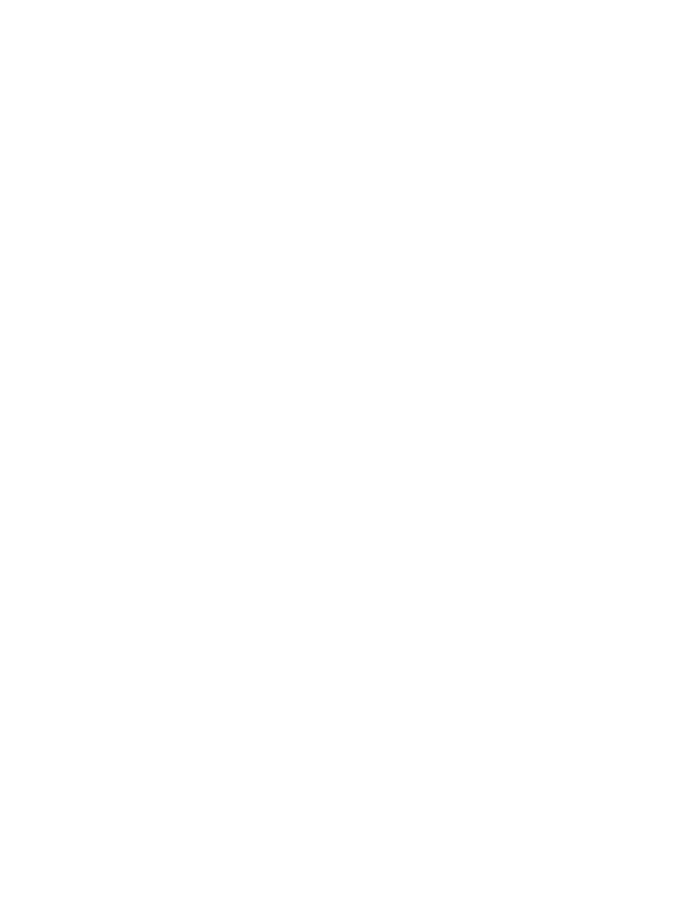
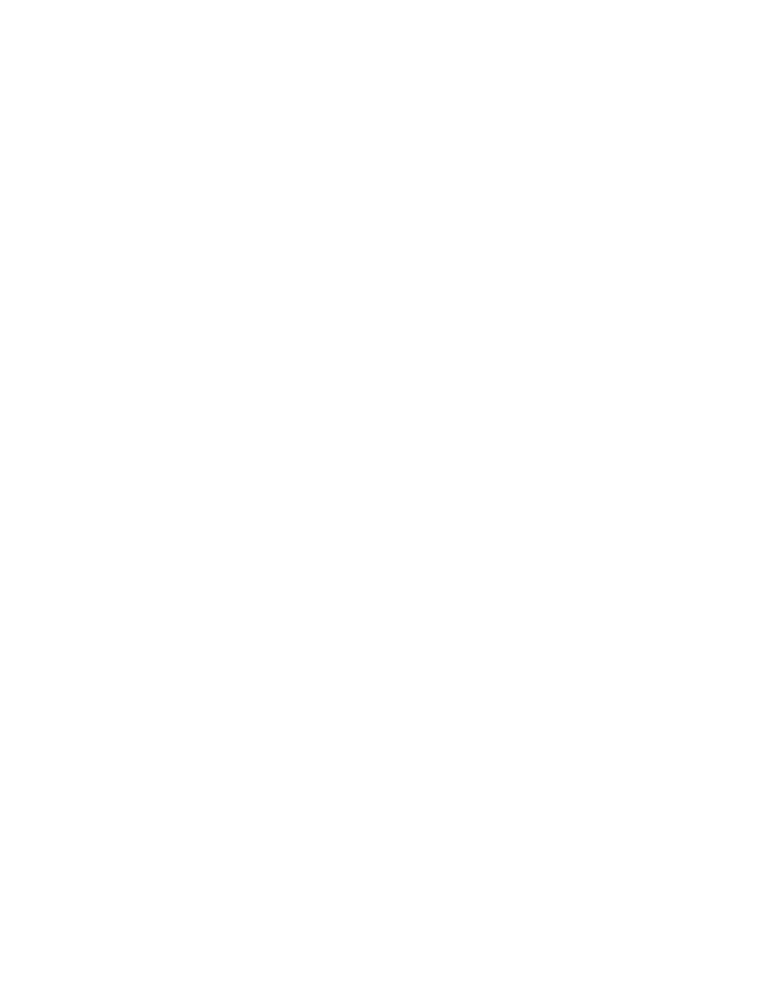
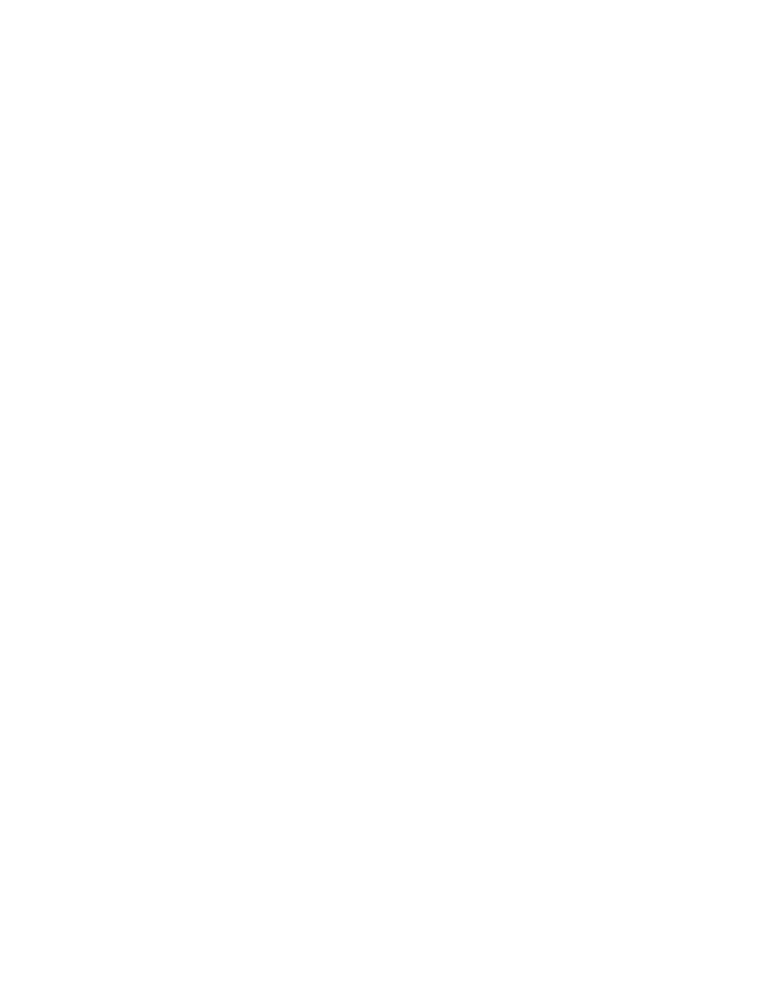
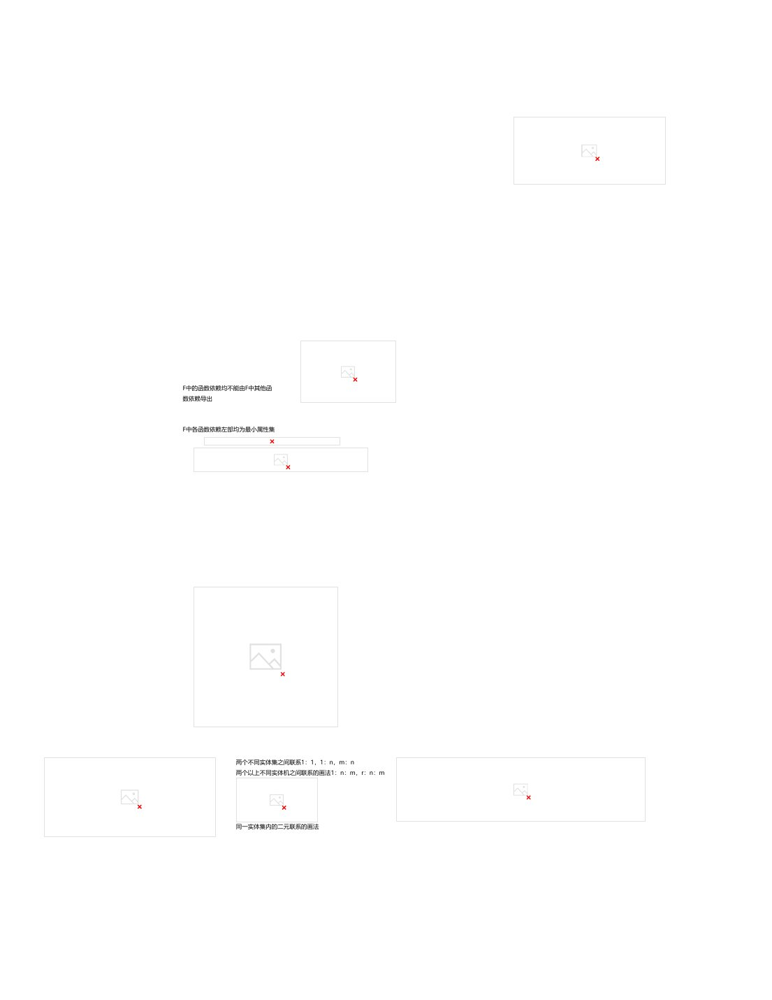

# 数据库原理：课堂笔记

[下载本课程 PDF](../../../assets/downloads/database-systems.pdf)

## 文字版

数据库原理
2024年11月24日     16:15

### 第一章 诸论
数据库：长期储存在计算机内、有组织的、可共享的大量数据的集合
基本特征：数据按数据模型组织、描述和储存，可为各种用户共享、冗余度较小、数据独立性较高、易扩展
数据库管理系统：数据库+一系列软件 功能：数据定义、数据组织存储管理、数据操纵、数据库事务管理和运行管理、数据库建立和维护…
数据库系统：数据库、数据库管理系统、应用程序、数据库管理员
数据库系统特点：数据结构化、数据的共享性高，冗余度低且易扩充、数据独立性高、数据由数据库管理系统统一管理和控制
数据库管理技术发展：人工管理——>文件系统——>数据库系统                      单用户、主从式、分布式、客户/服务器
数据模型的组成要素：数据结构、数据操作、数据完整性
数据模型：（1）概念模型（信息模型）：用于数据库设计，用实体-联系方法表示（E-R图） 码：唯一标识实体的属性集
（2）逻辑模型和物理模型：包含网状模型、层次模型、关系模型、面向对象数据模型、半结构化数据模型
层次模型：用树形结构表示实体类型及联系的数据模型
网状模型：用有向图表示实体及联系的数据模型
关系模型：规范化的二维表，关系必须是规范化的，满足条件：关系的每一个分量必须是一个不可分的数据项，不允许表中还有表
数据库系统的三级模式结构：模式（逻辑模式）：数据库中全体数据的逻辑结构和特征的描述，一个数据库只有一个模式，结构的中间层                                  模式-型   实例-值
外模式（子模式或用户模式）：数据库用户能够使用的局部数据的逻辑结构和特征的描述，介于模式和应用之间，保证数据库安全性
内模式（存储模式）：数据物理结构和存储方式的描述，数据再数据库内部的组织方式
二级映像：（1）外模式/模式映像：数据的局部逻辑结构vs数据的全局逻辑结构，保证数据的逻辑独立性
（2）模式/内模式映像：数据的全局逻辑结构vs存储结构，保证数据的物理独立性
数据库系统组成：硬件平台及数据库、软件、人员
### 第二章 关系数据库
关系模型概念：用二维表格结构来表示实体及实体之间联系的数据模型
域：一组具有相同数据类型的值的集合           笛卡尔积：集合，n元组        关系：笛卡尔积的任一个子集为域上的一个n元关系
关系的键：候选键：唯一标识关系中元组的一个属性或属性集合（关键字，候选码）
主关系键、主属性、非码属性、全码
关系完整性：实体完整性、参照完整性、用户定义完整性
关系操作：选择、投影、并、差、笛卡尔积
关系代数运算：（1）传统集合运算：并，差，交，笛卡尔积
（2）专门关系运算：选择（行）、投影（列）（删去重复）、连接（两个关系笛卡尔积组成的新的关系）、除（S在Y上的投影是Y在x中的象集的子集）
连接：       、F连接、自然连接（去掉重复的属性）悬浮元组：两个关系在做自然连接时，R中某些元组可能在S中不存在公共属性上值相等的元组，从而造成R中这些元组在操作时被舍弃了
外连接：如果把悬浮元组也保存在结果关系中，而在其他属性上填空值NULL 左外连接：只保留左边关系R中的悬浮元组 右：只保留右边关系S中的悬浮元组
象集：R中属性组X上值为x的诸元组在Z上分量的集合
### 第三章 SQL
SQL语言特点：综合统一、高度非过程化、面向集合的操作方式、以同一种语法结构提供多种使用方式、语言简洁、易学易用
定义CREATE 删除DELETE（级联CASCADE、限制RESTRICT）修改ALTER
定义模式：CREATE SCHEMA <模式名> AUTHORIZATION <用户名>
定义约束（列约束、行约束）：            （1）NOT NULL约束：NULL值不是0也不是空白，更不是填入字符串，而表示不知道，不确定，没有数据的意思
CONSTRAINT+约束名+约束类型 （2）UNIQUE（唯一约束）：指明基本表在某一列或多个列的组合上的取值必须唯一
（3）PRIMARY KEY（主键约束）：定义基本表的主键，起唯一标识作用
（4）FOREIGN KEY（外键约束）：指定一个列或一组列作为外键，包含外部键的表称为从表，包含外部键所引用的主键的表称为主表
（5）CHECK约束：用来检查字段值所允许的范围，来保证域的完整性
修改基本表：（1）ALTER TABLE <表名>         ADD <列定义>|<完整性约束定义>
（2）ALTER TABLE <表名>      ALTER COLUMN <列名> <数据类型>
（3）ALTER TABLE <表名>      DROP CONSTRAINT <约束名>/DROP COLUMN（删除列）
索引建立：CREATE [UNIQUE][CLUSTER] INDEX <索引名> ON <表名>(<列名>)
UNIQUE：此索引的每一个索引值只对应唯一的数据记录                   CLUSTER ：表示要建立的索引是聚族索引
索引修改：ALTER INDEX <旧索引名> RENAME TO <新索引名>             索引删除：DROP INDEX <索引名>
数据字典：关系数据库管理系统内部的一组系统表，记录了数据库中所有定义信息：关系模式，视图，索引，完整性约束，操作权限等的定义
投影查询：SELECT 目标列表达式 FROM 表名            查询全部列：SELECT * FROM STUDENT       可以是表达式，可以用别名
选择查询：SELECT 列表名 FROM 表名 WHERE 查询条件（逻辑表达式）
排序查询：SELECT 列表名 FROM 表名 WHERE 查询条件 ORDER BY 列表名 ASC/DESC
使用合计函数-聚集函数：AVG，COUNT，MIN，MAX，SUM
GROUP BY子句：将查询结果按某一列或多列值分组，值相等的记录为一组
HAVING短语：如果分组后还要求按一定的条件对这些组进行筛选，最终输出满足条件的组，则在GROUP BY子句后增加HAVING短语筛选条件
连接查询：SELECT 列名1，列名2，… FROM 表1，表2，… WHERE 连接条件[and查询条件]                  通常具有公共列的两个表进行连接，可以用别名
自身连接：需要给表起别名以示区别                外连接：以指定表为连接主体，将主体表中不满足连接条件的元组一并输出
嵌套查询：将一个查询块嵌套在另一个查询块的WHERE子句或HAVING短语的条件中的查询                        IN谓词、比较运算符、ANY（SOME）或ALL谓词、EXISTS谓词
集合查询：并操作UNION、交操作INTERSECT、差操作EXCEPT
插入数据：INSERT INTO<表名>[<属性列1>[,<属性列2>…)] VALUES(<常量1>[,<常量2>]…) 也可以插入子查询
修改数据：UPDATE <表名> SET <列名>=<表达式>
删除数据：DELETE FROM <表名>
空值的产生：没有赋值NULL           空值的判断：IS NULL或IS NOT NULL来表示
定义视图：CREATE VIEW<视图名>AS<子查询> WITH CHECK OPTION
删除视图：DROP VIEW <视图名>[CASCADE]
查询视图：视图消解法               更新视图：UPDATE
视图的作用：简化用户的操作，使用户能以多种角度看待同一数据、对重构数据库提供了一定程度的逻辑独立性，能够对机密数据提供安全保护，可以更清晰的表达查询

### 第四章 数据库安全性
数据库不安全因素：非授权用户对数据库的恶意存取和破坏、重要或敏感数据被泄露、安全环境的脆弱性
计算机系统的安全标准：（1）TCSEC/TDI标准：D,C(C1,C2).B(B1.B2,B3),A(A1)
（2）CC标准
数据库安全性控制的方法：用户标识和鉴定、存取控制、视图、审计、数据加密
用户标识：用户名+用户标识号            用户身份鉴别的方法：静态口令鉴别、动态口令鉴别、生物特征鉴别、智能卡鉴别
存取控制机制组成：定义用户权限（并将用户权限登记到数据字典中）、合法权限检查（DBMS查找数据字典，进行检查）
存取控制方法：自主存取控制（C2级）：用户对不同的数据对象有不同的存取权限，不同用户对同一对象也有不同的权限。用户还可将其拥有的存取权限转授给其他用户
强制存取控制（B1级）：每一个数据对象被标以一定的密级，每一个用户也被授予某一个级别的许可证。对于任意一个对象，只有具有合法许可证的用户才可以存取
自主存取控制：授权（定义存取权限）：GRANT <权限> ON <对象类型> <对象名> TO <用户> WITH GRANT OPTION（表示可以再授予）
回收：REVOKE <权限> ON <对象类型> <对象名> FROM <用户>
CREATE USER <username>[WITH][DBA|RESOURCE|CONNECT] RESOURCE：能创建基本表和视图，不能创建模式，新的用户 DBA：超级用户
数据库角色：被命名的一组与数据库操作相关的权限，可以为一组具有相同权限的用户创建一个角色
CREATE ROLR <角色名>        GRANT <权限> ON <对象类型>对象名 TO <角色>       REVOKE
强制存取控制（MAC）：敏感度标记：绝密（TS）、机密（S）、可信（C）、公开（P），主体的敏感度标记称为许可证级别，客体的敏感度标记称为密级
全部实体分为主体（用户）和客体（文件、基本表、视图、索引）
规则：仅当主体的许可证级别大于或等于客体的密级时，该主体才能读取相应的客体，仅当主体的许可证级别小于或等于客体的密级时，该主体才能写相应的客体
视图机制：把要保密的数据对无权存取这些数据的用户隐藏起来，对数据提供一定程度的安全保护
审计：把用户对数据库的所有操作记录在上面，审计员可以利用审计日志监控数据库中的各种行为，C2以上安全级别的的DBMS必须具有审计功能
审计事件：服务器时间、系统权限、语句事件、模式对象事件                   审计功能：提供多种审计查阅方式，审计分析和报表，审计日志管理、提供查询审计设置及审计记录信息的专门视图
设计审计功能：AUDIT <操作> ON<对象名>               取消审计功能：NOAUDIT
数据加密：根据一定的算法将原始数据（明文)变换为不可直接识别的格式（暗文），主要包括存储加密和传输加密

---

自主存取控制：授权（定义存取权限）：GRANT <权限> ON <对象类型> <对象名> TO <用户> WITH GRANT OPTION（表示可以再授予）
回收：REVOKE <权限> ON <对象类型> <对象名> FROM <用户>
CREATE USER <username>[WITH][DBA|RESOURCE|CONNECT] RESOURCE：能创建基本表和视图，不能创建模式，新的用户 DBA：超级用户
数据库角色：被命名的一组与数据库操作相关的权限，可以为一组具有相同权限的用户创建一个角色
CREATE ROLR <角色名>     GRANT <权限> ON <对象类型>对象名 TO <角色>   REVOKE
强制存取控制（MAC）：敏感度标记：绝密（TS）、机密（S）、可信（C）、公开（P），主体的敏感度标记称为许可证级别，客体的敏感度标记称为密级
全部实体分为主体（用户）和客体（文件、基本表、视图、索引）
规则：仅当主体的许可证级别大于或等于客体的密级时，该主体才能读取相应的客体，仅当主体的许可证级别小于或等于客体的密级时，该主体才能写相应的客体
视图机制：把要保密的数据对无权存取这些数据的用户隐藏起来，对数据提供一定程度的安全保护
审计：把用户对数据库的所有操作记录在上面，审计员可以利用审计日志监控数据库中的各种行为，C2以上安全级别的的DBMS必须具有审计功能
审计事件：服务器时间、系统权限、语句事件、模式对象事件              审计功能：提供多种审计查阅方式，审计分析和报表，审计日志管理、提供查询审计设置及审计记录信息的专门视图
设计审计功能：AUDIT <操作> ON<对象名>          取消审计功能：NOAUDIT
数据加密：根据一定的算法将原始数据（明文)变换为不可直接识别的格式（暗文），主要包括存储加密和传输加密

### 第五章 数据库完整性
DBMS为维护数据库完整性必须提供三种功能：定义功能、检查功能、违约处理功能
实体完整性：若A是基本关系R的主属性，则属性A不能取空值 PRIMARY KEY
实体完整性检查：检查主码是否唯一（全表扫描），检查主码各个属性是否为空
参照完整性：若属性F是基本关系R的外码，它与基本关系S主码Ks相对应，则对于R中每一个元组在F上的值必须为空值或等于S中某个元组的主码值                         FOREIGN KEY
参照完整性检查和违约处理

用户定义完整性：针对某一具体关系数据库的约束条件，反映某一具有应用所涉及的数据必须满足的语义要求
属性上的约束条件的定义：列值非空（NOT NULL）、列值唯一（UNIQUE）、检查列值是否都足一个布尔表达式（CHECK()）

元组上的约束条件定义：CHECK短语定义元组上的约束条件
完整性约束命名子句：CONSTRAIINT<完整性约束条件名>[PRIMARY KEY短语|FOREIGN KEY短语|CHECK短语|NOT NULL|UNIQUE]
修改表中完整性限制：ALTER TABLE STUDENT DROP CONSTRAINT C3
断言：通过声明性断言来指定更具一般性的约束 CREATE ASSERTION<断言名><CHECK子句>             DROP ASSERTION<断言名>
触发器：用户定义在关系表上的一类由事件驱动的特殊过程 CREATE TRIGGER<触发器名>BEFORE|AFTER<触发事件>ON<表名>REFERENCING NEW|OLD ROW AS<变量>FOR EACH ROW（行级触发器）|STATEMENT（语句级触发器） WHEN <触发条件>
触发器执行顺序：（1）执行该表上的BEFORE触发器（2）激活触发器的SQL语句（3）执行该表上的AFTER触发器
### 第六章 关系数据理论
关系模式设计不当引起的问题：插入异常、删除异常、更新异常、数据冗余
数据依赖：是一个关系内部属性与属性之间的一种约束关系，是现实世界属性间相互联系的抽象。是数据内在的性质，是语义的体现
函数依赖：设R(U)是一个属性集U上的关系模式，X和Y是U的子集，若对于R(U)的任意一个可能的关系r，r中不可能存在两个元组在X上的属性值相等。而在Y上的属性值不等。则称"X函数确定Y"或"Y函数依赖于X"，记作X——>Y
平凡函数依赖：X——>Y，但Y是X的真子集           非平凡函数依赖：X——>Y，但Y不是X的真子集
完全函数依赖：在R(U)中，如果X——>Y，且对于X的任何一个真子集X'，都有Y不依赖于X',则称Y对X完全函数依赖
部分函数依赖：若X——>Y，但Y不完全函数依赖于X，则称Y对X部分函数依赖
传递函数依赖：如果Y非平凡函数依赖于X，X不依赖于Y，Z非平凡函数依赖Y，则称Z对X传递函数依赖
候选码：设K为R<U,F>中的属性或属性组合，若U对K完全函数依赖，则K称为R的一个候选码                如果U部分函数依赖于K，则K称为超码        候选码是最小的超码
外部码：关系模式R中属性或属性组X并非R的码，但X是另一个关系模式的码，则称X是R的外部码
范式：符合某一种级别的关系模式的集合 1NF 2NF 3NF BCNF 4NF 5NF 规范化：一个低一级范式的关系模式，通过模式分解可以转换为若干个高一级范式的关系模式的集合
2NF：若关系模式R属于1NF，并且每一个非主属性都完全函数依赖于任何一个候选码，则R属于2NF                   不属于2NF产生的问题：插入异常，删除异常，修改复杂
3NF：设关系模式R<U,F>，若R中不存在这样的码X、属性组Y及非主属性Z，使得X——>Y,Y——>Z成立，Y不依赖于X不成立，则R属于3NF
BCNF：扩充的第三范式，在R<U,F>中，如果每一个决定属性集都包含候选码，则R属于BCNF
性质：所有非主属性都完全函数依赖于每个码，所有主属性都完全函数依赖于每个不包含它的码，没有任何属性完全函数依赖于非码的任何一组属性
多值依赖：设R(U)是属性集U上的一个关系模式，设X,Y,Z是U的子集，并且Z=U-X-Y。关系模式R(U)中多值依赖X—>—>Y成立，当且仅当对R(U)的任一关系r，给定的一对(x,z)值，有一组Y的值，这组值仅仅决定于x值而与z值无关
性质：（1）对称性：若X—>—>Y，则X—>—>Z，其中Z=U-X-Y          （2）传递性：若X—>—>Y，Y—>—>Z,则X—>—>Z-Y      （3）函数依赖是多值依赖的特殊情况，若X——>Y，则X—>—>Y
（4）若X—>—>Y，X—>—>Z，则X—>—>YZ              （5）若X—>—>Y，X—>—>Z，则X—>—>Y和Z的交集        （6）若X—>—>Y，X—>—>Z，则X—>—>Y-Z，X—>—>Z-Y
4NF：若关系模式R<U,F>属于1NF，如果对于R的每个非平凡多值依赖X—>—>Y，X都含有码，则R属于4NF
逻辑蕴涵：对于满足一组函数依赖F的关系模式R<U,F>，其任何一个关系r，若函数依赖X——>Y都成立，则称F逻辑蕴涵X——>Y
闭包：在关系模式R<U,F>中为F所逻辑蕴涵的函数依赖的全体叫做F的闭包，记为F+
Armstrong公理系统：设U为属性集总体，F是U上的一组函数依赖，于是有关系模式R<U,F>，对R<U,F>来说有以下的推理规则：

引理：X——>A1A2…Ak成立的充分必要条件是X——>Ai成立（i=1，2，…，k）
设F为属性集U上的一组函数依赖，X、Y是U的子集，XF+={A|X——>Y能由F根据Armstrong公理导出}，XF+称为属性集X关于函数依赖集F的闭包
X——>A能由F根据Armstrong公理导出的充分必要条件是Y是XF+的子集
求闭包的算法：求属性集X关于U上的函数依赖集F的闭包XF+。            输入：X，F    输出：XF+
如果G+=F+，就说函数依赖集F覆盖G，或F与G等价
极小函数依赖集：

投影：

模式分解的准则：分解具有无损连接性、分解要保持函数依赖、分解既要保持函数依赖，又要具有无损连接性

### 第七章 数据库设计

---

投影：

模式分解的准则：分解具有无损连接性、分解要保持函数依赖、分解既要保持函数依赖，又要具有无损连接性

### 第七章 数据库设计
数据库设计特点：（1）数据库建设的基本规律：三分技术，七分管理，十二分基础数据
（2）结构（数据）设计和行为（处理）设计相结合
数据库设计的六个阶段：

需求分析：调查的重点是"数据"和"处理"，获得用户对数据库要求                      分析方法：自顶向下的结构化分析方法（SA方法）
数据字典：数据项、数据结构、数据流、数据存储、处理过程
概念设计：真实反映现实世界、易于理解，更改，向关系、网状、层次等各种数据模型转换                                 工具：E-R模型（实体联系表示法）
实体和属性的划分准则：（1）属性不能再具有需要描述的性质，即属性必须是不可分的数据项，不能再由另一些属性组成
（2）属性不能与其他实体具有联系，联系只发生在实体之间
E-R图的集成：合并（属性冲突、命名冲突、结构冲突）+修改和重构（消除不必要的冗余）
用规范化理论来消除冗余：（1）确定E-R图实体之间的函数依赖 （2）求出函数依赖集FL，求FL的最小覆盖GL，差集D=FL-GL，考察D中的函数依赖是否是冗余的联系
逻辑结构设计的任务：将概念结构设计阶段设计好的基本E-R图转换为选用DBMS产品所支持的数据模型相符合的逻辑结构（关系模型）
转换规则：（1）一个实体型转换为一个关系模式
（2）实体型之间的联系有以下不同情况：
一个m：n联系转换为一个关系模式、一个1：n联系可以转换为一个独立的关系模式，也可以与n端对应的关系模式合并、一个1：1联系可以转换为一个独立的关系模式，也可以与任意一端对应的关系模式合并、
三个或三个以上实体间的一个多元联系转换为一个关系模式、同一实体集的实体间的联系，即自联系，也可按上述1：1，1：n，m：n三种情况处理、具有相同码的关系模式可合并
数据模型的优化：得到初步数据模型后，还应该适当的修改、调整数据模型的结构，进一步提高数据库应用系统的性能
物理设计：为关系模式选择存取方法，以及设计关系、索引等数据库文件的物理存储结构
存取方法：B+树、hash索引、聚簇存取方法
### 第八章 数据库编程
嵌入式SQL：使用预编译方法处理，由DBMS的预处理程序对源程序进行扫描，识别出SQL语句，把它们转换成主语言调用语句，以使主语言编译程序能识别它，最后由主语言的编译程序将纯的主语言程序编译成目标码
区分SQL语句和主语句，所有SQL语句必须加前缀
嵌入式SQL语句与主语言之间的通信：（1）SQL通信区：向主语言传递SQL语句的执行状态信息，使主语言能够据此控制程序流程、
（2）主变量：主语言向SQL提供参数，将SQL语句查询数据库的结果交给主语言进一步处理
（3）游标：解决集合性操作语言与过程性操作语言的不匹配
主变量：主语言程序变量，分为输入主变量（由应用程序对其赋值，SQL语句引用）和输出主变量（SQL语句对其赋值或设置状态信息，返回给应用程序）
一个主变量可以附带一个任选的指示变量，指示变量是一个整型变量，用来"指示"所指主变量的值或条件
输入主变量可以利用指示变量赋空值，输出主变量可以利用指示变量检测出是否空值，值是否被截断
游标的使用：游标相当于一个缓冲区，存放SQL的执行结果

建立数据库连接：EXEC SQL CONNECT TO target[AS connection-name][USER user-name]   关闭数据库连接：EXEC SQL DISCONNECT [connection]
不使用游标的SQL语句：说明性语句、数据定义语句、数据控制语句、查询结果为单记录的SQL语句、非CURRENT形式的增删改语句
使用游标的SQL语句：查询结果为多条记录的SELECT语句、CURRENT形式的UPDATE和DELETE语句
动态SQL：执行时才能确定要提交的SQL语句、查询的条件，允许在程序执行过程中临时组装SQL语句
形式：（1）使用SQL语句主变量：包含SQL语句的内容，在程序执行期间可以设定不同的SQL语句
（2）动态参数：使用参数符号（？）表示该位置的数据在运行时设定，通过PREPARE语句准备主变量和执行语句EXECUTE绑定数据或主变量来完成
用上述两种形式中的一种后，用EXECUTE执行准备好的语句
过程化SQL：对SQL的扩展，使其增加了过程化语句功能，基本结构是块，块之间可以互相嵌套，每个块完成一个逻辑操作
块的基本结构：定义部分：DECLARE          变量、常量、游标、异常
执行部分：BEGIN（SQL语句，过程化SQL的流程控制语句） EXCEPTION（异常处理部分） END
变量定义：变量名 数据类型 [[NOT NULL] 初值表达式]          常量定义：常量名 数据类型 CONSTANT:=常量表达式              赋值语句：变 量名:=表达式
流程控制语句：（1）条件控制语句：IF-THEN、IF-THEN-ELSE、嵌套的IF语句
（2）循环控制语句：LOOP、WHILE-LOOP、FOR-LOOP
过程化SQL块类型：命名块：编译后保存在数据库中，可以被反复调用，运行速度较快，存储过程和函数是命名块
匿名块：每次执行时都要进行编辑，不能被存储在数据库中，也不能在其他过程化SQL块中调用
存储过程的优点：（1）运行效率高，不需要进行语法分析和优化工作 （2）降低了客户机和服务之间的通信量
（3）方便实现企业规则。可以把企业规则的运算程序写成存储过程放入数据库服务器，由DBMS管理，有利于集中管理，维护方便
创建存储：CREATE OR REPLACE PROCEDURE 过程名（[参数1，参数2，…]）           AS<过程化SQL块>
执行存储过程：CALL/PERFORM PROCEDURE 过程名（[参数1，参数2，…]）
修改存储过程：ALTER PROCEDURE 过程名1 RENAME TO 过程名2
删除存储过程：DROP PROCEDURE 过程名()
函数：必须指定返回的类型，自定义函数
定义函数：CREATE OR REPLACE FUNCTION 函数名（[参数1，参数2，…]） RETURNS <类型>             AS<过程化SQL块>
执行函数：CALL/SELECT 函数名[参数1，参数2，…]）
修改函数：ALTER FUNCTION 过程名1 RENAME TO 过程名2
ODBC/JDBC编程：提供了一组访问数据库的应用程序编程接口，具有规范应用开发、规范RDBMS应用接口的作用

### 第九章 关系查询处理和查询优化
查询处理步骤：查询分析、查询检查、查询优化、查询执行

---

执行函数：CALL/SELECT 函数名[参数1，参数2，…]）
修改函数：ALTER FUNCTION 过程名1 RENAME TO 过程名2
ODBC/JDBC编程：提供了一组访问数据库的应用程序编程接口，具有规范应用开发、规范RDBMS应用接口的作用

### 第九章 关系查询处理和查询优化
查询处理步骤：查询分析、查询检查、查询优化、查询执行

实现查询操作的算法示例：（1）选择操作的实现：简单的全表扫描算法（顺序扫描）、索引扫描算法（例如Sno=201215121'，Sno上有索引，可以找到）
（2）连接操作的实现：嵌套循环算法（最简单可行）、排序-合并算法（等值连接常用算法）、索引连接算法、hash join算法（处理等值连接）
查询优化优点：用户不必考虑如何最好地表达查询以获得较高的效率，并且系统可以比用户程序的"优化"做的更好，分为代数优化和物理优化
在集中式数据库中，查询执行开销主要包括磁盘存取块数（I/O代价）、处理机时间（CPU代价）以及查询的内存代价，在分布式数据库中，还要加上通信代价
代数优化：找到一个与给定的查询表达式等价、但执行起来更加有效的关系代数表达式
查询树的启发式优化：启发式规则：选择运算尽可能先做、把投影运算和选择运算同时进行、把投影同其前或后的双目运算结合起来、
把某些选择同在它前面要执行的笛卡尔积结合起来成为一个连接运算、找出公共子表达式
物理优化：为关系代数表达式选择一个详细的策略，包括为特定的操作选择可用的算法（底层操作算法），选择可用的索引（存取路径）等
选择方法：基于规则的启发式优化、基于代价估算的优化、两者结合
基于规则的启发式优化：选择操作的启发式规则：小关系，全表顺序扫描
大关系，主码=值（主码索引）、非主属性=值（索引10%or全表顺序扫描）、非等值查询范围查询（索引10%or全表）、AND（组合索引扫描）、OR（全表）
基于代价估算的优化：利用元数据中的统计信息，估计不同的查询执行计划的开销，从中选择最优方案
1、全表扫描算法的代价估算公式：基本表大小为B块，代价cost=B，如果选择条件为"码=值"，平均所搜代价cost=B/2
2、索引扫描算法的代价估算公式：如果选择条件为"码=值"，若为B+树，层数为L，需要存取B+树从根结点到叶结点L块，再加上基本表中该元组所在的那一块，cost=L+1
如果选择条件涉及非码属性，B+树索引，S是索引的选择基数，可能会保存在不同的块上，最坏的情况cost=L+S
如果比较条件不是相等比较，假设有一半的元组满足条件，就要存取一半的叶结点，通过索引访问一半的表存储块，cost=L+Y/2+X/2
### 第十章 数据库恢复技术
事务：用户定义的一个数据库操作序列，这些操作要么全做，要么全不做，是一个不可分割的工作单位
定义事务：以BEGIN TRANSACTION开始，以COMMIT或ROLLBACK结束
COMMIT表示提交事务的所有操作，将事务所有对数据库的更新写回到磁盘上的物理数据库中去，ROLLBACK表示回滚，系统将事务中对数据库的所有已完成的操作全部撤销，回滚到事务开始时的状态
事务的ACID特性：原子性、一致性、隔离性、持续性
故障的种类：（1）事务内部的故障：事务没有达到预期的终点，应强行回滚 （2）系统故障：软故障 （3）介质故障：硬故障           （4）计算机病毒
恢复机制涉及的问题：如何建立冗余数据，以及如何利用这些冗余数据实施数据库恢复
建立冗余数据常用的技术：数据转储和登记日志文件
数据转储：静态转储（系统中无运行事务时进行）、动态转储（转储期间允许对数据库进行存取或修改）
也可以分为：海量转储（每次转储全部数据库）和增量转储（每次只转储上一次转储后更新的数据）
登记日志文件：用来记录事务对数据库的更新操作文件（开始标记，结束标记，所有更新操作）
数据库的镜像功能：避免磁盘介质出现故障影响数据库的可用性
### 第十一章 并发控制
并行执行：并行事务的并行操作轮流交叉运行          事务是并发控制的基本单位
并发操作带来的数据不一致性：丢失修改（两个事务同时读入同一数据并修改）、不可重复读（事务t1读取数据后，事务t2执行更新操作，使t1无法再现前一次读取结果）
读"脏"数据（事务t1修改某一数据并将其写回磁盘，事务t2读取同一数据后，t1由于某种原因撤销，这时被t1修改过的数据恢复原值，t2读到的数据就与数据库中的数据不一致，即"脏"数据
并发控制机制的任务：对并发操作进行正确调度、保证事务的隔离性、保证数据库的一致性
并发控制的主要技术：封锁、时间戳、乐观控制法、多版本并发控制
封锁：事务T在对某个数据对象操作
之前，先向系统发出请求，分为排他锁（写锁，X锁）、共享锁（读锁，S锁）
锁的相容矩阵：

封锁协议：（1）一级封锁协议：事务T在修改数据R之前必须先对其加X锁，直到事务结束才释放，可防止丢失修改，保证事务T是可恢复的
（2）二级封锁协议：在一级封锁协议基础上增加事务T在读取数据R之前必须对其加S锁，读完即可释放S锁，防止丢失修改，防止读"脏"数据
（3）三级封锁协议：在一级封锁协议的基础上增加事务T在读取数据R之前必须先对其加S锁，直到事务结束才释放

避免活锁的方法：先来先服务的策略
死锁：如果事务T1封锁了数据R1，T2封锁了数据R2，然后T1又请求封锁R2，因T2已封锁了R2，于是T1等待T2释放R2上的锁；接着T2又申请封锁R1，因T1已封锁了R1，T2只能等待T1释放R1上的锁
这样就出现了T1在等待T2，而T2又在等待T1的局面
死锁的预防：一次封锁法、顺序封锁法
可串行化调度：多个事务的并发执行是正确的，当却仅当其结果与按某一次序串行地执行这些事务时的结构相同
判断可串行化调度的充分条件是冲突可串行化调度。如果一个并行调度可以通过交换事务的操作而得到一个串行调度，那么这个并行调度的结果是正确的
两段锁协议：：实现并发调度的可串行性，指所有事务必须分两个阶段对数据项加锁和解锁，在对任何数据进行读、写操作之前，事务首先要获得对该数据的封锁
第一阶段是获得封锁，也称为扩展阶段；第二阶段是释放封锁，也成为收缩阶段
事务遵守两段锁协议是可串行化调度的充分条件
封锁粒度：封锁对象的大小      封锁粒度与系统的并发度和并发控制的开销密切相关
封锁粒度越大，数据库所能够封锁的数据单元就越少，封锁粒度越小，并发度较高，但系统开销也就越大
多粒度封锁：系统中同时支持多种封锁粒度供不同的事务选择 建立多粒度树，允许多粒度树中每个结点都被独立地加锁
封锁方式：显式封锁：应事务的要求之间加到数据对象上的锁
隐式封锁：该数据对象没有被独立加锁，是由于其上级结点加锁而使该数据对象加上了锁
意向锁：如果对一个结点加意向锁，则说明该结点的下层结点正在被加锁，对任一结点加基本锁，必须先对它的上层结点加意向锁

---

封锁粒度：封锁对象的大小   封锁粒度与系统的并发度和并发控制的开销密切相关
封锁粒度越大，数据库所能够封锁的数据单元就越少，封锁粒度越小，并发度较高，但系统开销也就越大
多粒度封锁：系统中同时支持多种封锁粒度供不同的事务选择 建立多粒度树，允许多粒度树中每个结点都被独立地加锁
封锁方式：显式封锁：应事务的要求之间加到数据对象上的锁
隐式封锁：该数据对象没有被独立加锁，是由于其上级结点加锁而使该数据对象加上了锁
意向锁：如果对一个结点加意向锁，则说明该结点的下层结点正在被加锁，对任一结点加基本锁，必须先对它的上层结点加意向锁

---

---

---

---

---

F中的函数依赖均不能由F中其他函
数依赖导出

F中各函数依赖左部均为最小属性集

两个不同实体集之间联系1：1，1：n，m：n
两个以上不同实体机之间联系的画法1：n：m，r：n：m

同一实体集内的二元联系的画法

---

## 原版页面

### 第 1 页

### 第 2 页

### 第 3 页

### 第 4 页

### 第 5 页

### 第 6 页

### 第 7 页

### 第 8 页

### 第 9 页

### 第 10 页

