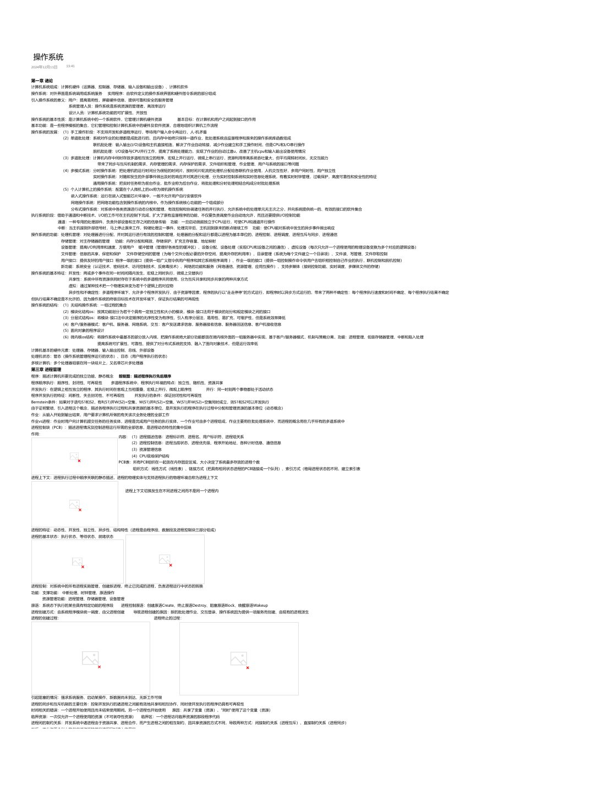
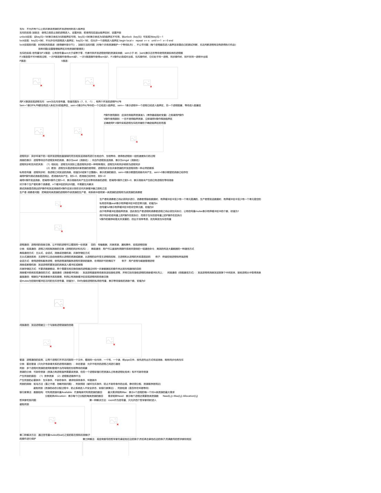
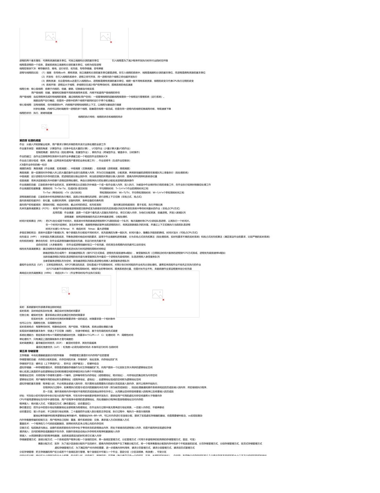
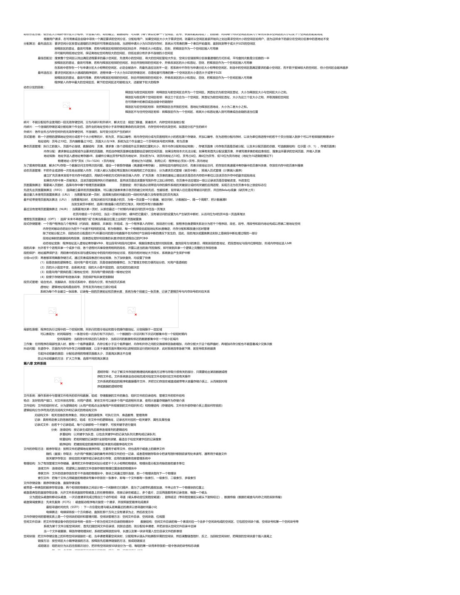
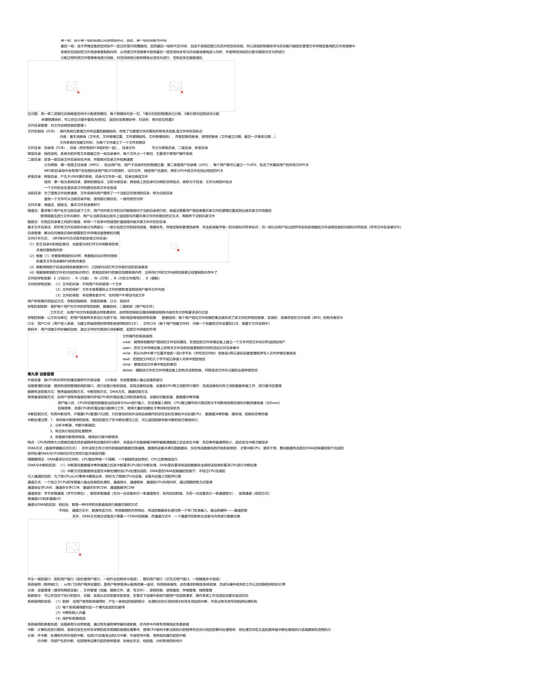
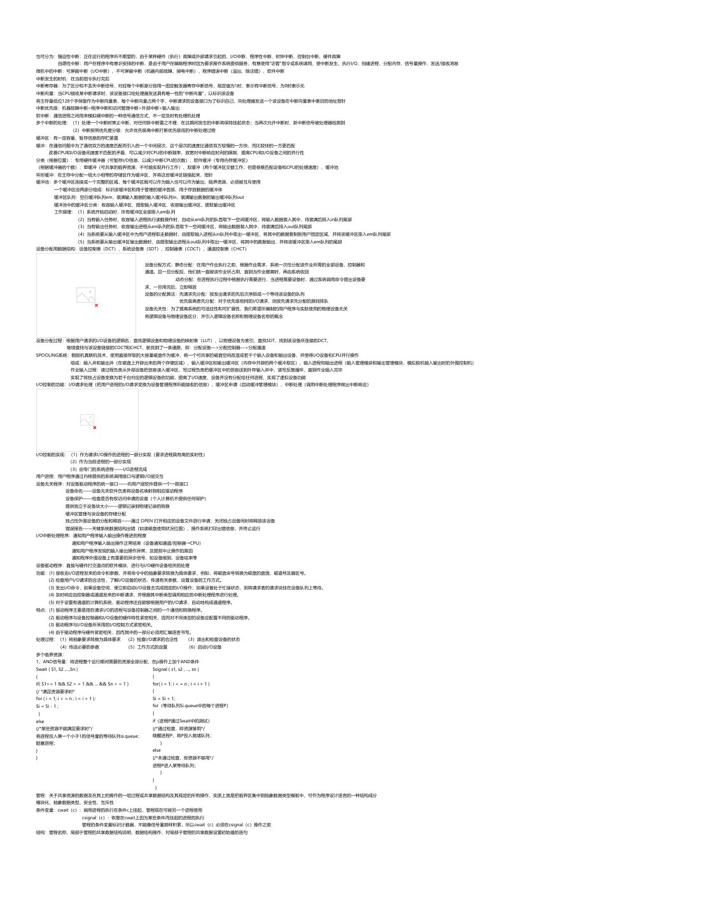

# 操作系统：课堂笔记

[下载本课程 PDF](../../../assets/downloads/operating-systems.pdf)

## 文字版

操作系统
2024年12月11日     13:41

### 第一章 诸论
计算机系统组成：计算机硬件（运算器、控制器、存储器、输入设备和输出设备）、计算机软件
操作系统：对外界面是系统调用或系统服务           实用程序：由软件定义的操作系统界面和硬件指令系统的部分组成
引入操作系统的意义：用户：提高易用性，屏蔽硬件信息，提供可靠和安全的服务管理
系统管理人员：操作系统是系统资源的管理者，高效率运行
设计人员：计算机系统功能的可扩展性、开放性
操作系统的基本性质：是计算机系统中的一个系统软件，它管理计算机硬件资源                      基本目标：在计算机和用户之间起到接口的作用
基本功能：是一些程序模板的集合，它们管理和控制计算机系统中的硬件及软件资源，合理地组织计算机工作流程
操作系统的发展：（1）手工操作阶段：不支持并发和多道程序运行，等待用户输入命令再运行，人-机矛盾
（2）单道批处理：系统对作业的处理都是成批进行的，且内存中始终只保持一道作业，批处理系统由监督程序和原来的操作系统库函数组成
联机批处理：输入输出(I/O)设备和主机直接相连，解决了作业自动转接，减少作业建立和手工操作时间，但是CPU和I/O串行操作
脱机批处理：I/O设备与CPU并行工作，提高了系统处理能力，实现了作业的自动过渡u，改善了主机cpu和输入输出设备使用情况
（3）多道批处理：计算机内存中同时存放多道相互独立的程序，宏观上并行运行，微观上串行运行，资源利用率高系统吞吐量大，但平均周转时间长，无交互能力
带来了同步与互斥机制的需求、内存管理的需求、内存保护的需求、文件组织和管理、作业管理、用户与系统的接口等问题
（4）多模式系统：分时操作系统：把处理机的运行时间分为很短的时间片，按时间片轮流把处理机分配给各联机作业使用，人机交互性好，多用户同时性，用户独立性
实时操作系统：对随即发生的外部事件做出及时的响应并对其进行处理，分为实时控制系统和实时信息处理系统，有着实时时钟管理，过载保护，高度可靠性和安全性的特征
通用操作系统：把实时任务称为前台作业，批作业称为后台作业，将批处理和分时处理相结合构成分时批处理系统
（5）个人计算机上的操作系统：配置在个人微机上的os称为微机操作系统
嵌入式操作系统：运行在嵌入式智能芯片环境中，一般不允许用户自行安装软件
网络操作系统：把网络功能包含到操作系统的内核中。作为操作系统核心功能的一个组成部分
分布式操作系统：对系统中各类资源进行动态分配和管理，有效控制和协调诸任务的并行执行，允许系统中的处理单元无主次之分，并向系统提供统一的、有效的接口的软件集合
执行系统阶段：借助于通道和中断技术，I/O的工作可在主机控制下完成，扩大了原有监督程序的功能，不仅要负责调度作业自动地允许，而且还要提供I/O控制功能
通道：一种专用的处理部件，负责外部设备和主存之间的信息传输            功能：一旦启动就能独立于CPU运行，可使CPU和通道并行操作
中断：当主机接到外部信号时，马上停止原来工作，转储处理这一事件，处理完毕后，主机回到原来的断点继续工作                      功能：使CPU能对系统中发生的异步事件做出响应
操作系统的功能：处理机管理：对处理器进行分配，并对其运行进行有效的控制和管理，处理器的分配和运行都是以进程为基本单位的，进程控制、进程调度、进程互斥与同步、进程通信
存储管理：对主存储器的管理      功能：内存分配和释放、存储保护、扩充主存容量、地址映射
设备管理：提高I/O利用率和速度，方便用户       缓冲管理（管理好各类型的缓冲区）、设备分配、设备处理（实现CPU和设备之间的通信）、虚拟设备（每次只允许一个进程使用的物理设备变换为多个对应的逻辑设备）
文件管理：信息的共享，保密和保护       文件存储空间的管理（为每个文件分配必要的外存空间，提高外存的利用率）、目录管理（系统为每个文件建立一个目录项）、文件读、写管理、文件存取控制
用户接口：提供友好的用户接口 程序一级的接口（提供一组广义指令供用户程序和其它系统程序调用 ）、作业一级的接口（提供一组控制操作命令供用户去组织相控制自己作业的执行，联机控制和脱机控制）
新功能：系统安全（认证技术、密码技术、访问控制技术、反病毒技术）、网络的功能和服务（网络通信、资源管理、应用互操作）、支持多媒体（接纳控制功能、实时调度、多媒体文件的存储）
操作系统的基本特征：并发性：两或多个事件在同一时间间隔内发生，宏观上同时执行，微观上交替执行
共享性：系统中所有资源供同时存在于系统中的多道程序共同使用，分为互斥共享和同步共享的两种共享方式
虚拟：通过某种技术把一个物理实体变为若干个逻辑上的对应物
异步性和不确定性：多道程序环境下，允许多个程序并发执行，由于资源等因素，程序的执行以"走走停停"的方式运行，即程序时以异步方式运行的，带来了两种不确定性：每个程序执行速度和时间不确定、每个程序执行结果不确定
但执行结果不确定是不允许的，因为操作系统的终极目标技术在并发环境下，保证执行结果的可再现性
操作系统的结构：（1）无结构操作系统：一组过程的集合
（2）模块化结构os：按其功能划分为若干个具有一定独立性和大小的模块，模块-接口法用于模块的划分和规定模块之间的接口
（3）分层式结构os：将模块-接口法中决定顺序的无序性变为有序性，引入有序分层法，易用性、易扩充，可维护性，但是系统效率降低
（4）客户/服务器模式：客户机、服务器、网络系统，交互：客户发送请求信息，服务器接收信息，服务器回送信息，客户机接收信息
（5）面向对象的程序设计
（6）微内核os结构：将操作系统中最基本的部分放入内核，把操作系统绝大部分功能都放在微内核外面的一组服务器中实现，基于客户/服务器模式，机制与策略分离，功能：进程管理、低级存储器管理、中断和陷入处理
提高系统可扩展性、可靠性、提供了对分布式系统的支持、融入了面向对象技术，但是运行效率低
计算机基本的硬件元素：处理器、存储器、输入输出控制、总线、外部设备
处理机状态：管态（操作系统管理程序运行的状态）、目态（用户程序执行的状态）
多核计算机：多个处理器组装在同一块硅片上，又名单芯片多处理器
### 第三章 进程管理
程序：描述计算机所要完成的独立功能，静态概念            前驱图：描述程序执行先后顺序
程序顺序执行：顺序性、封闭性、可再现性            多道程序系统中，程序执行环境的特点：独立性、随机性、资源共享
并发执行：在逻辑上相互独立的程序，其执行时间在客观上互相重叠，宏观上并行，微观上顺序性                          并行：同一时刻两个事物都处于活动状态
程序并发执行的特征：间断性、失去封闭性、不可再现性               并发执行的条件：保证封闭性和可再现性
Bernstein条件：如果对于语句S1和S2，有R(S1)并W(S2)=空集，W(S1)并R(S2)=空集，W(S1)并W(S2)=空集同时成立，则S1和S2可以并发执行
由于证明繁琐，引入进程这个概念，描述各程序执行过程和共享资源的基本单位，是并发执行的程序在执行过程中分配和管理资源的基本单位（动态概念）
作业：从输入开始到输出结束，用户要求计算机所做的有关该次业务处理的全部工作
作业vs进程：作业时用户向计算机提交任务的任务实体，进程是完成用户任务的执行实体，一个作业可由多个进程组成，作业主要用在批处理系统中，而进程的概念用在几乎所有的多道系统中
进程控制块（PCB）：描述进程情况及控制进程运行所需的全部信息，是进程动态特性的集中反映
作用：
内容：（1）进程描述信息：进程标识符、进程名、用户标识符、进程组关系
（2）进程控制信息：进程当前状态、进程优先级、程序开始地址、各种计时信息、通信信息
（3）资源管理信息
（4）CPU现场保护结构
PCB表：所有PCB组织在一起放在内存固定区域，大小决定了系统最多存放的进程个数
组织方式：线性方式（线性表）、链接方式（把具有相同状态进程的PCB链接成一个队列）、索引方式（格局进程状态的不同，建立索引表

进程上下文：进程执行过程中顺序关联的静态描述，进程的物理实体与支持进程执行的物理环境合称为进程上下文

进程上下文切换发生在不同进程之间而不是同一个进程内

进程的特征：动态性、并发性、独立性、异步性、结构特性（进程是由程序段、数据段及进程控制块三部分组成）
进程的基本状态：执行状态、等待状态、就绪状态

进程控制：对系统中的所有进程实施管理，创建新进程，终止已完成的进程，负责进程运行中状态的转换
功能：支撑功能： 中断处理、时钟管理、原语操作
资源管理功能：进程管理、存储器管理、设备管理
原语：系统态下执行的某些具有特定功能的程序段             进程控制原语：创建原语Create、终止原语Destroy、阻塞原语Block、唤醒原语Wakeup
进程创建方式：由系统程序模块统一调度，由父进程创建               导致进程创建的原因：新的批处理作业、交互登录、操作系统因为提供一项服务而创建、由现有的进程派生
进程的创建过程：                                        进程终止的过程：

引起阻塞的情况：强求系统服务、启动某操作、新数据尚未到达、无新工作可做
进程的同步和互斥机制的主要任务：控制并发执行的诸进程之间能有效地共享和相互协作，同时使并发执行的程序仍具有可再现性
时间相关的错误：一个进程开始使用且尚未结束使用期间。另一个进程也开始使用                   原因：共享了变量（资源）、"同时"使用了这个变量（资源）
临界资源：一次仅允许一个进程使用的资源（不可剥夺性资源）               临界区：一个进程访问临界资源的那段程序代码
进程间的制约关系：并发系统中诸进程由于资源共享、进程合作，而产生进程之间的相互制约，因共享资源的方式不同，导致两种方式：间接制约关系（进程互斥）、直接制约关系（进程同步）
互斥：不允许两个以上的共享该资源的并发进程同时进入临界区
互斥的实现-加锁法：使用之前防止别的进程进入，设置关锁；若使用完后退出临界区时，设置开锁
unlock实现：设key[S]=1时表示类名为S的临界区可用，key[S]=0时表示类名为S的临界区不可用，则unlock（key[S]）可实现为key[S]<-1
lock实现：key[S]=0时，不允许任何进程进入临界区；key[S]=1时，仅允许一个进程进入临界区 begin local v repeat v<-x until v=1 x<-0 end
lock实现的问题：时间相关的错误（使用硬件指令TS）、加锁方法的问题（对每个共有资源维护一个等待队列）、不公平问题（每个进程能否进入临界区依靠自己的测试判断，无法判断进程有没有获得执行机会）
效率问题(设置管理临界区共有资源的管理员）
互斥的实现-信号量与P,V原语：公有信号量sem大于或等于零，代表可供并发进程使用的资源实体数；sem小于-时，|sem|表示正在等待使用资源实体的进程数
P,V原语是不可中断的过程，一次P原语操作使得sem减1，一次V原语操作使得sem加1，P,V操作必须成对出现，互斥操作时，它们处于同一进程，同步操作时，则不在同一进程中出现
P原语：                      V原语：

---

引起阻塞的情况：强求系统服务、启动某操作、新数据尚未到达、无新工作可做
进程的同步和互斥机制的主要任务：控制并发执行的诸进程之间能有效地共享和相互协作，同时使并发执行的程序仍具有可再现性
时间相关的错误：一个进程开始使用且尚未结束使用期间。另一个进程也开始使用                   原因：共享了变量（资源）、"同时"使用了这个变量（资源）
临界资源：一次仅允许一个进程使用的资源（不可剥夺性资源）               临界区：一个进程访问临界资源的那段程序代码
进程间的制约关系：并发系统中诸进程由于资源共享、进程合作，而产生进程之间的相互制约，因共享资源的方式不同，导致两种方式：间接制约关系（进程互斥）、直接制约关系（进程同步）
互斥：不允许两个以上的共享该资源的并发进程同时进入临界区
互斥的实现-加锁法：使用之前防止别的进程进入，设置关锁；若使用完后退出临界区时，设置开锁
unlock实现：设key[S]=1时表示类名为S的临界区可用，key[S]=0时表示类名为S的临界区不可用，则unlock（key[S]）可实现为key[S]<-1
lock实现：key[S]=0时，不允许任何进程进入临界区；key[S]=1时，仅允许一个进程进入临界区 begin local v repeat v<-x until v=1 x<-0 end
lock实现的问题：时间相关的错误（使用硬件指令TS）、加锁方法的问题（对每个共有资源维护一个等待队列）、不公平问题（每个进程能否进入临界区依靠自己的测试判断，无法判断进程有没有获得执行机会）
效率问题(设置管理临界区共有资源的管理员）
互斥的实现-信号量与P,V原语：公有信号量sem大于或等于零，代表可供并发进程使用的资源实体数；sem小于-时，|sem|表示正在等待使用资源实体的进程数
P,V原语是不可中断的过程，一次P原语操作使得sem减1，一次V原语操作使得sem加1，P,V操作必须成对出现，互斥操作时，它们处于同一进程，同步操作时，则不在同一进程中出现
P原语：                      V原语：

用P,V原语实现进程互斥：sem为互斥信号量，取值范围为（1，0，-1），有两个并发的进程PA,PB
Sem=1表示PA,PB都没有进入类名为S的临界区，sem=0表示PA,PB中的一个已经进入临界区，sem=-1表示进程中一个进程已经进入临界区，另一个进程阻塞，等待进入阻塞区

P操作使用原则：应该在将临界资源读入（寄存器或临时变量）之前调用P操作
V操作使用原则：一旦不使用临界资源，立即调用V操作释放临界区
正确使用P,V操作实现进程互斥的关键在于确定临界区的范围

进程同步：异步环境下的一组并发进程因直接制约而互相发送消息而进行互相合作、互相等待，使得各进程按一定的速度执行的过程
消息的表示：进程等待合作进程发来的消息，表示为wait（消息名）；向合作进程发送消息，表示为singal（消息名）
进程同步和互斥的关系：（1）相似处：进程互斥实际上是进程同步的一种特殊情况，进程互斥和同步统称为进程同步
（2）差别：进程互斥是进程间共享资源的使用权，进程同步涉及共享资源的并发进程间有一种必然的联系
私有信号量：进程同步时，各进程之间发送的消息，初值为0或某个正整数n，表示资源的数目，sem=0表示期望的消息尚未产生，sem!=0表示期望的消息已经存在
调用P操作测试消息是否到达，若消息尚未产生，则S=0，若消息已经存在，则S!=0
调用V操作发送消息，若调用V操作之前S=0，表示消息尚未产生且无等待消息的进程；若调用V操作之前S<0，表示消息未产生前已有进程在等待消息
对于单个生产者和单个消费者，n个缓冲区的同步问题，不需要互斥解决
测试消息是否到达的P操作和发送消息的V操作应该分别在访问共享缓冲器之前和之后
生产者-消费者问题：把释放同类资源的进程称作该资源的生产者，将系统中使用某一类资源的进程称为该资源的消费者

生产者和消费者之间必须同步进行，消费者想接收数据时，有界缓冲区中至少有一个单元是满的，生产者想发送数据时，有界缓冲区中至少有一个单元是空的
私有信号量avail表示有界缓冲区中的空单元数，初值为n
信号量full表示有界缓冲区中的非空单元数，初值为0
由于有界缓冲区是临界资源，因此各生产者进程和消费者进程之间必须互斥执行，公有信号量mutex表示有界缓冲区中的个数，初值为1
用于同步的信号量上的P操作在前执行，而用于互斥的信号量上的P操作在后执行
V操作的顺序却是无关紧要的，但出于效率考虑，优先释放互斥信号量

进程通信：进程间的信息交换，让不同的进程可以看到同一份资源                目的：传输数据、共享资源、通知事件、实现进程控制
分类：低级通信：进程之间控制消息的交换（进程的同步和互斥）； 高级通信：用户可以直接利用操作系统所提供的一组通信命令，高效的传送大量数据的一种通信方式
高级通信方式：主从式、会话式、消息或信箱机制、共享存储区方式
主从式通信系统：主进程可以自由地使用从进程的资源或数据，从进程的动作受主进程的控制，主进程和从进程的关系是固定的                             例子：终端控制进程和终端进程
会话方式：使用进程和服务进程，使用进程调用服务进程所提供的服务，在得到许可的情况下                       例子：用户进程与磁盘管理进程
消息或邮箱机制：发送进程把要发送的消息送入缓冲区或邮箱
共享存储区方式：不要求数据移动，两个需要互相交换信息的进程通过对同一共享数据区的操作来达到互相通信的目的
消息缓冲系统实现通信的方式：直接通信（消息缓冲机制）：发送进程直接将信息发送给接收进程，并将它挂在接收进程的消息缓冲队列上；                                间接通信（信箱通信方式）：发送进程将消息发送到某个中间实体，接收进程从中取得消息
直接通信：根据生产者消费者关系的原理，利用公有消息缓冲区实现进程间的信息交换
设mutex为控制对缓冲区访问的互斥信号量，初值为1，SM为接收进程的私用信号量，表示等待接收的消息个数，初值为0

间接通信：发送进程建立一个与接收进程链接的信箱

管道：进程通信的实例，让两个进程打开并访问到同一个文件，看到同一份内存，一个写，一个读，称pipe文件，按先进先出方式传送消息，既有同步也有互斥
分类：匿名管道（只允许有亲缘关系的进程间通信）；命名管道：允许不相关的进程之间进行通信
死锁：多个进程对资源的使用和管理不当而导致的互相等待的现象
资源的分类：可剥夺资源（资源占有进程虽然需要该资源，但另一个进程却强行把资源从占有者进程处抢来）和不可剥夺资源
产生死锁的原因：（1）竞争资源 （2）进程推进顺序不当
产生死锁的必要条件：互斥条件、不剥夺条件、请求和保持条件、环路条件
死锁的排除：鸵鸟方法（置之不理，忽略死锁问题）、死锁预防（破坏互斥条件、防止不剥夺条件的出现、静态预分配、资源顺序使用法）
避免死锁（资源的动态分配过程中，防止系统进入不安全状态，如银行家算法）、死锁检测（是否存在环路等待）
银行家算法：数据结构：可利用资源向量Available：代表每类可利用资源的数目               最大需求矩阵Max：表示n个进程的每一个对m类资源的最大需求
分配矩阵Allocation：表示每个已分配的每类资源的数目         需求矩阵Need：表示每个进程还需要各类资源数            Need[i.j]=Max[I,j]-Allocation[I,j]
哲学家吃饭问题：                                    第一种解决方法：room作为信号量，只允许四个哲学家同时进入
避免死锁

第二种解决方法：通过信号量mutex对eat()之前的取左侧和右侧筷子
的操作进行保护                                第三种解法：规定奇数号的哲学家先拿起他左边的筷子,然后再去拿他右边的筷子;而偶数号的哲学家则相反

进程的两个基本属性：可拥有资源的基本单位、可独立调度和分派的基本单位                        引入线程是为了减少程序并发执行时所付出的时空开销

---

第二种解决方法：通过信号量mutex对eat()之前的取左侧和右侧筷子
的操作进行保护                           第三种解法：规定奇数号的哲学家先拿起他左边的筷子,然后再去拿他右边的筷子;而偶数号的哲学家则相反

进程的两个基本属性：可拥有资源的基本单位、可独立调度和分派的基本单位                  引入线程是为了减少程序并发执行时所付出的时空开销
线程是进程的一个实体，是被系统独立调度和分派的基本单位，也称为轻型进程
线程控制块TCB：寄存器状态、堆栈、运行状态、优先级、专有存储器、信号屏蔽
进程与线程的比较：（1）调度：在传统os中，拥有资源、独立调度和分派的基本单位都是进程。在引入线程的系统中，线程是调度和分派的基本单位，而进程是拥有资源的基本单位
（2）并发性：在引入线程的系统中，进程之间可并发，同一进程内的个线程之间也能并发执行
（3）拥有资源：无论是传统os还是引入线程的os，进程都是拥有资源的基本单位，线程一般不用有系统资源，线程的改变只代表CPU执行过程的改变
（4）系统开销：进程远大于线程，多线程往往减少用户的等待时间，提高系统的响应速度
线程分类：核心级线程：依赖于内核的，创建、撤销、切换都由内核实现
用户级线程：创建、撤销和切换都不用系统调用来实现，内核不知道用户级线程的存在
用户级线程：由应用程序完成所有线程的管理，通过线程库(用户空间)：一组管理线程的函数线程库提供一个线程运行管理系统（运行系统）。
调度由用户自行确定，但是同一进程中的两个线程不能同时运行于两个处理器上
核心级线程：没有线程库，但内核提供API，内核维护进程和线程的上下文，以线程为基础进行调度
对多处理器、内核可以同时调度同一进程的多个线程，阻塞是在线程一级完成，但是在同一进程内的线程切换调用内核，导致速度下降
线程的状态：执行、就绪和阻塞
线程的执行特性：线程的状态和线程的同步

### 第四章 处理机调度
作业：从输入开始到输出结束，用户要求计算机所做的有关该次业务处理的全部工作
作业基本类型：调度的角度：计算型作业（任务中包含大量的计算）、I/O型作业（少量计算大量I/O的作业）
控制的角度：脱机作业（批处理环境、批量型作业）、联机作业（终端型作业，键盘命令、分时操作）
作业的建立：由作业注册程序在系统中为该作业申请建立起一个相应的作业控制块JCB
作业由三部分组成：程序、数据（这两项来完成用户要求的业务处理工作）、作业说明书（生成作业控制块）
JCB是作业存在的唯一标识
调度的类型：高级调度（作业调度、宏观调度）、中级调度（交换调度）、低级调度（进程调度、微观调度）
高级调度：按一定原则对外存输入井上的大量后备作业进行选择调入内存，并为它们创建进程、分配资源，再将新创建的进程排在就绪队列上准备执行（批处理系统）
中级调度：设计进程在内外存间的交换，把进程的部分换出到外存，将当前进程的所需部分换入到内存，提高内存利用率和系统吞吐量
低级调度：用来决定就绪队列中的哪个进程应获得处理机，再由分派程序执行把处理机分配给该进程的具体操作
作业调度的功能：记录系统中各作业的状况、按某种算法从后背队列中掉选一个或一批作业调入内存，投入执行、为被选中作业做好执行前的准备工作、在作业执行结束时做善后处理工作
作业调度的性能衡量：周转时间：Ti=Tei-Tsi，完成时刻-提交时刻         平均周转时间：T=1/n*n个作业的周转时间之和
Ti=Twi（等待时间）+Tri（执行时间）         带权周转时间Wi：Wi=Ti/Tri，平均带权周转时间：W=1/n*n个带权周转时间之和
进程调度的功能：记录系统中所有进程的执行情况、选择占有处理机的进程、进行进程上下文切换（非抢占式、抢占式）
面向系统的性能评价：吞吐量、处理机利用率、设备利用率、各种设备的均衡利用
面向用户的性能准则：周转时间短、响应时间快、截止时间的保证、优先权准则                 面向算法的性能准则：易于实现、执行开销比高
先来先服务调度算法（FCFS）：将用户作业和就绪进程按提交顺序或变为就绪状态的先后排成队列优先考虑在系统中等待时间最长的作业（非抢占CPU方式）
应用范围：作业调度：选择一个或多个最先进入后备队列的作业，将它们调入内存，为他们分配资源、创建进程。并放入就绪队列
进程调度：按照进程就绪的先后次序来调度进程，分配处理机
时间片轮转算法（RR）：把CPU划分成若干时间片。将系统中所有的就绪进程按照FCFS原则排成一个队列，每次调度时将CPU分派给队首进程，让其执行一个时间片。
在一个时间片结束时，发生时钟中断，调度程序据此暂停当前进程的执行，将其送到就绪队列的末尾，并通过上下文切换执行当前的队首进程
时间片长度S=R/Nmax   R：响应时间   Nmax：最大进程数
多级反馈轮转法：系统中设置多个就绪队列，每个就绪队列分配给不同时间片，优先级高的为第一级队列，时间片最小，随着队列级别的降低，时间片加大（可抢占CPU方式）
优先级法（HPF）：对多级队列算法的改进，平衡各进程对响应时间的要求，适用于作业调度和进程调度，分为非抢占式优先权算法（批处理系统，实时性要求不高的实时系统）和抢占式优先权算法（满足紧迫作业的要求，比较严格的实时系统）
优先权的类型：静态优先权：在作业或进程创建时指定优先数，在运行时优先数不变
动态优先权（大多数使用）：在作业或进程创建时创立一个优先数，但在其生命周期内优先数可以动态变化
线性优先级调度算法：通过线程优先级的递增来改进长执行时间进程的周转时间特征
就绪进程队列分成两个：新创建进程队列（按FCFS方式排成，进程优先级按速率a增加）、享受服务队列（已得到过时间片服务的进程按FCFS方式排成，进程优先级按速率b增加）
当新创建进程队列的队首进程的优先级与享受服务队列中最后一个进程优先级相同时，队首进程转入享受服务队列
当享受服务进程队列为空时，新创建进程队列的队首进程也将移入享受服务进程队列
最短作业优先法（SJF）：又称短进程优先，对FCFS算法的改进，目标是减少平均周转时间，对预计执行时间短的作业优先分派处理机，通常后来的短作业不抢先正在执行的作业
比FCFS改善平均周转时间和带权周转时间，缩短作业的等待时间，提高系统吞吐量，但是对长作业不利，未能依据作业紧迫程度来划分优先级
高响应比优先调度算法（HRN）：响应比R=1+（作业等待时间/作业执行实现）

实时：系统能够对外部请求做出即时响应
实时系统：及时响应和及时处理，满足实时任务的时间要求
任务分类：硬实时任务：要求系统必须完全满足任务的时限要求
软实时任务：允许系统对任务的时限要求有一定的延迟，时限要求是一个相对条件
也可以分为：周期性任务、非周期性任务
实时系统特点：有限等待时间、有限响应时间、用户控制、可靠性高、系统出错处理能力强
实现实时调度的基本条件：快速上下文切换（线程）、快速中断响应、基于优先级的抢先式调度
系统处理能力：假定系统中有m个周期性的硬实时任务，则要求m个Ci/Pi<=1 Ci：处理时间 Pi：周期性时间
单处理机下，只有满足上面的限制条件才是可调度的
实时调度算法：最早截至时间优先（EOF）：截至时间愈早，其优先级越高
最低松弛度优先（LLF）：松弛度=必须完成的时间点-本身所运行时间-当前时间
### 第五章 存储管理
主存储器：中央处理器能直接访问的存储器        存储管理主要是针对内存用户区的管理
存储管理的功能：内存的分配和回收、内存空间的共享、存储保护、地址变换、内存地址的扩充
存储保护方法：硬件法（上下界保护法）、软件法（保护键法）、软硬件结合
虚拟存储器：一种存储管理技术，思想是把辅助存储器作为对主存储器的扩充，向用户提供一个比实际主存大得多的逻辑地址空间
核心实质上就是把作业的逻辑地址空间和物理空间的存储空间分为两个不同的概念
物理地址空间：内存的每个存储单元都有一个编号，这种编号称为内存地址（或物理地址、绝对地址），内存地址的集合称为内存空间
逻辑地址空间：用户编程所用的地址称为逻辑地址（或程序地址、虚地址），由逻辑地址组成的空间称为逻辑地址空间
虚拟存储的基本原理：程序装入时，不必将其全部读入到内存，而只需将当前需要执行的部分页或段读入到内存，就可让程序开始执行，
在程序执行过程中，如果需执行的指令或访问的数据尚未在内存（称为缺页或缺段），则由处理器通知操作系统将相应的页或段调入到内存，然后继续执行程序，
另一方面，操作系统将内存中暂时不使用的页或段调出保存在外存上，从而腾出空间存放将要装入的程序以及将要调入的页或段
好处：可在较小的可用内存中执行较大的用户程序、可在内存中容纳更多程序并发执行、提供给用户可用的虚拟内存空间通常大于物理内存
CPU不能用逻辑地址在内存中读取信息，用户在程序中使用的是逻辑地址，而处理器执行程序时是按物理地址访问内存的
程序装入：绝对装入方式、可重定位方式（静态重定位、动态重定位）
静态重定位：把作业中的指令地址和数据地址全部转换为物理地址，在作业执行过程中就无需再进行地址转换，一旦装入内存后，不能再移动
动态重定位：装入作业时，不立即进行地址转换，二十直接把作业装入到分配的主存区域，执行过程中，每执行一条指令就转换
基地址寄存器BR和程序逻辑地址寄存器VR，物理地址MA=BR+VR，可以对内存进行非连续分配，提供了实现虚拟存储器的基础，但是需要硬件配合，os实现较复杂
内外存数据传输的控制方法：用户程序自己控制：覆盖、操作系统控制：交换、请求调入方式和预调入方式
覆盖技术：一个程序的几个代码段或数据段，按照时间先后来占用公共的内存空间
交换方式：包括换进与换出，由操作系统把那些在内存中处于等待状态的进程换出内存，把处于就绪态的进程换入内存，但是不能用来实现虚拟存储
请求调入：访问的程序段或数据段不在内存，则操作系统自动地从外存将有关程序和数据调入内存
预调入：os预测将要访问的程序和数据，由系统选择适当的时机将它们调入内存
存储器管理方式：连续分配方式：一个系统或用户程序分配一个连续的空间，单一连续区管理方式、分区管理方式（可用于多道程序的较简单的存储管理方式，固定、可变）
离散分配方式：实存：为了减少因连续分配所产生的碎片，提高内存的利用率产生了离散分配方式，将一个程序离散地分配到内存中的多个不相连接的区域，分页存储管理方式、分段存储管理方式、段页式存储管理方式
虚拟存储管理方式：为了满足用户对内存的需要，进一步提高内存利用率，请求分页管理方式、请求分段管理方式、请求段页式管理方式
分区存储管理：把主存储器的用户区分成若干个连续区进行管理，每个连续区中可装入一个作业，固定分区（分区说明表，有浪费）、可变分区
动态分区分配：使分区大小刚好与作业大小相等，作业装入时，动态建立，数据结构：可用表（每个表目记录一个空闲区，区号、长度和起始地址）、自由链：利用每个内存空闲区的头几个单元存放本空闲区的大小以及下个空闲区的起始地址
根据用户请求，在可用表或自由链中寻找一个满足要求的空间分区，分配给用户，如果空闲区大小大于需求空间，则最好从空闲区底部开始向上划出需求空间大小的空闲区给用户，因为这样余下的部分在空闲分区表中的首地址不变
分配算法：最先适应法：要求空闲分区按首址递增的次序组织可用表或自由链。当进程申请大小为SIZE的内存时，系统从可用表的第一个表目开始查询，直到找到等于或大于SIZE的空闲区
按释放区的首址，查询可用表，若有与释放区相邻的空闲区则合并，并修改大小和首址，否则，把释放区作为一个空闲区插入可用表
尽可能利用低地址空间，保证高地址空间有较大的空闲区，但低址部分有许多不连续的小空闲区
最佳匹配法：搜索整个空闲区以找出满足进程要求的最小空闲区，先使用小的空闲区，将大的空闲区留给大作业，空闲分区链按照分区容量递增的方式形成，平均查找次数是分区数的一半
按释放区的首址，查询可用表，若有与释放区相邻的空闲区，则合并到相邻的空闲区中，并修改该区的大小和首址，否则，把释放区作为一个空闲区插入可用表
在系统中若存在一个与申请分区大小相等的空闲区，必定会被选中，而最先适应法则不一定；若系统中不存在与申请分区大小相等的空闲区，则选中的空闲区是满足要求的最小空闲区，而不致于毁掉较大的空闲区，但小空闲区会越来越多
最坏适应法：要求空闲区按大小递减的顺序组织，进程申请一个大小为SIZE的存储区时，总是检查可用表的第一个空闲区的大小是否大于或等于SIZE
按释放区的首址，查询可用表，若有与释放区相邻的空闲区，则合并到相邻的空闲区中，并修改该区的大小和首址，否则，把释放区作为一个空闲区插入可用表

---

交换方式：包括换进与换出，由操作系统把那些在内存中处于等待状态的进程换出内存，把处于就绪态的进程换入内存，但是不能用来实现虚拟存储
请求调入：访问的程序段或数据段不在内存，则操作系统自动地从外存将有关程序和数据调入内存
预调入：os预测将要访问的程序和数据，由系统选择适当的时机将它们调入内存
存储器管理方式：连续分配方式：一个系统或用户程序分配一个连续的空间，单一连续区管理方式、分区管理方式（可用于多道程序的较简单的存储管理方式，固定、可变）
离散分配方式：实存：为了减少因连续分配所产生的碎片，提高内存的利用率产生了离散分配方式，将一个程序离散地分配到内存中的多个不相连接的区域，分页存储管理方式、分段存储管理方式、段页式存储管理方式
虚拟存储管理方式：为了满足用户对内存的需要，进一步提高内存利用率，请求分页管理方式、请求分段管理方式、请求段页式管理方式
分区存储管理：把主存储器的用户区分成若干个连续区进行管理，每个连续区中可装入一个作业，固定分区（分区说明表，有浪费）、可变分区
动态分区分配：使分区大小刚好与作业大小相等，作业装入时，动态建立，数据结构：可用表（每个表目记录一个空闲区，区号、长度和起始地址）、自由链：利用每个内存空闲区的头几个单元存放本空闲区的大小以及下个空闲区的起始地址
根据用户请求，在可用表或自由链中寻找一个满足要求的空间分区，分配给用户，如果空闲区大小大于需求空间，则最好从空闲区底部开始向上划出需求空间大小的空闲区给用户，因为这样余下的部分在空闲分区表中的首地址不变
分配算法：最先适应法：要求空闲分区按首址递增的次序组织可用表或自由链。当进程申请大小为SIZE的内存时，系统从可用表的第一个表目开始查询，直到找到等于或大于SIZE的空闲区
按释放区的首址，查询可用表，若有与释放区相邻的空闲区则合并，并修改大小和首址，否则，把释放区作为一个空闲区插入可用表
尽可能利用低地址空间，保证高地址空间有较大的空闲区，但低址部分有许多不连续的小空闲区
最佳匹配法：搜索整个空闲区以找出满足进程要求的最小空闲区，先使用小的空闲区，将大的空闲区留给大作业，空闲分区链按照分区容量递增的方式形成，平均查找次数是分区数的一半
按释放区的首址，查询可用表，若有与释放区相邻的空闲区，则合并到相邻的空闲区中，并修改该区的大小和首址，否则，把释放区作为一个空闲区插入可用表
在系统中若存在一个与申请分区大小相等的空闲区，必定会被选中，而最先适应法则不一定；若系统中不存在与申请分区大小相等的空闲区，则选中的空闲区是满足要求的最小空闲区，而不致于毁掉较大的空闲区，但小空闲区会越来越多
最坏适应法：要求空闲区按大小递减的顺序组织，进程申请一个大小为SIZE的存储区时，总是检查可用表的第一个空闲区的大小是否大于或等于SIZE
按释放区的首址，查询可用表，若有与释放区相邻的空闲区，则合并到相邻的空闲区中，并修改该区的大小和首址，否则，把释放区作为一个空闲区插入可用表
程序装入内存中最大的空闲区后，剩下的空闲区还可能相当大，还能装下较大的程序
动态分区的回收：
释放区与前空闲区相邻：将释放区与前空闲区合并为一个空闲区。其首址仍为前空闲区首址，大小为释放区大小与空闲区大小之和。
释放区与前后两个空闲区相邻：将这三个区合为一个空闲区，其首址为前空闲区首址，大小为这三个区大小之和，并取消原后空闲区
在可用表中的表目或自由链中的链指针
释放区与后空闲区相邻：则把释放区合并到后空闲，首地址为释放区首地址，大小为二者大小之和。
释放区不与任何空闲区相邻：将释放区作为一个空闲区，将其大小和首址插入到可用表或自由链的适当位置

碎片：不能分配给作业使用的一段无效存储空间，分为内碎片和外碎片，解决方法：规定门限值、紧凑技术、内存空间非连续分配
内碎片：一个连续的存储区域分配给某个作业后，因作业的地址空间小于该存储区剩余的无效空间，内存空间中的无效空间，如固定分区产生的碎片
外碎片：各作业所占内存空间外的无效存储空间，不连续的，如可变分区所产生的碎片
页式管理：将一个进程的逻辑地址空间分成若干个大小相等的片，称为页，并加以编号；将内存空间分成与页面相同大小的若尬黑个存储块，并加以编号，在为进程分配内存时，以块为单位将进程中的若干个页分别装入到多个可以不相邻接的物理块中
地址结构：页号占10位，页内偏移量占10位，页面大小为1KB，系统为这个作业建立一个页号和块号的对照表，称为页表
静态页面管理：执行之前装入，页面不必连续，数据结构：页表、请求表（各个进程或作业页表的位置和大小，用于内存分配和地址转换）、存储页面表（内存各页面是否被分配、以及未分配页面的总数，可选数据结构：位示图（0，1）、存储页面表）
内存分配：请求表给出进程或作业要求的页面数、然后由存储页面表检查是都由足够的空闲页面，如果没有则本次无法分配，如果有则首先分配设置页表，并填写请求表的相应表项后，搜索出所要求的空闲页面，并填入页表
地址转换：地址字送入虚地址寄存器VR，由硬件分离出页号P和页内地址W，页长若为1k，则页内地址占10位，页号占6位，高6位为页号，低10位为页内地址（地址为16进制的情况下）
物理地址=页号*页长（1k=1024）+页内地址       若地址为10进制，则用公式：程序地址/页长=页号…页内地址
为了提高存取速度，解决CPU存取一个数据访问主存两次的问题，增设一个联想存储器（高速缓冲寄存器），按照给定内容特征访问，而表示按地址访问，把存放在高速缓冲寄存器中的页表叫快表，存放在内存中的页表叫慢表
动态页面管理：不把作业或进程一次性地全部装入内存，只装入被认为是经常反复执行和调用的工作区部分，分为请求页式管理（缺页中断）、预调入页式管理（计算调入顺序）
建立扩充页表来发现不在内存中的虚页，用缺页中断的方式将所缺页调入内存，扩充页表：在页表的基础上增设该页是否在内存的中断位以及该页在外存中的副本起始地址
如果在内存中某一页被淘汰，且该页曾因程序执行而被修改，显然该页是应该重新写到外存上加以保存的，在页表中还应增加一项以记录该页是否曾被改变，叫改变位
页面置换算法：需要调入页面时，选择内存中哪个物理页面被置换           页面锁定：用于描述必须常驻内存的操作系统的关键部分或时间关键的应用进程，实现方法为在页表中加上锁定标志位
先进先出页面置换算法（FIFO）：选择建立最早的页面被置换，可以通过链表来表示各页的建立时间先后，性能较差，较早调入往往是经常被访问的页，并且有Belady现象（缺页率上升）
最近最久未使用页面置换算法（LRU）：当需要淘汰某一页时，选择离当前时间最近的一段时间内最久没有使用过的页先淘汰
最不经常使用页面淘汰算法（LFU）：当需要淘汰时，应淘汰被访问次数最少的页，为每一页设置一个计数器，被访问时，计数器加一，隔一个周期T，把计数器清0
当发生缺页中断时，选择计数值最小的页把它淘汰，同时把所有计数器清0
最近没有使用页面置换算法（NUR）：当需要淘汰某一页时，从那些最近一个时期内未被访问的页中任选一页淘汰
在页内增设一个访问位，当这一页被访问时，硬件把它置成1，没有被访问的设置为0,产生缺页中断时，从访问位为0的页中选一页选择淘汰
理想型页面置换法（OPT）：选择"未来不再使用的"或"在离当前最远位置上出现的"页面被置换
段式存储管理：一个用户程序由几个程序段（代码段、数据段、共享段）所组成，当一个程序装入内存时，按段进行分配，按程序自身逻辑关系划分为若干个程序段，段名，段号，用段号和段内地址构成以恶搞二维地址空间
内存空间被动态的划分为若干个长度不相同的区域，称为物理段，每一个物理段由起始地址和长度确定，内存分配和释放通分区时管理
除了初始分配之外，段的动态分配是在CPU所要访问的指令和数据不在内存时产生缺段中断的情况下发生的，因此，段的淘汰或置换算法实际上是缺段中断处理过程的一部分
段地址映射的数据结构有段表、段表首址指针和段表的长度(存放在进程自己的PCB中
动态地址变换：程序地址送入虚地址寄存器VR中，取出段号S和段内位移W，根据段表首址指针找到段表。查找段号为S的表目，得到该段的首地址，把段首地址与段内位移相加，形成内存地址送入MR
段的共享：允许若干个进程共享一个或多个段，各个进程对共享段使用相同的段名，并置以适当的读/写控制权，即可做到共享一个逻辑上完整的主存段信息
段的保护：地址越界保护法：用段表中的段长项与虚拟地址中的段内相对地址比较，若段内相对地址大于段长，系统就会产生保护中断
分段vs分页：两者都采用离散存储方式，通过页表或段表进行地址转换，为了加快查找，均设置了快表
（1）段是信息的逻辑单位，段对用户是可见的；页是信息的物理单位，为了管理主存的方便而划分的，对用户是透明的
（2）页的大小固定不变，由系统决定；段的大小是不固定的，由完成的功能决定
（3）段是向用户提供的是二维地址空间；页向用户提供的是一维地址空间
（4）段便于存储保护和信息共享；页的保护和共享受到限制
段页式管理：结合优点，克服缺点，在段式系统中，若段内分页，称为段页式系统
虚地址：逻辑地址结构是由段号、页号及页内地址三部分组成
系统为每个作业建立一张段表，记录每一段的页表始址和页表长度，系统为每个段建立一张页表，记录了逻辑页号与内存块号的对应关系

局部性原理：程序在执行过程中的一个较短时期，所执行的指令地址和指令的操作数地址，分别局限于一定区域
可以表现为：时间局部性：一条指令的一次执行和下次执行，一个数据的一次访问和下次访问都集中在一个较短时期内
空间局部性：当前指令和邻近的几条指令，当前访问的数据和邻近的数据都集中在一个较小区域内
工作集：任何程序在局部性放入时，都有一个临界值要求，内存分配小于这个临界值时，内存和外存之间的交换频率回急剧增加，内存分配大于这个临界值时，再增加内存分配也不能显著减少交换次数
抖动问题：在虚存中，页面在内存与外存之间频繁调度，以至于调度页面所需时间比进程实际运行的时间还多，此时系统效率急剧下降，甚至导致系统崩溃
引起抖动现象的原因：分配给进程的物理页面数太少、页面淘汰算法不合理
防止抖动现象的方法：扩大工作集、选择不同的淘汰算法
### 第八章 文件系统

透明存取：不必了解文件存放的物理结构和查找方法等与存取介质有关的部分，只需要给出某段数据或程
序的文件名。文件系统就会自动地完成对给定文件名相对应文件的有关操作
文件系统把相应的程序和数据看作文件，并把它们存放在磁盘或磁带等大容量存储介质上，从而做到对程
序或数据的透明存取

文件系统：操作系统中与管理文件有关的软件和数据，组成：存储数据的文件的集合、组织文件的目录结构、管理文件的软件结构
特点：友好的用户接口、对文件按名存取，对用户透明、某些文件可以被多个用户或进程所共享、使用大容量存储器作为存储介质
文件结构：文件的组织形式，分为逻辑结构（从用户的观点出发每用户所观察到的文件组织形式）和物理结构（存储结构，文件在外部存储介质上是如何存放的）
逻辑结构分为字符流式的无结构文件和记录式的有结构文件
无结构文件：相关信息的有序集合，例如大量的源程序、可执行文件、库函数等，管理简单
记录：具有特定意义的信息的单位，组成：在文件中的逻辑地址、记录名所对应的一组关键字、属性及属性值
记录式文件：由若干个记录组成，每个记录都有一个关键字，可按关键字进行查找
分类：连续结构：按记录生成的先后顺序连续排列的逻辑结构
多重结构：以关键字为队首，以包含关键字Ki的记录为队列元素构成记录队列、
转置结构：把相同键的记录指针全部指向该键，最适合于给定关键字后的记录搜索
顺序结构：把键按规定的顺序排列起来就形成顺序结构文件
文件的存取方法：顺序存取法：按照文件的逻辑地址顺序存取，主要用于磁带文件，但也适用于磁盘上的顺序文件
随机（直接）存取法：允许用户根据记录的编号来存取文件的任一记录，或者是根据存取命令把读写指针移到欲读写处来读写，通常用于磁盘文件
按关键字存取法：按给定的关键字或记录名进行存取，应用在数据库信息管理系统中
物理结构：为了有效管理文件存储器，通常把文件存储空间划分成若干个大小相等的物理块，物理块是分配及传输信息的基本单位
连续文件：连续结构，把逻辑上连续的文件信息存储在物理位置连续的物理块中
串联文件：文件的信息存放在若干不连续的物理块中，各块之间通过指针连接，前一个物理块指向下一个物理块
索引文件：把每个文件占用磁盘的物理块号集中存放在一张表中，即每一个文件都有一张索引，一级索引、二级索引、多级索引
文件存储设备：顺序存储设备、直接存储设备
磁带是一种典型的顺序存取设备，两个相邻的物理块之间设计有一个间隙将它们隔开，是为了让磁带机提前加速，不停止在下一个物理块的位置上
磁盘是典型的直接存取设备，允许文件系统直接存取磁盘上的任意物理块，信息记录在磁道上，多个盘片，正反两面都用来记录信息，每面一个磁头
分为固定头磁盘和移动头磁盘，一次访盘请求完成过程由三个动作组成：寻道（磁头移动定位到指定磁道）、旋转延迟（等待指定扇区从磁头下旋转经过）、数据传输（数据在磁盘与内存之间的实际传输）
磁盘臂调度算法：先来先服务（FCFS）：磁盘驱动程序每次接受一个请求，并按照接受顺序完成请求
最短寻道时间优先（SSTF）：下一次总是处理与磁头距离最近的请求以使寻道时间最小化
电梯算法：电梯保持按一个方向移动，直到在那个方向上没有请求为止，然后改变方向
文件存储空间的管理实质上是一个空闲块的组织和管理问题，空闲块管理方法：空闲文件目录、空闲块链、位视图
空闲文件目录：把文件存储设备中的空闲块号统一放在一个称为空闲文件目录的物理块中        数据结构：空闲文件目录的每一个表项对应一个由多个空闲块构成的空闲区，它包括空闲块个数、空闲块号和第一个空闲块号等
系统为某个文件分配空闲块时，首先扫描空闲文件目录项，找到合适的，则分配给申请者，并把该项从空闲文件目录中去掉
当一个文件被删除，释放存储物理块时，系统把被释放的块号、长度以及第一块块号置入空白目录文件的新表项
空闲块链：把文件存储设备上的所有空闲块链接在一起，当申请者需要空闲块时，分配程序从链头开始摘取所需的空闲块，然后调整链首指针，反之，当回收空闲块时，把释放的空闲块逐个插入链尾上
链接方法：按空闲区大小顺序链接的方法、按释放先后顺序链接的方法、按成组链接法
成组链法：组的划分为从后往前顺次划分，把所有空闲块按50块划分为一组，每组的第一块用来存放前一组中各块的块号和总块数
第一组：由于第一组的前面已无其他组存在，因此，第一组的块数为49块
最后一组：由于存储设备的空间块不一定正好是50的整数倍，因而最后一组将不足50块，且由于该组后面已无另外的空闲块组，所以该组的物理块号与总块数只能放在管理文件存储设备用的文件资源表中
系统在初启时把文件资源表复制到内存，从而使文件资源表中放有最后一组空闲块块号与总块数地堆栈进入内存，并使得空闲块的分配与释放可在内存进行
分配过程利用文件管理堆栈进行回收，对空闲块的分配和释放必须互斥进行，否则会发生数据混乱

---

文件存储空间的管理实质上是一个空闲块的组织和管理问题，空闲块管理方法：空闲文件目录、空闲块链、位视图
空闲文件目录：把文件存储设备中的空闲块号统一放在一个称为空闲文件目录的物理块中          数据结构：空闲文件目录的每一个表项对应一个由多个空闲块构成的空闲区，它包括空闲块个数、空闲块号和第一个空闲块号等
系统为某个文件分配空闲块时，首先扫描空闲文件目录项，找到合适的，则分配给申请者，并把该项从空闲文件目录中去掉
当一个文件被删除，释放存储物理块时，系统把被释放的块号、长度以及第一块块号置入空白目录文件的新表项
空闲块链：把文件存储设备上的所有空闲块链接在一起，当申请者需要空闲块时，分配程序从链头开始摘取所需的空闲块，然后调整链首指针，反之，当回收空闲块时，把释放的空闲块逐个插入链尾上
链接方法：按空闲区大小顺序链接的方法、按释放先后顺序链接的方法、按成组链接法
成组链法：组的划分为从后往前顺次划分，把所有空闲块按50块划分为一组，每组的第一块用来存放前一组中各块的块号和总块数
第一组：由于第一组的前面已无其他组存在，因此，第一组的块数为49块
最后一组：由于存储设备的空间块不一定正好是50的整数倍，因而最后一组将不足50块，且由于该组后面已无另外的空闲块组，所以该组的物理块号与总块数只能放在管理文件存储设备用的文件资源表中
系统在初启时把文件资源表复制到内存，从而使文件资源表中放有最后一组空闲块块号与总块数地堆栈进入内存，并使得空闲块的分配与释放可在内存进行
分配过程利用文件管理堆栈进行回收，对空闲块的分配和释放必须互斥进行，否则会发生数据混乱

位示图：用一串二进制位反映磁盘空间中分配使用情况，每个物理块对应一位，1表示对应的物理块已分配，0表示其对应的块未分配
申请物理块时，可以在位示图中查找为0的位，返回对应物理块号；归还时，将对应位转置0
文件目录管理：对文件说明信息的管理 c
文件控制块（FCB）：操作系统位管理文件而设置的数据结构，存放了为管理文件所需的所有有关信息,是文件存在的标志
内容：基本消息类（文件名、文件物理位置、文件逻辑结构、文件物理结构）、存取控制信息类、使用信息类（文件建立日期、最后一次修改日期….）
文件系统在创建文件时，为每个文件建立了一个文件控制块
文件目录：目录项（FCB）、目录（把所有的FCB组织在一起）、目录文件        可分为单级目录、二级目录、多级目录
单级目录：线性结构，系统中的所有文件都建立在一张目录表中，每个文件占一个表目，主要用于单用户操作系统
二级目录：改变一级目录文件目录命名冲突，并提高对目录文件检索速度
分为两级：第一级是主目录表（MFD），给出用户名，用户子目录所在的物理位置；第二级是用户目录表（UFD），每个用户都可以建立一个UFD，包含了所属该用户的所有文件FCB
MFD的目录项中含有用户名和指向该用户的UFD的指针，访问文件，线按用户名查找，再在UFD中按文件名找出相应的FCB
多级目录：树级目录，产生于UNIX操作系统，目录与文件在一起，目录也做成文件
结构：第一级为系统目录，是树的根结点，又称为根目录；其他级上的目录均为树的非终结点，统称为子目录；文件为树的叶结点
一个文件的全名是由该文件的路径名和文件名组成
当前目录：为了提高文件检索速度，文件系统向用户提供了一个当前正在使用的目录，称为当前目录
查找一个文件可从当前目录开始，使用部分路径名，一般存放在内存
文件共享：绕道法、链接法、基本文件目录表BFD
绕道法：要求每个用户处在当前目录下工作，用户对所有文件的访问都是相对于当前目录进行的，绕道法需要用户指定索要共享文件的逻辑位置或到达被共享文件的路径
使用绕道法进行文件共享时，用户从当前目录出发向上返回到与所要共享文件所在路径的交叉点，再顺序下访到共享文件
链接法：在相应目录表之间进行链接，即将一个目录中的链指针直接指向被共享文件所在的目录
基本文件目录法：把所有文件目录的内容分为两部分：一部分包括文件的结构信息、物理块号、存取控制和管理信息等，并由系统赋予唯一的内部标识符来标识；另一部分由用户给出的符号名和系统赋给文件说明信息的内部标识符组成（符号文件目录表SFD）
目录管理：解决访问每级目录时都要到文件存储设备搜索的问题
文件打开方式：（BFD和SFD方式排列的多级文件目录）
（1）把主目录中的相应表目，也就是与待打开文件相联系的有
关表目复制到内存
（2）根据（1）所复制得到的标识符，再复制此标识符所指明
的基本文件目录表BFD的有关表目
（3）根据得到的子目录说明信息搜索SFD，已找到与待打开文件相对应的目录表项
（4）根据搜索到的文件名对应的标识符ID，把相应的BFD的表目项复制到内存，这样待打开的文件说明信息就已经复制到内存中了
文件的存取权限：E（只执行）、R（只读）、W（只写）、B（只在文件尾写）、D（删除）
文件的存取控制：（1）文件的共享：不同用户共同使用一个文件
（2）文件的保护：文件本身需要防止文件的拥有者或其他用户破坏文件内容
（3）文件的保密：未经拥有者许可，任何用户不得访问该文件
用户存取操作的验证方式：存取控制矩阵、存取控制表、口令、密码术
存取控制矩阵：维护每个用户对文件的存取控制权 数据结构：二维矩阵（用户和文件）
工作方式：当用户向文件系统提出存取请求时，由存取控制验证模块根据该矩阵内容对本次存取要求进行比较
存取控制表：以文件为单位，把用户按某种关系划分为若干组，同时规定每组的存取权限       数据结构：每个用户组对文件权限的集合就形成了该文件的存取控制表，实现时，该表存放在文件说明（BFD）的有关表目中
口令：用户口令（用户进入系统，为建立终端进程时获得系统使用权的口令）、文件口令（每个用户创建文件时，为每一个创建的文件设置的口令，被置于文件说明中）
密码术：用户创建文件时编码加密，读出文件时对其进行译码解密，起到文件保密的作用

文件操作的系统调用：
creat：调用将根据用户提供的文件名和属性，在指定的文件存储设备上建立一个文件并把文件标识符返回给用户
open：把在文件存储设备上的有关文件说明信息复制到内存的活动文件目录表中
write：把从内存中某个位置开始的一段n字节长（字符流文件时）信息或n哥记录经设备管理程序写入文件存储设备修改
read：把指定文件的几个字节或记录读入内存中指定地区
close：撤销活动文件表中相应的表目
delete：删除该文件在文件存储设备上的有关说明信息，并释放该文件所占据的全部存储空间
### 第九章 设备管理
外部设备：除CPU和内存外的硬设备称作外部设备    I/O系统：负责管理输入输出设备的部分
设备管理的功能：提供和进程管理系统的接口、进行设备分配和回收、实现设备和设备、设备和CPU等之间的并行操作：完成设备和内存之间的数据传输工作、进行缓冲区管理
数据传送控制方式：程序直接控制方式、中断控制方式、DMA方式、通道控制方式
程序直接控制方式：由用户进程来直接控制内存或CPU和外围设备之间的信息传送，设备标识触发器、数据缓冲寄存器
用户输入时，CPU向设备控制器发出启动命令Start进行输入，在设备输入期间，CPU通过循环执行测试指令不间断地检测设备标识触发器地值（为Done）
控制简单，但是CPU和外围设备只能串行工作，使得大量时间都处于等待和空闲状态
中断控制方式：利用中断信号，不需要CPU管理I/O过程，只在某些时刻外设将自身操作的状态及时反馈给中央处理CPU， 数据缓冲寄存器、请求线、控制状态寄存器
中断处理过程：1、保存被中断程序的现场，其目的是为了在中断处理完之后，可以返回到原来被中断的地方继续执行；
2、分析中断源，判断中断原因；
3、转去执行相应的处理程序；
4、恢复被中断程序现场，继续执行被中断程序。
特点：CPU利用率大大提高且能支持多道程序和设备的并行操作，但是由于在数据缓冲寄存器装满数据之后会发生中断，而且寄存器通常较小，因此发生中断次数较多
DMA方式（直接存储器访问方式）：在外设和主存之间开辟直接的数据交换通路，数据传送基本单位是数据块，仅在传送数据块的开始和结束时，才需中断CPU，请求干预，整块数据传送是在DMA控制器控制下完成的
如何处理DMA与CPU同时访问主存而引起冲突的问题：
周期挪用法：DMA要求访问主存时，CPU暂时停顿一个周期，一个数据传送结束时，CPU立即继续运行
DMA与中断的区别：（1）中断是在数据缓冲寄存器满之后发中断要求CPU进行中断处理，DMA是在要求转送的数据块全部传送结束时要求CPU进行中断处理
（2）中断方式的数据传送是在中断处理时由CPU处理完成的，DMA是在DMA控制器的控制下，不经过CPU完成的
引入通道的目的：为了使CPU从I/O事务中解脱出来，同时为了提高CPU与设备、设备与设备之间的并行度
通道方式：一个独立于CPU的专管输入输出控制的处理机，通道指令、通道程序，通道和CPU共用内存，通过周期窃取方式取得
通道地址字CAW、通道命令字CCW、通道状态字CSW、通道数据字CDW
通道类型：字节多路通道（字节为单位）、数组多路通道（先为一台设备执行一条通道指令，如何自动转接，为另一台设备执行一条通道指令）、选择通道（成组方式）
单通道I/O和多通道I/O
通道与DMA的区别：相似处：都是一种内存和设备直接进行数据交换的方式
不同处：通道方式中，数据传送方向、存放数据的内存地址、传送的数据块长度均有一个专门负责输入。输出的硬件——通道控制
另外，DMA方式每台设备至少需要一个DMA控制器，而通道方式中，一个通道可控制多台设备与内存进行数据交换

作业一级的接口：脱机用户接口（批处理用户接口、一组作业控制命令组成）、联机用户接口（交互式用户接口，一组键盘命令组成）
系统调用（程序接口）：os专门为用户程序设置的，是用户程序取得os服务的唯一途径，利用系统调用，动态请求和释放系统资源，完成与硬件相关的工作以及控制程序的执行等
分类：设备管理（请求和释放设备）、文件管理（创建、删除文件，读、写文件）、进程控制、进程通信、存储管理、线程管理
陷阱指令：可以在目态下执行的指令，功能：实现从目态到管态的改变、在管态下由操作系统代替用户完成其请求、操作系统工作完成后由管态返回目态
系统调用的实现：（1）陷阱：当用户使用系统调用时，产生一条相应的陷阱指令，处理机在执行到该指令时发生相应的中断，并发出有关信号给陷阱处理机构
（2）每个系统调用都对应一个事先给定的功能号
（3）中断和陷入向量
（4）保护和恢复现场
系统调用的参数传递：由陷阱指令自带参数、通过有关通用寄存器传递参数、在内存中开辟专用堆栈区传递参数
中断：计算机在执行期间，系统内发生任何非寻常的或非预期的急需处理事件，使得CPU暂时中断当前执行的程序而去执行相应的事件处理程序，待处理完毕后又返回原来被中断处继续执行或调度新的进程执行
分类：外中断：处理和内存外部的中断，包括I/O设备发出的I/O中断、外部信号中断、各种定时器引起的中断
内中断：内部产生的中断，包括程序运算引起的各种错误，如地址非法、检验错、分时系统的时间片
也可分为：强迫性中断：正在运行的程序所不期望的，由于某种硬件（执行）故障或外部请求引起的，I/O中断、程序性中断、时钟中断、控制台中断、硬件故障
自愿性中断：用户在程序中有意识安排的中断，是由于用户在编制程序时因为要求操作系统提供服务，有意使用"访管"指令或系统调用，使中断发生，执行I/O、创建进程、分配内存、信号量操作、发送/接收消息
微机中的中断：可屏蔽中断（I/O中断）、不可屏蔽中断（机器内部故障、掉电中断）、程序错误中断（溢出、除法错）、软件中断
中断发生的时机：在当前指令执行完后
中断寄存器：为了区分和不丢失中断信号，对应每个中断源分别用一固定触发器寄存中断信号，规定值为1时，表示有中断信号，为0时表示无
中断向量：当CPU接收某中断请求时，该设备接口给处理器发送具有唯一性的"中断向量"，以标识该设备
将主存最低位128个字保留作为中断向量表，每个中断向量占两个字，中断请求的设备接口为了标识自己，向处理器发送一个该设备在中断向量表中表目的地址指针
中断优先级：机器故障中断>程序中断和访问管理中断>外部中断>输入输出
软中断：通信进程之间用来模拟硬中断的一种信号通信方式，不一定及时有处理机处理

---

（2）每个系统调用都对应一个事先给定的功能号
（3）中断和陷入向量
（4）保护和恢复现场
系统调用的参数传递：由陷阱指令自带参数、通过有关通用寄存器传递参数、在内存中开辟专用堆栈区传递参数
中断：计算机在执行期间，系统内发生任何非寻常的或非预期的急需处理事件，使得CPU暂时中断当前执行的程序而去执行相应的事件处理程序，待处理完毕后又返回原来被中断处继续执行或调度新的进程执行
分类：外中断：处理和内存外部的中断，包括I/O设备发出的I/O中断、外部信号中断、各种定时器引起的中断
内中断：内部产生的中断，包括程序运算引起的各种错误，如地址非法、检验错、分时系统的时间片
也可分为：强迫性中断：正在运行的程序所不期望的，由于某种硬件（执行）故障或外部请求引起的，I/O中断、程序性中断、时钟中断、控制台中断、硬件故障
自愿性中断：用户在程序中有意识安排的中断，是由于用户在编制程序时因为要求操作系统提供服务，有意使用"访管"指令或系统调用，使中断发生，执行I/O、创建进程、分配内存、信号量操作、发送/接收消息
微机中的中断：可屏蔽中断（I/O中断）、不可屏蔽中断（机器内部故障、掉电中断）、程序错误中断（溢出、除法错）、软件中断
中断发生的时机：在当前指令执行完后
中断寄存器：为了区分和不丢失中断信号，对应每个中断源分别用一固定触发器寄存中断信号，规定值为1时，表示有中断信号，为0时表示无
中断向量：当CPU接收某中断请求时，该设备接口给处理器发送具有唯一性的"中断向量"，以标识该设备
将主存最低位128个字保留作为中断向量表，每个中断向量占两个字，中断请求的设备接口为了标识自己，向处理器发送一个该设备在中断向量表中表目的地址指针
中断优先级：机器故障中断>程序中断和访问管理中断>外部中断>输入输出
软中断：通信进程之间用来模拟硬中断的一种信号通信方式，不一定及时有处理机处理
多个中断的处理：（1）处理一个中断时禁止中断，对任何新中断置之不理，在这期间发生的中断将保持挂起状态；当再次允许中断时，新中断信号被处理器检测到
（2）中断按照优先度分级：允许优先级高中断打断优先级低的中断处理过程
缓冲区：有一定容量、暂存信息的存贮装置
缓冲：在通信问题中为了通信双方的速度匹配而引入的一个中间层次，这个层次的速度比通信双方较慢的一方快，而比较快的一方更匹配
改善CPU和I/O设备间速度不匹配的矛盾、可以减少对CPU的中断频率，放宽对中断响应时间的限制、提高CPU和I/O设备之间的并行性
分类（根据位置）：专用硬件缓冲器（可暂存I/O信息、以减少中断CPU的次数）、软件缓冲（专用内存缓冲区）
（根据缓冲器的个数）：单缓冲（可共享的临界资源、不可能实现并行工作）、双缓冲（两个缓冲区交替工作，但是很难匹配设备和CPU的处理速度）、缓冲池
环形缓冲：在主存中分配一组大小相等的存储区作为缓冲区，并将这些缓冲区链接起来，指针
缓冲池：多个缓冲区连接成一个完整的区域，每个缓冲区既可以作为输入也可以作为输出，临界资源，必须被互斥使用
一个缓冲区由两部分组成：标识该缓冲区和用于管理的缓冲首部、用于存放数据的缓冲体
缓冲区队列：空白缓冲队列em、装满输入数据的输入缓冲队列in、装满输出数据的输出缓冲队列out
缓冲池中的缓冲区分类：收容输入缓冲区、提取输入缓冲区、收容输出缓冲区、提取输出缓冲区
工作原理：（1）系统开始启动时，所有缓冲区全部排入em队列
（2）当有输入任务时，收容输入进程执行读数操作时，自动从em队列的队首取下一空闲缓冲区，将输入数据装入其中，待装满后排入in队列尾部
（3）当有输出任务时，收容输出进程从em队列的队首取下一空闲缓冲区，将输出数据装入其中，待装满后排入out队列尾部
（4）当系统要从输入缓冲区中为用户进程取走数据时，由提取输入进程从in队列中取出一缓冲区，将其中的数据复制到用户指定区域，并将该缓冲区排入em队列尾部
（5）当系统要从输出缓冲区输出数据时，由提取输出进程从out队列中取出一缓冲区，将其中的数据输出，并将该缓冲区排入em队列的尾部
设备分配用数据结构：设备控制表（DCT）、系统设备表（SDT）、控制器表（COCT）、通道控制表（CHCT）

设备分配方式：静态分配：在用户作业执行之前，根据作业需求，系统一次性分配该作业所需的全部设备、控制器和
通道。且一旦分配后，他们就一直被该作业所占用，直到当作业撤离时，再由系统收回
动态分配：在进程执行过程中根据执行需要进行，当进程需要设备时，通过系统调用命令提出设备要
求，一旦用完后，立即释放
设备的分配算法：先请求先分配：按发出请求的先后次序排成一个等待该设备的队列
优先级高者先分配：对于优先级相同的I/O请求，则按先请求先分配的原则排队
设备无关性：为了提高系统的可适应性和可扩展性，我们希望所编制的用户程序与实际使用的物理设备无关
将逻辑设备与物理设备区分，并引入逻辑设备名称和物理设备名称的概念

设备分配过程：根据用户请求的I/O设备的逻辑名，查找逻辑设备和物理设备的映射表（LUT），以物理设备为索引，查找SDT，找到该设备所连接的DCT，
继续查找与该设备链接的COCT和CHCT，就找到了一条通路，即：分配设备—>分配控制器—>分配通道
SPOOLING系统：假脱机真联机技术，使用直接存取的大容量磁盘作为缓冲，将一个可共享的磁盘空间改造成若干个输入设备和输出设备，并使得I/O设备和CPU并行操作
组成：输入井和输出井（在磁盘上开辟出来的两个存储区域）、输入缓冲区和输出缓冲区（内存中开辟的两个缓冲取区）、输入进程和输出进程（输入管理模块和输出管理模块，模拟脱机输入输出时的外围控制机）
作业输入过程：读过程负责从外部设备把信息读入缓冲区，写过程负责把缓冲区中的信息送到外存输入井中，读写反复循环，直到作业输入完毕
实现了将独占设备变换为若干台对应的逻辑设备的功能，提高了I/O速度，设备并没有分配给任何进程、实现了虚拟设备功能
I/O控制的功能：I/O请求处理（把用户进程的I/O请求变换为设备管理程序所能接收的信息）、缓冲区申请（启动缓冲管理模块）、中断处理（调用中断处理程序做出中断响应）

I/O控制的实现：（1）作为请求I/O操作的进程的一部分实现（要求进程具有高的实时性）
（2）作为当前进程的一部分实现
（3）由专门的系统进程——I/O进程完成
用户进程：用户程序通过内核提供的系统调用接口与逻辑I/O层交互
设备无关程序：对设备驱动程序的统一接口——向用户层软件提供一个一致接口
设备命名——设备无关软件负责将设备名映射到相应驱动程序
设备保护——检查是否有权访问申请的设备（个人计算机不提供任何保护）
提供独立于设备块大小——逻辑记录到物理记录的转换
缓冲区管理与块设备的存储分配
独占性外围设备的分配和释放——通过 OPEN 打开相应的设备文件进行申请；关闭独占设备同时将释放该设备
错误报告——关键系统数据结构出错（如读磁盘使用状况位图），操作系统打印出错信息，并终止运行
I/O中断处理程序：通知用户程序输入输出操作推进的程度
通知用户程序输入输出操作正常结束（设备通知通道/控制器→CPU）
通知用户程序发现的输入输出操作异常，及提前中止操作的原因
通知程序外围设备上有重要的异步信号，如设备报到、设备结束等
设备驱动程序：直接与硬件打交道点的软件模块，进行与I/O硬件设备相关的处理
功能：(1) 接收由I/O进程发来的命令和参数，并将命令中的抽象要求转换为具体要求，例如，将磁盘块号转换为磁盘的盘面、磁道号及扇区号。
(2) 检查用户I/O请求的合法性，了解I/O设备的状态，传递有关参数，设置设备的工作方式。
(3) 发出I/O命令，如果设备空闲，便立即启动I/O设备去完成指定的I/O操作；如果设备处于忙碌状态，则将请求者的请求块挂在设备队列上等待。
(4) 及时响应由控制器或通道发来的中断请求，并根据其中断类型调用相应的中断处理程序进行处理。
(5) 对于设置有通道的计算机系统，驱动程序还应能够根据用户的I/O请求，自动地构成通道程序。
特点：(1) 驱动程序主要是指在请求I/O的进程与设备控制器之间的一个通信和转换程序。
(2) 驱动程序与设备控制器和I/O设备的硬件特性紧密相关，因而对不同类型的设备应配置不同的驱动程序。
(3) 驱动程序与I/O设备所采用的I/O控制方式紧密相关。
(4) 由于驱动程序与硬件紧密相关，因而其中的一部分必须用汇编语言书写。
处理过程：（1）将抽象要求转换为具体要求                     （2）检查I/O请求的合法性            （3）读出和检查设备的状态
（4）传送必要的参数                   （5）工作方式的设置                 （6）启动I/O设备
多个临界资源：
1、AND信号量：将进程整个运行期间需要的资源全部分配，在p操作上加个AND条件
Swait ( S1, S2 ,...,Sn )                        Ssignal ( s1, s2 , ..., sn )
{                                               {
if( S1>= 1 && S2 > = 1 && ... && Sn > = 1 )     for( i = 1; i < = n ; i = i + 1 )
{/ *满足资源要求时*                                    {
for ( i = 1; i < = n ; i = i + 1 ):             Si = Si + 1;
Si = Si - 1 ;                                   for（等待队列Si.queue中的每个进程P）
}                                           {
else                                            if（进程P通过Swait中的测试）
{/*某些资源不能满足要求时*/                                {/*通过检查，即资源够用*/
将进程投入第一个小于1的信号量的等待队列si.queue；                   唤醒进程P，将P投入就绪队列；
阻塞进程；                                                   }
}                                               else
}                                               {/*未通过检查，即资源不够用*/
进程P进入某等待队列；
}
}
}
管程：关于共享资源的数据及在其上的操作的一组过程或共享数据结构及其规定的所有操作，实质上就是把临界区集中到抽象数据类型模板中，可作为程序设计语言的一种结构成分
模块化、抽象数据类型、安全性、互斥性
条件变量：cwait（c）：调用进程的执行在条件c上挂起，管程现在可被另一个进程使用
csignal（c）：恢复在cwait上因为某些条件而挂起的进程的执行
管程的条件变量标识计数器，不能像信号量那样积累，所以cwait（c）必须在csignal（c）操作之前
结构：管程名称、局部于管程的共享数据结构说明、数据结构操作、对局部于管程的共享数据设置初始值的语句

---

## 原版页面

### 第 1 页

### 第 2 页

### 第 3 页

### 第 4 页

### 第 5 页

### 第 6 页

