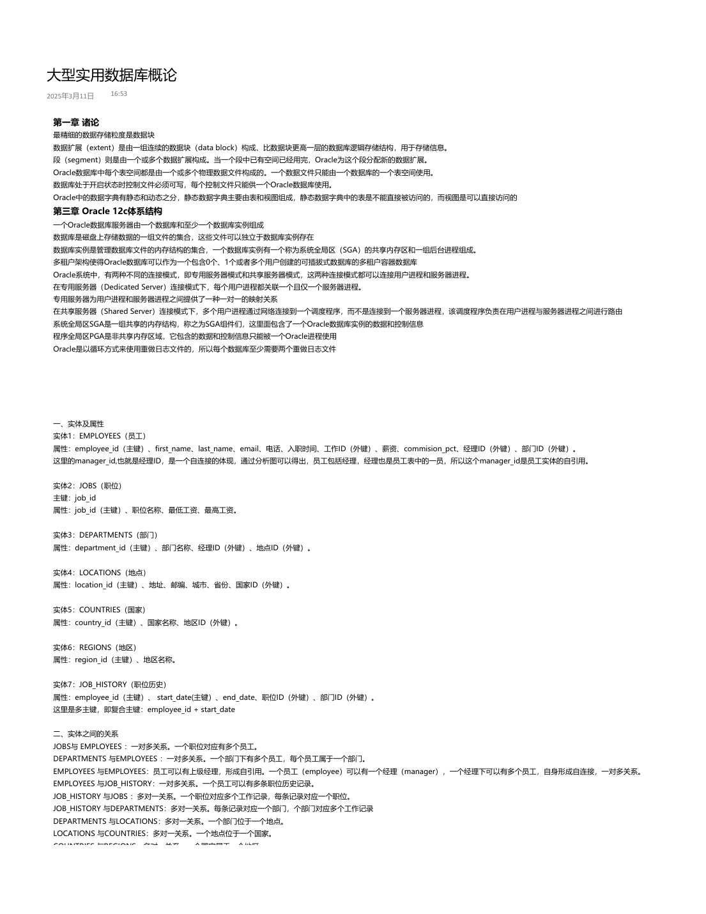

# 大型实用数据库概论：课程笔记

[下载本课程 PDF](../../../assets/downloads/advanced-practical-database.pdf)

## 文字版

大型实用数据库概论
2025年3月11日   16:53

### 第一章 诸论
最精细的数据存储粒度是数据块
数据扩展（extent）是由一组连续的数据块（data block）构成、比数据块更高一层的数据库逻辑存储结构，用于存储信息。
段（segment）则是由一个或多个数据扩展构成。当一个段中已有空间已经用完，Oracle为这个段分配新的数据扩展。
Oracle数据库中每个表空间都是由一个或多个物理数据文件构成的。一个数据文件只能由一个数据库的一个表空间使用。
数据库处于开启状态时控制文件必须可写，每个控制文件只能供一个Oracle数据库使用。
Oracle中的数据字典有静态和动态之分，静态数据字典主要由表和视图组成，静态数据字典中的表是不能直接被访问的，而视图是可以直接访问的
### 第三章 Oracle 12c体系结构
一个Oracle数据库服务器由一个数据库和至少一个数据库实例组成
数据库是磁盘上存储数据的一组文件的集合，这些文件可以独立于数据库实例存在
数据库实例是管理数据库文件的内存结构的集合，一个数据库实例有一个称为系统全局区（SGA）的共享内存区和一组后台进程组成。
多租户架构使得Oracle数据库可以作为一个包含0个、1个或者多个用户创建的可插拔式数据库的多租户容器数据库
Oracle系统中，有两种不同的连接模式，即专用服务器模式和共享服务器模式，这两种连接模式都可以连接用户进程和服务器进程。
在专用服务器（Dedicated Server）连接模式下，每个用户进程都关联一个且仅一个服务器进程。
专用服务器为用户进程和服务器进程之间提供了一种一对一的映射关系
在共享服务器（Shared Server）连接模式下，多个用户进程通过网络连接到一个调度程序，而不是连接到一个服务器进程，该调度程序负责在用户进程与服务器进程之间进行路由
系统全局区SGA是一组共享的内存结构，称之为SGA组件们，这里面包含了一个Oracle数据库实例的数据和控制信息
程序全局区PGA是非共享内存区域，它包含的数据和控制信息只能被一个Oracle进程使用
Oracle是以循环方式来使用重做日志文件的，所以每个数据库至少需要两个重做日志文件

### 一、实体及属性
实体1：EMPLOYEES（员工）
属性：employee_id（主键）、first_name、last_name、email、电话、入职时间、工作ID（外键）、薪资、commision_pct、经理ID（外键）、部门ID（外键）。
这里的manager_id,也就是经理ID，是一个自连接的体现，通过分析图可以得出，员工包括经理，经理也是员工表中的一员，所以这个manager_id是员工实体的自引用。

实体2：JOBS（职位）
主键：job_id
属性：job_id（主键）、职位名称、最低工资、最高工资。

实体3：DEPARTMENTS（部门）
属性：department_id（主键）、部门名称、经理ID（外键）、地点ID（外键）。

实体4：LOCATIONS（地点）
属性：location_id（主键）、地址、邮编、城市、省份、国家ID（外键）。

实体5：COUNTRIES（国家）
属性：country_id（主键）、国家名称、地区ID（外键）。

实体6：REGIONS（地区）
属性：region_id（主键）、地区名称。

实体7：JOB_HISTORY（职位历史）
属性：employee_id（主键）、 start_date(主键）、end_date、职位ID（外键）、部门ID（外键）。
这里是多主键，即复合主键：employee_id + start_date

### 二、实体之间的关系
JOBS与 EMPLOYEES ：一对多关系。一个职位对应有多个员工。
DEPARTMENTS 与EMPLOYEES ：一对多关系。一个部门下有多个员工，每个员工属于一个部门。
EMPLOYEES 与EMPLOYEES：员工可以有上级经理，形成自引用。一个员工（employee）可以有一个经理（manager），一个经理下可以有多个员工，自身形成自连接，一对多关系。
EMPLOYEES 与JOB_HISTORY：一对多关系。一个员工可以有多条职位历史记录。
JOB_HISTORY 与JOBS ：多对一关系。一个职位对应多个工作记录，每条记录对应一个职位。
JOB_HISTORY 与DEPARTMENTS：多对一关系。每条记录对应一个部门，个部门对应多个工作记录
DEPARTMENTS 与LOCATIONS：多对一关系。一个部门位于一个地点。
LOCATIONS 与COUNTRIES：多对一关系。一个地点位于一个国家。
COUNTRIES 与REGIONS：多对一关系。一个国家属于一个地区。

---

## 原版页面

### 第 1 页

