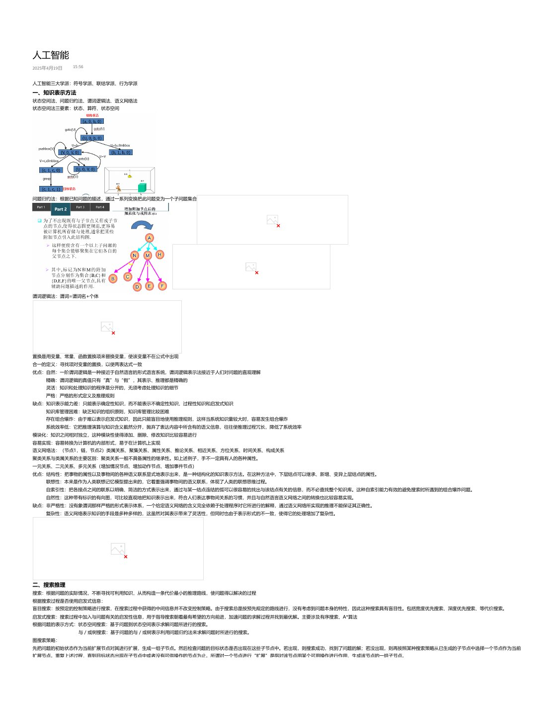
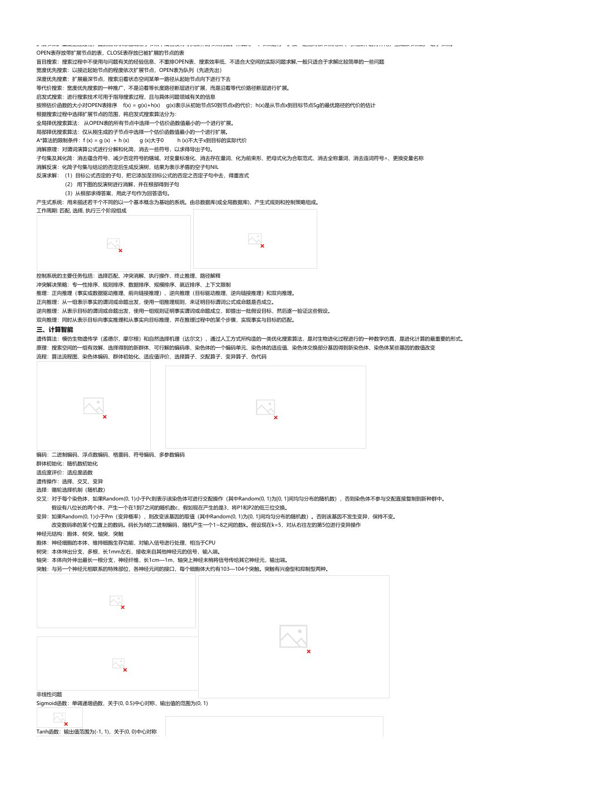
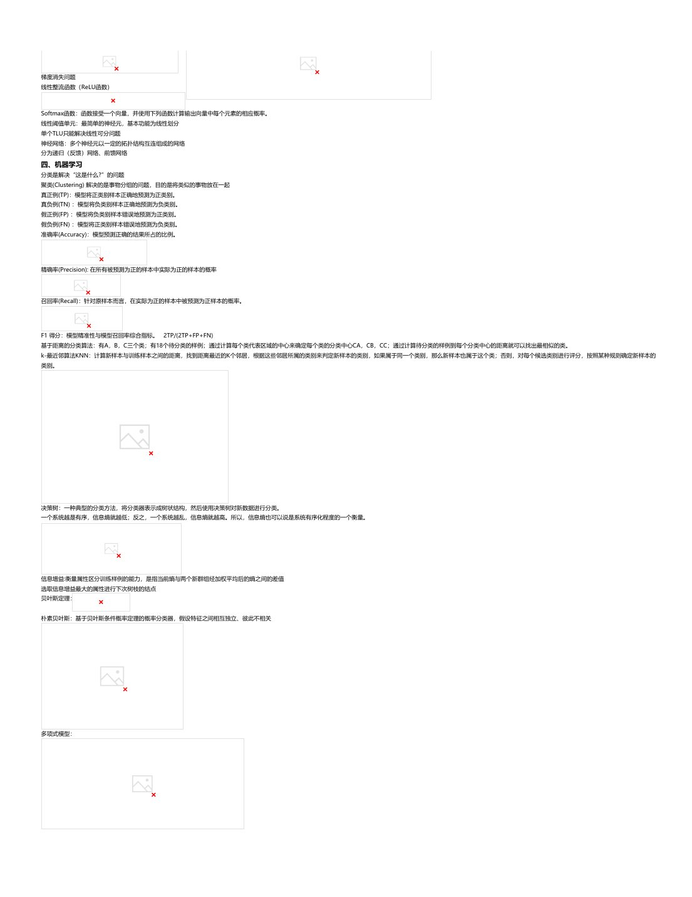
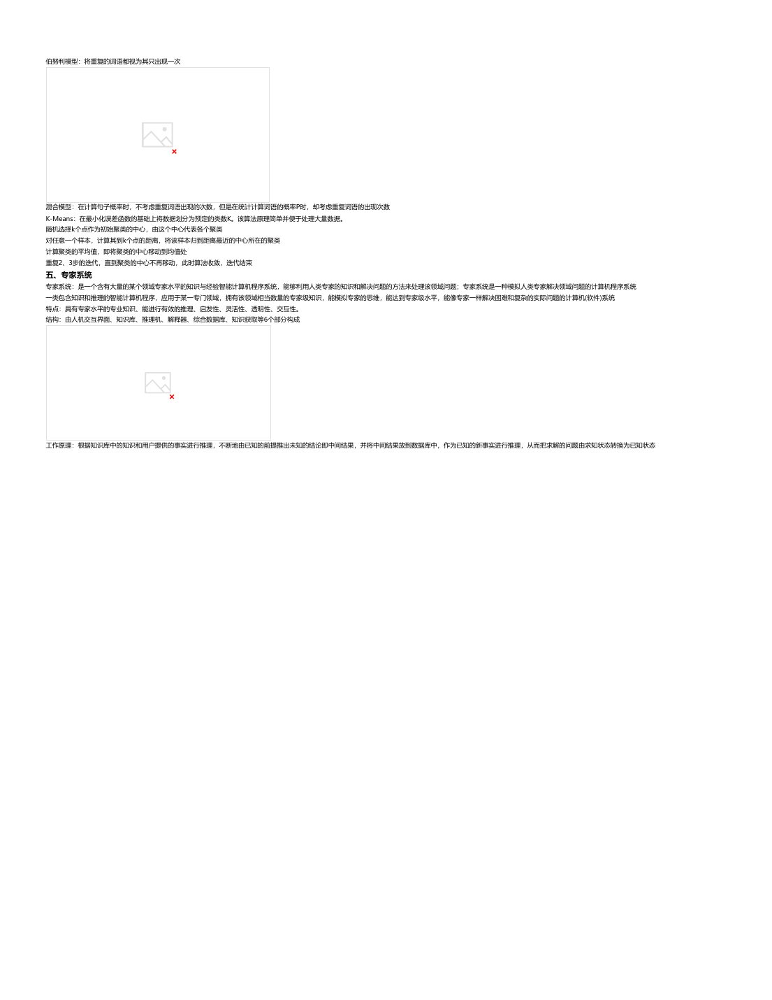

# 人工智能：课堂笔记

[下载本课程 PDF](../../../assets/downloads/artificial-intelligence.pdf)

## 文字版

人工智能
2025年4月19日   15:56

人工智能三大学派：符号学派、联结学派、行为学派
### 一、知识表示方法
状态空间法、问题归约法、谓词逻辑法、语义网络法
状态空间法三要素：状态、算符、状态空间

问题归约法：根据已知问题的描述，通过一系列变换把此问题变为一个子问题集合

谓词逻辑法：谓词=谓词名+个体

置换是用变量、常量、函数置换项来替换变量，使该变量不在公式中出现
合一的定义：寻找项对变量的置换，以使两表达式一致
优点：自然：一阶谓词逻辑是一种接近于自然语言的形式语言系统，谓词逻辑表示法接近于人们对问题的直观理解
精确：谓词逻辑的真值只有“真”与“假”，其表示、推理都是精确的
灵活：知识和处理知识的程序是分开的，无须考虑处理知识的细节
严格：严格的形式定义及推理规则
缺点：知识表示能力差：只能表示确定性知识，而不能表示不确定性知识、过程性知识和启发式知识
知识库管理困难：缺乏知识的组织原则，知识库管理比较困难
存在组合爆炸：由于难以表示启发式知识，因此只能盲目地使用推理规则，这样当系统知识量较大时，容易发生组合爆炸
系统效率低：它把推理演算与知识含义截然分开，抛弃了表达内容中所含有的语义信息，往往使推理过程冗长，降低了系统效率
模块化：知识之间相对独立，这种模块性使得添加、删除、修改知识比较容易进行
容易实现：容易转换为计算机的内部形式，易于在计算机上实现
语义网络法：（节点1，链，节点2）类属关系、聚集关系、属性关系、推论关系、相近关系、方位关系、时间关系、构成关系
聚类关系与类属关系的主要区别：聚类关系一般不具备属性的继承性。如上述例子，手不一定具有人的各种属性。
一元关系、二元关系、多元关系（增加情况节点、增加动作节点、增加事件节点）
优点：结构性：把事物的属性以及事物间的各种语义联系显式地表示出来，是一种结构化的知识表示方法。在这种方法中，下层结点可以继承、新增、变异上层结点的属性。
联想性：本来是作为人类联想记忆模型提出来的，它着重强调事物间的语义联系，体现了人类的联想思维过程。
自索引性：把各接点之间的联系以明确、简洁的方式表示出来，通过与某一结点连结的弧可以很容易的找出与该结点有关的信息，而不必查找整个知识库。这种自索引能力有效的避免搜索时所遇到的组合爆炸问题。
自然性：这种带有标识的有向图，可比较直观地把知识表示出来，符合人们表达事物间关系的习惯，并且与自然语言语义网络之间的转换也比较容易实现。
缺点：非严格性：没有象谓词那样严格的形式表示体系，一个给定语义网络的含义完全依赖于处理程序对它所进行的解释，通过语义网络所实现的推理不能保证其正确性。
复杂性：语义网络表示知识的手段是多种多样的，这虽然对其表示带来了灵活性，但同时也由于表示形式的不一致，使得它的处理增加了复杂性。

### 二、搜索推理
搜索：根据问题的实际情况，不断寻找可利用知识，从而构造一条代价最小的推理路线，使问题得以解决的过程
根据搜索过程是否使用启发式信息：
盲目搜索：按预定的控制策略进行搜索，在搜索过程中获得的中间信息并不改变控制策略。由于搜索总是按预先规定的路线进行，没有考虑到问题本身的特性，因此这种搜索具有盲目性。包括宽度优先搜索、深度优先搜索、等代价搜索。
启发式搜索：搜索过程中加入与问题有关的启发性信息，用于指导搜索朝着最有希望的方向前进，加速问题的求解过程并找到最优解。主要涉及有序搜索、A*算法
根据问题的表示方式：状态空间搜索：基于问题到状态空间表示求解问题所进行的搜索。
与／或树搜索：基于问题的与／或树表示利用问题归约法来求解问题时所进行的搜索。
图搜索策略：
先把问题的初始状态作为当前扩展节点对其进行扩展，生成一组子节点。然后检查问题的目标状态是否出现在这些子节点中。若出现，则搜索成功，找到了问题的解；若没出现，则再按照某种搜索策略从已生成的子节点中选择一个节点作为当前
扩展节点。重复上述过程，直到目标状态出现在子节点中或者没有可供操作的节点为止。所谓对一个节点进行“扩展”是指对该节点用某个可用操作进行作用，生成该节点的一组子节点。
OPEN表存放带扩展节点的表，CLOSE表存放已被扩展的节点的表
盲目搜索：搜索过程中不使用与问题有关的经验信息、不重排OPEN表、搜索效率低、不适合大空间的实际问题求解,一般只适合于求解比较简单的一些问题
宽度优先搜索：以接近起始节点的程度依次扩展节点，OPEN表为队列（先进先出）
深度优先搜素：扩展最深节点，搜索沿着状态空间某单一路径从起始节点向下进行下去
等代价搜索：宽度优先搜索的一种推广，不是沿着等长度路径断层进行扩展，而是沿着等代价路径断层进行扩展。
启发式搜索：进行搜索技术可用于指导搜索过程，且与具体问题领域有关的信息

---

启发式搜索：搜索过程中加入与问题有关的启发性信息，用于指导搜索朝着最有希望的方向前进，加速问题的求解过程并找到最优解。主要涉及有序搜索、A*算法
根据问题的表示方式：状态空间搜索：基于问题到状态空间表示求解问题所进行的搜索。
与／或树搜索：基于问题的与／或树表示利用问题归约法来求解问题时所进行的搜索。
图搜索策略：
先把问题的初始状态作为当前扩展节点对其进行扩展，生成一组子节点。然后检查问题的目标状态是否出现在这些子节点中。若出现，则搜索成功，找到了问题的解；若没出现，则再按照某种搜索策略从已生成的子节点中选择一个节点作为当前
扩展节点。重复上述过程，直到目标状态出现在子节点中或者没有可供操作的节点为止。所谓对一个节点进行“扩展”是指对该节点用某个可用操作进行作用，生成该节点的一组子节点。
OPEN表存放带扩展节点的表，CLOSE表存放已被扩展的节点的表
盲目搜索：搜索过程中不使用与问题有关的经验信息、不重排OPEN表、搜索效率低、不适合大空间的实际问题求解,一般只适合于求解比较简单的一些问题
宽度优先搜索：以接近起始节点的程度依次扩展节点，OPEN表为队列（先进先出）
深度优先搜素：扩展最深节点，搜索沿着状态空间某单一路径从起始节点向下进行下去
等代价搜索：宽度优先搜索的一种推广，不是沿着等长度路径断层进行扩展，而是沿着等代价路径断层进行扩展。
启发式搜索：进行搜索技术可用于指导搜索过程，且与具体问题领域有关的信息
按照估价函数的大小对OPEN表排序            f(x) = g(x)+h(x)   g(x)表示从初始节点S0到节点x的代价；h(x)是从节点x到目标节点Sg的最优路径的代价的估计
根据搜索过程中选择扩展节点的范围，将启发式搜索算法分为：
全局择优搜索算法： 从OPEN表的所有节点中选择一个估价函数值最小的一个进行扩展。
局部择优搜索算法：仅从刚生成的子节点中选择一个估价函数值最小的一个进行扩展。
A*算法的限制条件：f (x) = g (x) + h (x)     g (x)大于0      h (x)不大于x到目标的实际代价
消解原理：对谓词演算公式进行分解和化简，消去一些符号，以求得导出子句。
子句集及其化简：消去蕴含符号、减少否定符号的辖域、对变量标准化、消去存在量词、化为前束形、把母式化为合取范式、消去全称量词、消去连词符号∧、更换变量名称
消解反演：化简子句集与结论的否定后生成反演树，结果为表示矛盾的空子句NIL
反演求解：（1）目标公式否定的子句，把它添加至目标公式的否定之否定子句中去，得重言式
（2） 用下图的反演树进行消解，并在根部得到子句
（3）从根部求得答案，用此子句作为回答语句。
产生式系统：用来描述若干个不同的以一个基本概念为基础的系统。由总数据库(或全局数据库)、产生式规则和控制策略组成。
工作周期: 匹配, 选择, 执行三个阶段组成

控制系统的主要任务包括：选择匹配、冲突消解、执行操作、终止推理、路径解释
冲突解决策略：专一性排序、规则排序、数据排序、规模排序、就近排序、上下文限制
推理：正向推理（事实或数据驱动推理、前向链接推理）、逆向推理（目标驱动推理、逆向链接推理）和双向推理。
正向推理：从一组表示事实的谓词或命题出发，使用一组推理规则，来证明目标谓词公式或命题是否成立。
逆向推理：从表示目标的谓词或命题出发，使用一组规则证明事实谓词或命题成立，即提出一批假设目标，然后逐一验证这些假设。
双向推理：同时从表示目标向事实推理和从事实向目标推理，并在推理过程中的某个步骤，实现事实与目标的匹配。
### 三、计算智能
遗传算法：模仿生物遗传学（孟德尔，摩尔根）和自然选择机理（达尔文），通过人工方式所构造的一类优化搜索算法，是对生物进化过程进行的一种数学仿真，是进化计算的最重要的形式。
原理：搜索空间的一组有效解、选择得到的新群体、可行解的编码串、染色体的一个编码单元、染色体的适应值、染色体交换部分基因得到新染色体、染色体某些基因的数值改变
流程：算法流程图、染色体编码、群体初始化、适应值评价、选择算子、交配算子、变异算子、伪代码

编码：二进制编码、浮点数编码、格雷码、符号编码、多参数编码
群体初始化：随机数初始化
适应度评价：适应度函数
遗传操作：选择、交叉、变异
选择：赌轮选择机制（随机数）
交叉：对于每个染色体，如果Random(0, 1)小于Pc则表示该染色体可进行交配操作（其中Random(0, 1)为[0, 1]间均匀分布的随机数），否则染色体不参与交配直接复制到新种群中。
假设有八位长的两个体，产生一个在1到7之间的随机数c，假如现在产生的是3，将P1和P2的低三位交换。
变异：如果Random(0, 1)小于Pm（变异概率），则改变该基因的取值（其中Random(0, 1)为[0, 1]间均匀分布的随机数）。否则该基因不发生变异，保持不变。
改变数码串的某个位置上的数码。码长为8的二进制编码，随机产生一个1~8之间的数k。假设现在k=5，对从右往左的第5位进行变异操作
神经元结构：胞体、树突、轴突、突触
胞体：神经细胞的本体，维持细胞生存功能，对输入信号进行处理，相当于CPU
树突：本体伸出分支，多根，长1mm左右，接收来自其他神经元的信号，输入端。
轴突：本体向外伸出最长一根分支，神经纤维，长1cm—1m，轴突上神经末梢将信号传给其它神经元，输出端。
突触：与另一个神经元相联系的特殊部位，各神经元间的接口，每个细胞体大约有103—104个突触。突触有兴奋型和抑制型两种。

非线性问题
Sigmoid函数：单调递增函数，关于(0, 0.5)中心对称，输出值的范围为(0, 1)

Tanh函数：输出值范围为(-1, 1)，关于(0, 0)中心对称

梯度消失问题
线性整流函数（ReLU函数）

Softmax函数：函数接受一个向量，并使用下列函数计算输出向量中每个元素的相应概率。

---

非线性问题
Sigmoid函数：单调递增函数，关于(0, 0.5)中心对称，输出值的范围为(0, 1)

Tanh函数：输出值范围为(-1, 1)，关于(0, 0)中心对称

梯度消失问题
线性整流函数（ReLU函数）

Softmax函数：函数接受一个向量，并使用下列函数计算输出向量中每个元素的相应概率。
线性阈值单元：最简单的神经元，基本功能为线性划分
单个TLU只能解决线性可分问题
神经网络：多个神经元以一定的拓扑结构互连组成的网络
分为递归（反馈）网络、前馈网络

### 四、机器学习
分类是解决“这是什么?”的问题
聚类(Clustering) 解决的是事物分组的问题，目的是将类似的事物放在一起
真正例(TP)：模型将正类别样本正确地预测为正类别。
真负例(TN) ：模型将负类别样本正确地预测为负类别。
假正例(FP) ：模型将负类别样本错误地预测为正类别。
假负例(FN) ：模型将正类别样本错误地预测为负类别。
准确率(Accuracy)：模型预测正确的结果所占的比例。

精确率(Precision): 在所有被预测为正的样本中实际为正的样本的概率

召回率(Recall)：针对原样本而言，在实际为正的样本中被预测为正样本的概率。

F1 得分：模型精准性与模型召回率综合指标。 2TP/(2TP+FP+FN)
基于距离的分类算法：有A，B，C三个类；有18个待分类的样例；通过计算每个类代表区域的中心来确定每个类的分类中心CA，CB，CC；通过计算待分类的样例到每个分类中心的距离就可以找出最相似的类。
k-最近邻算法KNN：计算新样本与训练样本之间的距离，找到距离最近的K个邻居，根据这些邻居所属的类别来判定新样本的类别，如果属于同一个类别，那么新样本也属于这个类；否则，对每个候选类别进行评分，按照某种规则确定新样本的
类别。

决策树：一种典型的分类方法，将分类器表示成树状结构，然后使用决策树对新数据进行分类。
一个系统越是有序，信息熵就越低；反之，一个系统越乱，信息熵就越高。所以，信息熵也可以说是系统有序化程度的一个衡量。

信息增益:衡量属性区分训练样例的能力，是指当前熵与两个新群组经加权平均后的熵之间的差值
选取信息增益最大的属性进行下次树枝的结点
贝叶斯定理：

朴素贝叶斯：基于贝叶斯条件概率定理的概率分类器，假设特征之间相互独立、彼此不相关

多项式模型：

伯努利模型：将重复的词语都视为其只出现一次

---

伯努利模型：将重复的词语都视为其只出现一次

混合模型：在计算句子概率时，不考虑重复词语出现的次数，但是在统计计算词语的概率P时，却考虑重复词语的出现次数
K-Means：在最小化误差函数的基础上将数据划分为预定的类数K。该算法原理简单并便于处理大量数据。
随机选择k个点作为初始聚类的中心，由这个中心代表各个聚类
对任意一个样本，计算其到k个点的距离，将该样本归到距离最近的中心所在的聚类
计算聚类的平均值，即将聚类的中心移动到均值处
重复2、3步的迭代，直到聚类的中心不再移动，此时算法收敛，迭代结束
### 五、专家系统
专家系统：是一个含有大量的某个领域专家水平的知识与经验智能计算机程序系统，能够利用人类专家的知识和解决问题的方法来处理该领域问题；专家系统是一种模拟人类专家解决领域问题的计算机程序系统
一类包含知识和推理的智能计算机程序，应用于某一专门领域，拥有该领域相当数量的专家级知识，能模拟专家的思维，能达到专家级水平，能像专家一样解决困难和复杂的实际问题的计算机(软件)系统
特点：具有专家水平的专业知识、能进行有效的推理、启发性、灵活性、透明性、交互性。
结构：由人机交互界面、知识库、推理机、解释器、综合数据库、知识获取等6个部分构成

工作原理：根据知识库中的知识和用户提供的事实进行推理，不断地由已知的前提推出未知的结论即中间结果，并将中间结果放到数据库中，作为已知的新事实进行推理，从而把求解的问题由求知状态转换为已知状态

---

## 原版页面

### 第 1 页

### 第 2 页

### 第 3 页

### 第 4 页

