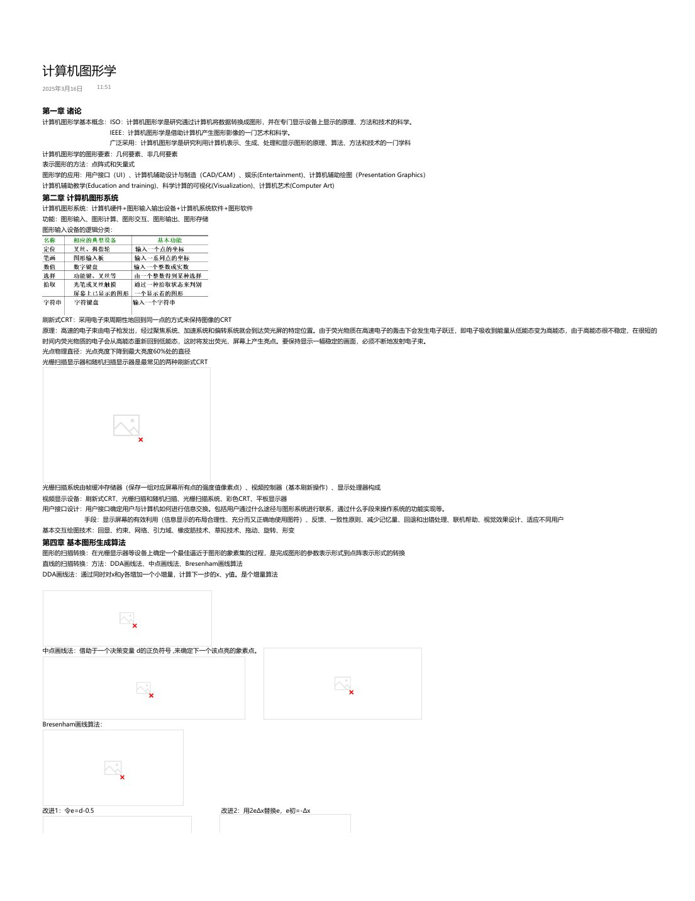
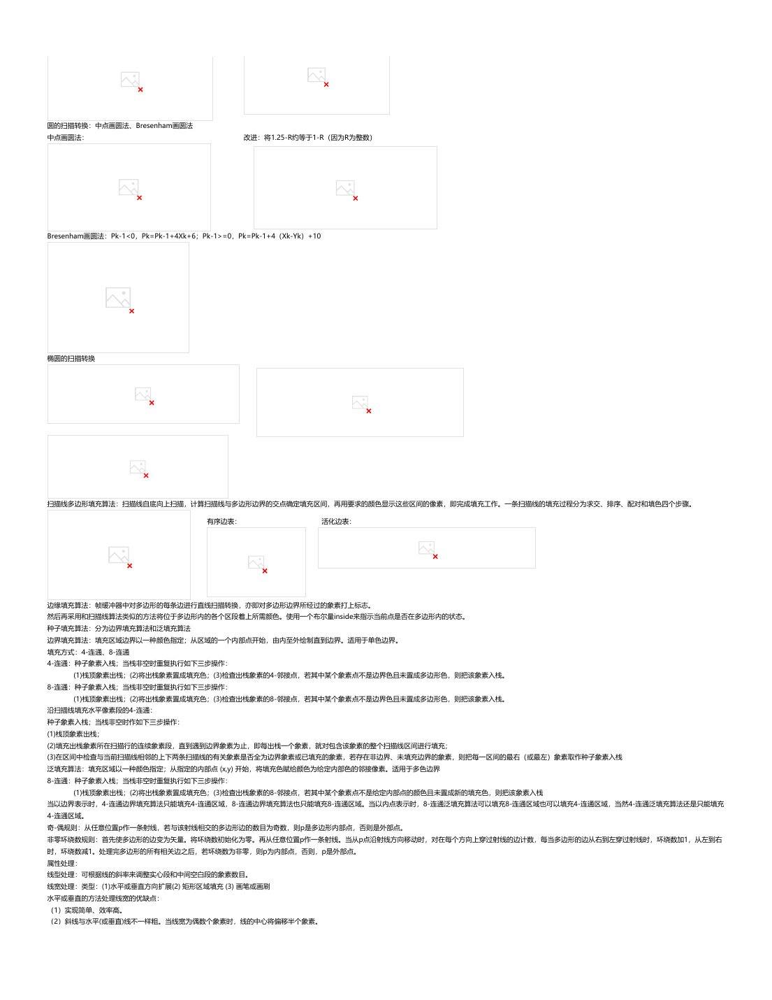
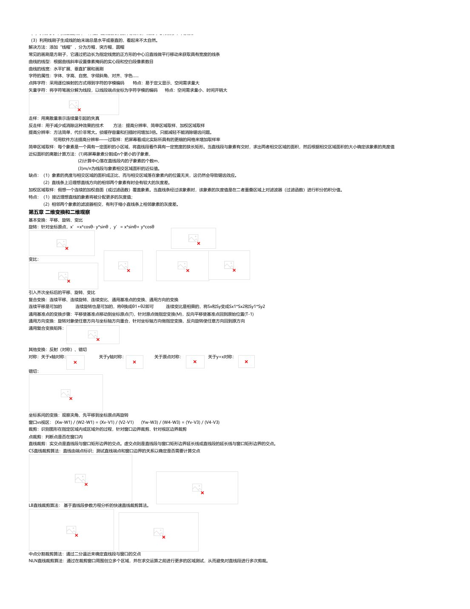
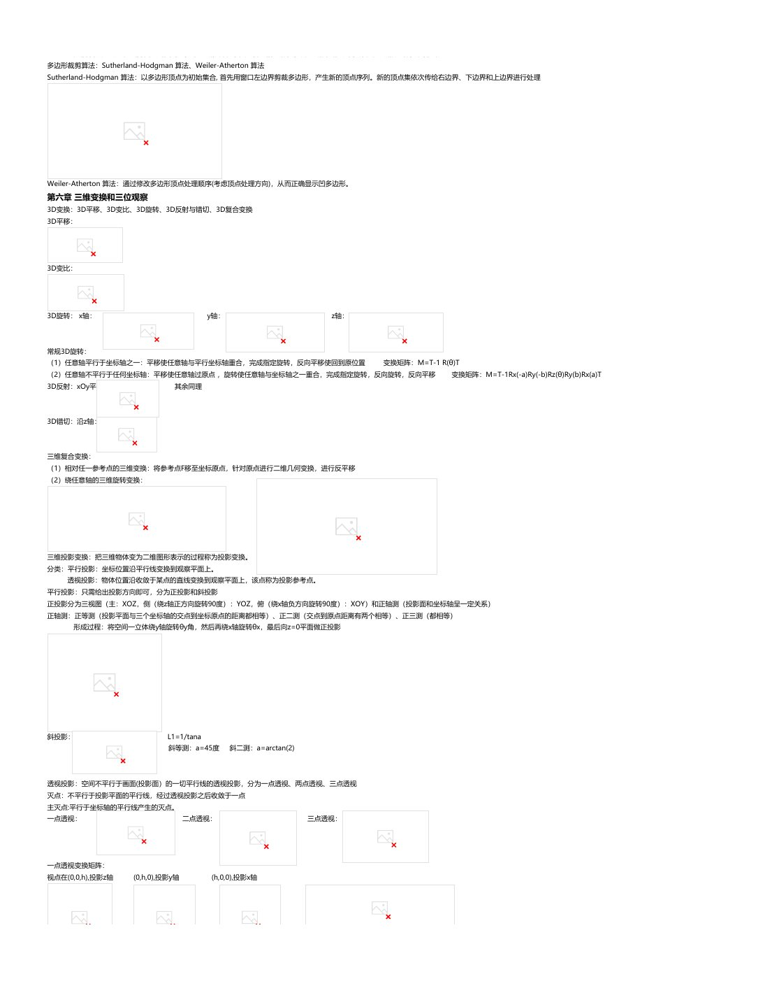
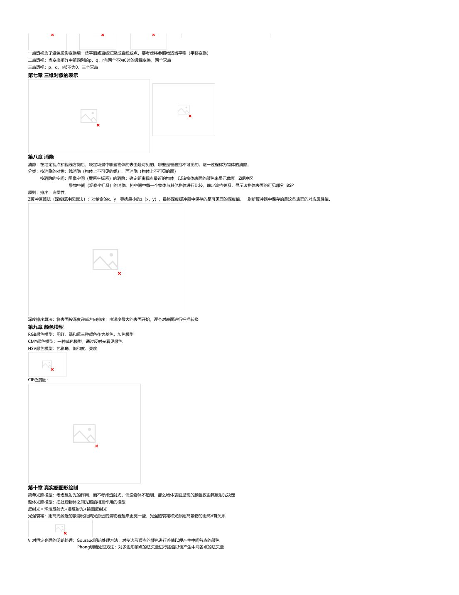
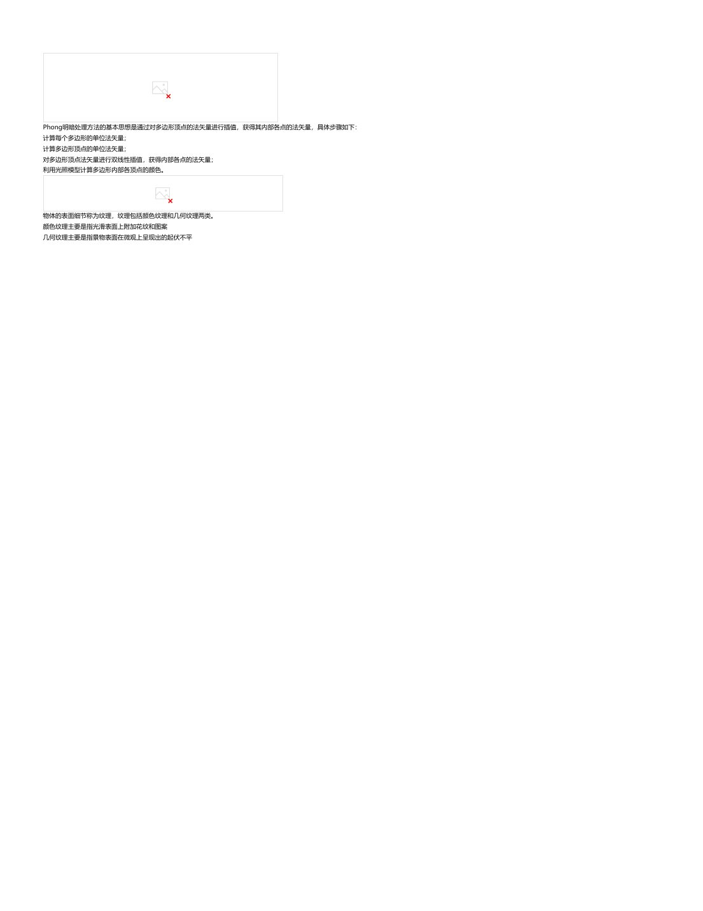
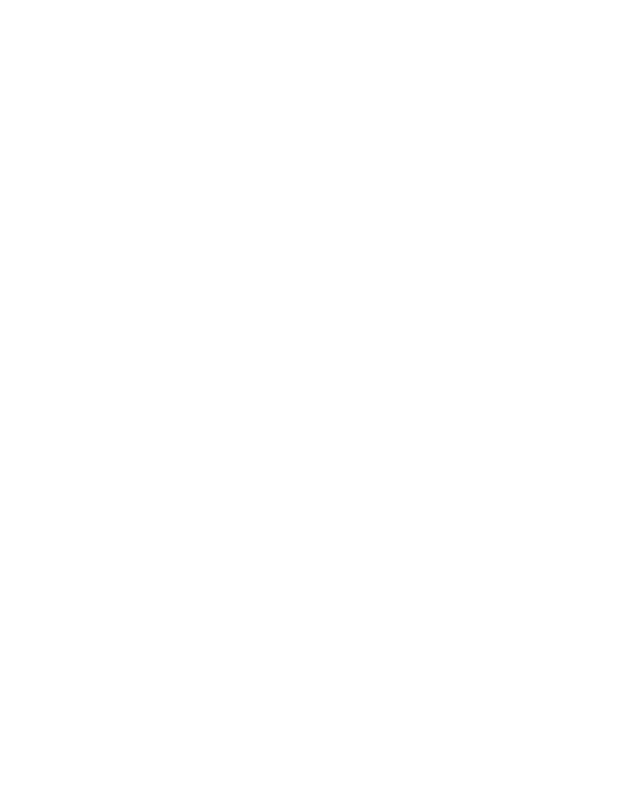
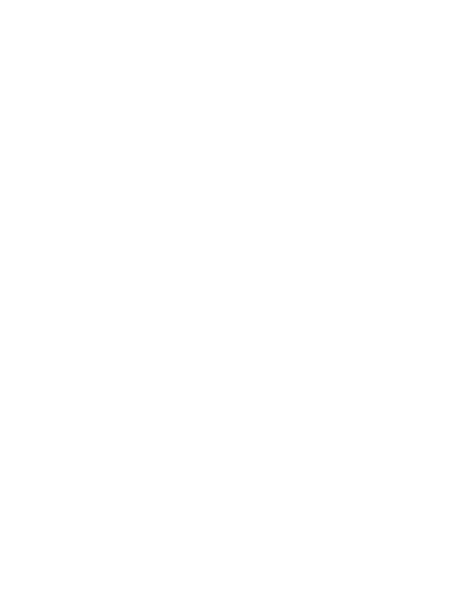
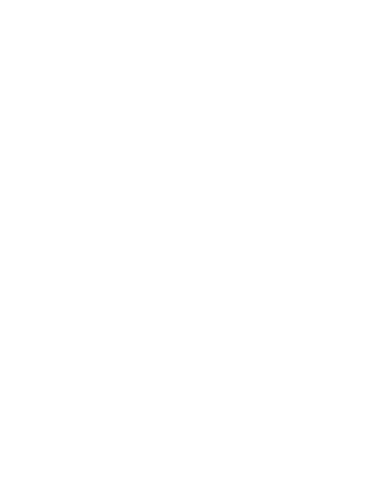
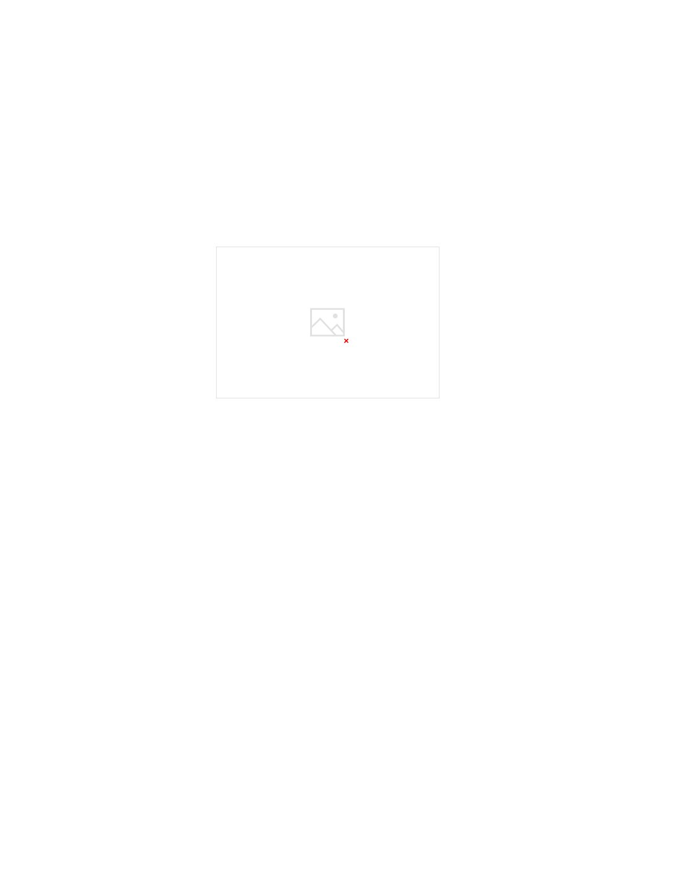

# 计算机图形学：课堂笔记

[下载本课程 PDF](../../../assets/downloads/computer-graphics.pdf)

## 文字版

计算机图形学
2025年3月16日     11:51

### 第一章 诸论
计算机图形学基本概念：ISO：计算机图形学是研究通过计算机将数据转换成图形，并在专门显示设备上显示的原理、方法和技术的科学。
IEEE：计算机图形学是借助计算机产生图形影像的一门艺术和科学。
广泛采用：计算机图形学是研究利用计算机表示、生成、处理和显示图形的原理、算法、方法和技术的一门学科
计算机图形学的图形要素：几何要素、非几何要素
表示图形的方法：点阵式和矢量式
图形学的应用：用户接口（UI）、计算机辅助设计与制造（CAD/CAM）、娱乐(Entertainment)、计算机辅助绘图（Presentation Graphics）
计算机辅助教学(Education and training)、科学计算的可视化(Visualization)、计算机艺术(Computer Art)

### 第二章 计算机图形系统
计算机图形系统：计算机硬件+图形输入输出设备+计算机系统软件+图形软件
功能：图形输入、图形计算、图形交互、图形输出、图形存储
图形输入设备的逻辑分类：

刷新式CRT：采用电子束周期性地回到同一点的方式来保持图像的CRT
原理：高速的电子束由电子枪发出，经过聚焦系统、加速系统和偏转系统就会到达荧光屏的特定位置。由于荧光物质在高速电子的轰击下会发生电子跃迁，即电子吸收到能量从低能态变为高能态，由于高能态很不稳定，在很短的
时间内荧光物质的电子会从高能态重新回到低能态，这时将发出荧光，屏幕上产生亮点。要保持显示一幅稳定的画面，必须不断地发射电子束。
光点物理直径：光点亮度下降到最大亮度60%处的直径
光栅扫描显示器和随机扫描显示器是最常见的两种刷新式CRT

光栅扫描系统由帧缓冲存储器（保存一组对应屏幕所有点的强度值像素点）、视频控制器（基本刷新操作）、显示处理器构成
视频显示设备：刷新式CRT、光栅扫描和随机扫描、光栅扫描系统、彩色CRT、平板显示器
用户接口设计：用户接口确定用户与计算机如何进行信息交换。包括用户通过什么途径与图形系统进行联系，通过什么手段来操作系统的功能实现等。
手段：显示屏幕的有效利用（信息显示的布局合理性、充分而又正确地使用图符）、反馈、一致性原则、减少记忆量、回退和出错处理、联机帮助、视觉效果设计、适应不同用户
基本交互绘图技术：回显、约束、网络、引力域、橡皮筋技术、草拟技术、拖动、旋转、形变

### 第四章 基本图形生成算法
图形的扫描转换：在光栅显示器等设备上确定一个最佳逼近于图形的象素集的过程，是完成图形的参数表示形式到点阵表示形式的转换
直线的扫描转换：方法：DDA画线法、中点画线法、Bresenham画线算法
DDA画线法：通过同时对x和y各增加一个小增量，计算下一步的x、y值。是个增量算法

中点画线法：借助于一个决策变量 d的正负符号 ,来确定下一个该点亮的象素点。

Bresenham画线算法：

改进1：令e=d-0.5                                 改进2：用2eΔx替换e，e初=-Δx

圆的扫描转换：中点画圆法、Bresenham画圆法

---

改进1：令e=d-0.5                                改进2：用2eΔx替换e，e初=-Δx

圆的扫描转换：中点画圆法、Bresenham画圆法
中点画圆法：                                     改进：将1.25-R约等于1-R（因为R为整数）

Bresenham画圆法：Pk-1<0，Pk=Pk-1+4Xk+6；Pk-1>=0，Pk=Pk-1+4（Xk-Yk）+10

椭圆的扫描转换

扫描线多边形填充算法：扫描线自底向上扫描，计算扫描线与多边形边界的交点确定填充区间，再用要求的颜色显示这些区间的像素，即完成填充工作。一条扫描线的填充过程分为求交、排序、配对和填色四个步骤。

有序边表：                        活化边表：

边缘填充算法：帧缓冲器中对多边形的每条边进行直线扫描转换，亦即对多边形边界所经过的象素打上标志。
然后再采用和扫描线算法类似的方法将位于多边形内的各个区段着上所需颜色。使用一个布尔量inside来指示当前点是否在多边形内的状态。
种子填充算法：分为边界填充算法和泛填充算法
边界填充算法：填充区域边界以一种颜色指定；从区域的一个内部点开始，由内至外绘制直到边界。适用于单色边界。
填充方式：4-连通、8-连通
4-连通：种子象素入栈；当栈非空时重复执行如下三步操作：
(1)栈顶象素出栈；(2)将出栈象素置成填充色；(3)检查出栈象素的4-邻接点，若其中某个象素点不是边界色且未置成多边形色，则把该象素入栈。
8-连通：种子象素入栈；当栈非空时重复执行如下三步操作：
(1)栈顶象素出栈；(2)将出栈象素置成填充色；(3)检查出栈象素的8-邻接点，若其中某个象素点不是边界色且未置成多边形色，则把该象素入栈。
沿扫描线填充水平像素段的4-连通：
种子象素入栈；当栈非空时作如下三步操作：
(1)栈顶象素出栈；
(2)填充出栈象素所在扫描行的连续象素段，直到遇到边界象素为止，即每出栈一个象素，就对包含该象素的整个扫描线区间进行填充；
(3)在区间中检查与当前扫描线相邻的上下两条扫描线的有关象素是否全为边界象素或已填充的象素，若存在非边界、未填充边界的象素，则把每一区间的最右（或最左）象素取作种子象素入栈
泛填充算法：填充区域以一种颜色指定；从指定的内部点 (x,y) 开始，将填充色赋给颜色为给定内部色的邻接像素。适用于多色边界
8-连通：种子象素入栈；当栈非空时重复执行如下三步操作：
(1)栈顶象素出栈；(2)将出栈象素置成填充色；(3)检查出栈象素的8-邻接点，若其中某个象素点不是给定内部点的颜色且未置成新的填充色，则把该象素入栈
当以边界表示时，4-连通边界填充算法只能填充4-连通区域，8-连通边界填充算法也只能填充8-连通区域。当以内点表示时，8-连通泛填充算法可以填充8-连通区域也可以填充4-连通区域，当然4-连通泛填充算法还是只能填充
4-连通区域。
奇-偶规则：从任意位置p作一条射线，若与该射线相交的多边形边的数目为奇数，则p是多边形内部点，否则是外部点。
非零环绕数规则：首先使多边形的边变为矢量。将环绕数初始化为零。再从任意位置p作一条射线。当从p点沿射线方向移动时，对在每个方向上穿过射线的边计数，每当多边形的边从右到左穿过射线时，环绕数加1，从左到右
时，环绕数减1。处理完多边形的所有相关边之后，若环绕数为非零，则p为内部点，否则，p是外部点。
属性处理：
线型处理：可根据线的斜率来调整实心段和中间空白段的象素数目。
线宽处理：类型：(1)水平或垂直方向扩展(2) 矩形区域填充 (3) 画笔或画刷
水平或垂直的方法处理线宽的优缺点：
（1）实现简单、效率高。
（2）斜线与水平(或垂直)线不一样粗。当线宽为偶数个象素时，线的中心将偏移半个象素。
（3）利用线刷子生成线的始末端总是水平或垂直的，看起来不太自然。
解决方法：添加“线帽”，分为方帽，突方帽，圆帽
常见的画刷是方刷子，它通过把边长为指定线宽的正方形的中心沿直线做平行移动来获取具有宽度的线条
曲线的线型：根据曲线斜率设置像素掩码的实心段和空白段像素数目
曲线的线宽：水平扩展、垂直扩展和画刷
字符的属性：字体、字高、自宽、字倾斜角、对齐、字色......

---

线型处理：可根据线的斜率来调整实心段和中间空白段的象素数目。
线宽处理：类型：(1)水平或垂直方向扩展(2) 矩形区域填充 (3) 画笔或画刷
水平或垂直的方法处理线宽的优缺点：
（1）实现简单、效率高。
（2）斜线与水平(或垂直)线不一样粗。当线宽为偶数个象素时，线的中心将偏移半个象素。
（3）利用线刷子生成线的始末端总是水平或垂直的，看起来不太自然。
解决方法：添加“线帽”，分为方帽，突方帽，圆帽
常见的画刷是方刷子，它通过把边长为指定线宽的正方形的中心沿直线做平行移动来获取具有宽度的线条
曲线的线型：根据曲线斜率设置像素掩码的实心段和空白段像素数目
曲线的线宽：水平扩展、垂直扩展和画刷
字符的属性：字体、字高、自宽、字倾斜角、对齐、字色......
点阵字符：采用逐位映射的方式得到字符的字模编码                     特点：易于定义显示、空间需求量大
矢量字符：将字符笔画分解为线段，以线段端点坐标为字符字模的编码                            特点：空间需求量小、时间开销大

走样：用离散量表示连续量引起的失真
反走样：用于减少或消除这种效果的技术                  方法：提高分辨率、简单区域取样、加权区域取样
提高分辨率：方法简单，代价非常大。侦缓存容量和扫描时间增加3倍。只能减轻不能消除锯齿问题。
可用软件方法提高分辨率——过取样：把屏幕看成比实际所具有的更细的网格来增加取样率
简单区域取样：每个象素是一个具有一定面积的小区域，将直线段看作具有一定宽度的狭长矩形。当直线段与象素有交时，求出两者相交区域的面积，然后根据相交区域面积的大小确定该象素的亮度值
近似面积的离散计算方法：(1)将屏幕象素分割成n个更小的子象素，
(2)计算中心落在直线段内的子象素的个数m，
(3)m/n为线段与象素相交区域面积的近似值。
缺点：（1）象素的亮度与相交区域的面积成正比，而与相交区域落在象素内的位置无关，这仍然会导致锯齿效应。
（2）直线条上沿理想直线方向的相邻两个象素有时会有较大的灰度差。
加权区域取样：假想一个连续的加权曲面（或过滤函数）覆盖象素。当直线条经过该象素时，该象素的灰度值是在二者重叠区域上对滤波器（过滤函数）进行积分的积分值。
特点：（1）接近理想直线的象素将被分配更多的灰度值；
（2）相邻两个象素的滤波器相交，有利于缩小直线条上相邻象素的灰度差。
### 第五章 二维变换和二维观察
基本变换：平移、旋转、变比
旋转：针对坐标原点，x’=x*cosθ- y*sinθ ，y’= x*sinθ+ y*cosθ

变比：

引入齐次坐标后的平移、旋转、变比
复合变换：连续平移、连续旋转、连续变比、通用基准点的变换、通用方向的变换
连续平移是可加的            连续旋转也是可加的，将θ换成θ1+θ2即可                  连续变比是相乘的，将Sx和Sy变成Sx1*Sx2和Sy1*Sy2
通用基准点的变换步骤：平移使基准点移动到坐标原点(T)，针对原点做指定变换(M)，反向平移使基准点回到原始位置(T-1)
通用方向变换：旋转对象使任意方向与坐标轴方向重合，针对坐标轴方向做指定变换，反向旋转使任意方向回到原方向
通用复合变换矩阵：

其他变换：反射（对称）、错切
对称：关于x轴对称：                    关于y轴对称：                 关于原点对称：                  关于y=x对称：

错切：

坐标系间的变换：观察夹角，先平移到坐标原点再旋转
窗口vs视区： (Xw-W1) / (W2-W1) = (Xv-V1) / (V2-V1)   (Yw-W3) / (W4-W3) = (Yv-V3) / (V4-V3)
裁剪：识别图形在指定区域内或区域外的过程，针对窗口边界裁剪、针对视区边界裁剪
点裁剪：判断点是否在窗口内
直线裁剪：实交点是直线段与窗口矩形边界的交点。虚交点则是直线段与窗口矩形边界延长线或直线段的延长线与窗口矩形边界的交点。
CS直线裁剪算法：直线由端点标识；测试直线端点和窗口边界的关系以确定是否需要计算交点

LB直线裁剪算法： 基于直线段参数方程分析的快速直线裁剪算法。

中点分割裁剪算法：通过二分逼近来确定直线段与窗口的交点
NLN直线裁剪算法：通过在裁剪窗口周围创立多个区域，并在求交运算之前进行更多的区域测试，从而避免对直线段进行多次剪裁。
多边形裁剪算法：Sutherland-Hodgman 算法、Weiler-Atherton 算法
Sutherland-Hodgman 算法：以多边形顶点为初始集合, 首先用窗口左边界剪裁多边形，产生新的顶点序列。新的顶点集依次传给右边界、下边界和上边界进行处理

---

中点分割裁剪算法：通过二分逼近来确定直线段与窗口的交点
NLN直线裁剪算法：通过在裁剪窗口周围创立多个区域，并在求交运算之前进行更多的区域测试，从而避免对直线段进行多次剪裁。
多边形裁剪算法：Sutherland-Hodgman 算法、Weiler-Atherton 算法
Sutherland-Hodgman 算法：以多边形顶点为初始集合, 首先用窗口左边界剪裁多边形，产生新的顶点序列。新的顶点集依次传给右边界、下边界和上边界进行处理

Weiler-Atherton 算法：通过修改多边形顶点处理顺序(考虑顶点处理方向)，从而正确显示凹多边形。

### 第六章 三维变换和三位观察
3D变换：3D平移、3D变比、3D旋转、3D反射与错切、3D复合变换
3D平移：

3D变比：

3D旋转： x轴：                              y轴：                        z轴：

常规3D旋转：
（1）任意轴平行于坐标轴之一：平移使任意轴与平行坐标轴重合，完成指定旋转，反向平移使回到原位置                         变换矩阵：M=T-1 R(θ)T
（2）任意轴不平行于任何坐标轴：平移使任意轴过原点 ，旋转使任意轴与坐标轴之一重合，完成指定旋转，反向旋转，反向平移                            变换矩阵：M=T-1Rx(-a)Ry(-b)Rz(θ)Ry(b)Rx(a)T
3D反射：xOy平面：                  其余同理

3D错切：沿z轴：

三维复合变换：
（1）相对任一参考点的三维变换：将参考点F移至坐标原点，针对原点进行二维几何变换，进行反平移
（2）绕任意轴的三维旋转变换：

三维投影变换：把三维物体变为二维图形表示的过程称为投影变换。
分类：平行投影：坐标位置沿平行线变换到观察平面上。
透视投影：物体位置沿收敛于某点的直线变换到观察平面上，该点称为投影参考点。
平行投影：只需给出投影方向即可，分为正投影和斜投影
正投影分为三视图（主：XOZ，侧（绕z轴正方向旋转90度）：YOZ，俯（绕x轴负方向旋转90度）：XOY）和正轴测（投影面和坐标轴呈一定关系）
正轴测：正等测（投影平面与三个坐标轴的交点到坐标原点的距离都相等）、正二测（交点到原点距离有两个相等）、正三测（都相等）
形成过程：将空间一立体绕y轴旋转θy角，然后再绕x轴旋转θx，最后向z=0平面做正投影

斜投影：                       L1=1/tana
斜等测：a=45度        斜二测：a=arctan(2)

透视投影：空间不平行于画面(投影面）的一切平行线的透视投影，分为一点透视、两点透视、三点透视
灭点：不平行于投影平面的平行线，经过透视投影之后收敛于一点
主灭点:平行于坐标轴的平行线产生的灭点。
一点透视：                             二点透视：                        三点透视：

一点透视变换矩阵：
视点在(0,0,h),投影z轴    (0,h,0),投影y轴        (h,0,0),投影x轴

一点透视为了避免投影变换后一些平面或直线汇聚成直线或点，要考虑将参照物适当平移（平移变换）
二点透视：当变换矩阵中第四列的p，q，r有两个不为0时的透视变换，两个灭点
三点透视：p，q，r都不为0，三个灭点

### 第七章 三维对象的表示

---

一点透视变换矩阵：
视点在(0,0,h),投影z轴     (0,h,0),投影y轴   (h,0,0),投影x轴

一点透视为了避免投影变换后一些平面或直线汇聚成直线或点，要考虑将参照物适当平移（平移变换）
二点透视：当变换矩阵中第四列的p，q，r有两个不为0时的透视变换，两个灭点
三点透视：p，q，r都不为0，三个灭点

### 第七章 三维对象的表示

### 第八章 消隐
消隐：在给定视点和视线方向后，决定场景中哪些物体的表面是可见的，哪些是被遮挡不可见的，这一过程称为物体的消隐。
分类：按消隐的对象：线消隐（物体上不可见的线）、面消隐（物体上不可见的面）
按消隐的空间：图像空间（屏幕坐标系）的消隐：确定距离视点最近的物体，以该物体表面的颜色来显示像素 Z缓冲区
景物空间（观察坐标系）的消隐：将空间中每一个物体与其他物体进行比较，确定遮挡关系，显示该物体表面的可见部分 BSP
原则：排序、连贯性、
Z缓冲区算法（深度缓冲区算法）：对给定的x，y，寻找最小的z（x，y），最终深度缓冲器中保存的是可见面的深度值， 刷新缓冲器中保存的是这些表面的对应属性值。

深度排序算法：将表面按深度递减方向排序；由深度最大的表面开始，逐个对表面进行扫描转换
### 第九章 颜色模型
RGB颜色模型：用红、绿和蓝三种颜色作为基色，加色模型
CMY颜色模型：一种减色模型，通过反射光看见颜色
HSV颜色模型：色彩角、饱和度、亮度

CIE色度图：

### 第十章 真实感图形绘制
简单光照模型：考虑反射光的作用，而不考虑透射光，假设物体不透明，那么物体表面呈现的颜色仅由其反射光决定
整体光照模型：把处理物体之间光照的相互作用的模型
反射光＝环境反射光+漫反射光+镜面反射光
光强衰减：距离光源近的景物比距离光源远的景物看起来更亮一些，光强的衰减和光源距离景物的距离d有关系

针对恒定光强的明暗处理：Gouraud明暗处理方法：对多边形顶点的颜色进行差值以便产生中间各点的颜色
Phong明暗处理方法：对多边形顶点的法矢量进行插值以便产生中间各点的法矢量

---

光强衰减：距离光源近的景物比距离光源远的景物看起来更亮一些，光强的衰减和光源距离景物的距离d有关系

针对恒定光强的明暗处理：Gouraud明暗处理方法：对多边形顶点的颜色进行差值以便产生中间各点的颜色
Phong明暗处理方法：对多边形顶点的法矢量进行插值以便产生中间各点的法矢量

Phong明暗处理方法的基本思想是通过对多边形顶点的法矢量进行插值，获得其内部各点的法矢量，具体步骤如下：
计算每个多边形的单位法矢量；
计算多边形顶点的单位法矢量；
对多边形顶点法矢量进行双线性插值，获得内部各点的法矢量；
利用光照模型计算多边形内部各顶点的颜色。

物体的表面细节称为纹理，纹理包括颜色纹理和几何纹理两类。
颜色纹理主要是指光滑表面上附加花纹和图案
几何纹理主要是指景物表面在微观上呈现出的起伏不平

---

---

---

---

---

---

## 原版页面

### 第 1 页

### 第 2 页

### 第 3 页

### 第 4 页

### 第 5 页

### 第 6 页

### 第 7 页

### 第 8 页

### 第 9 页

### 第 10 页

### 第 11 页

