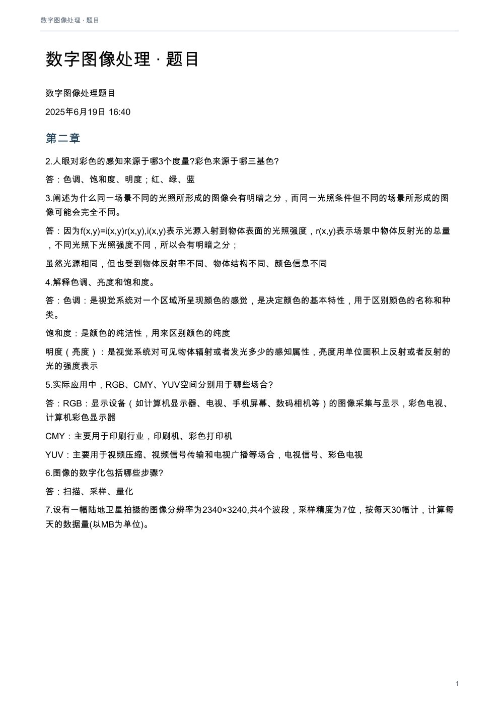
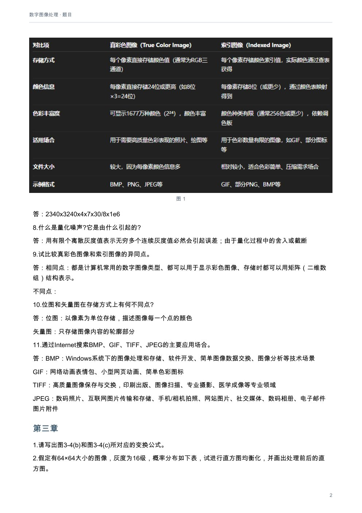
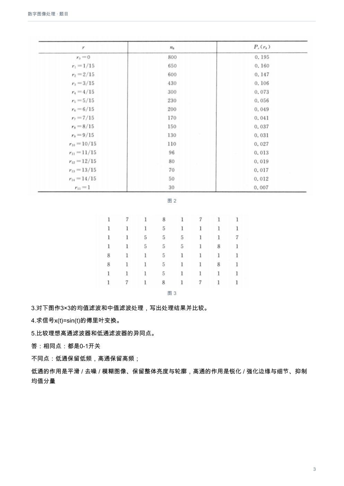
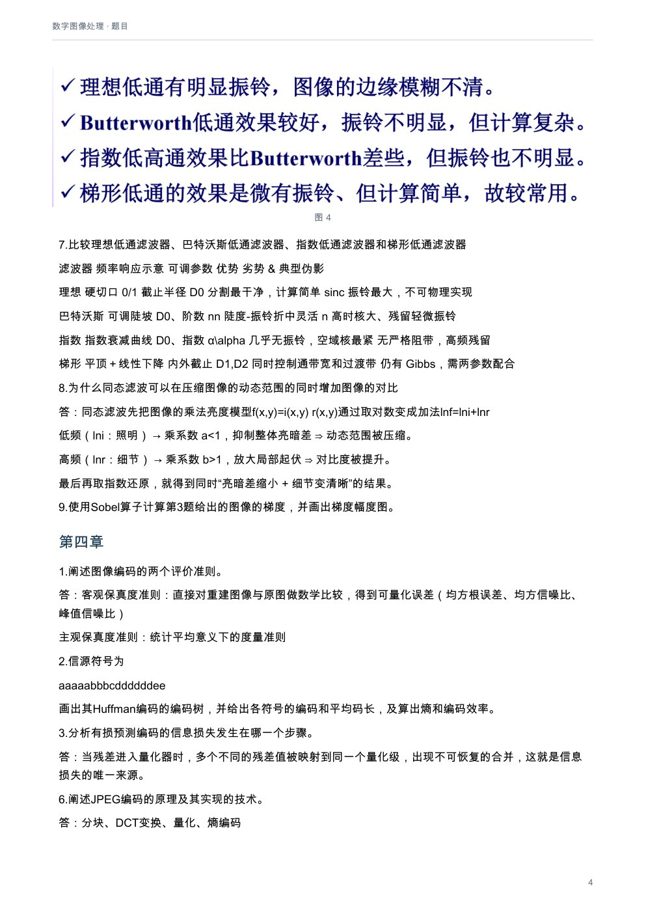
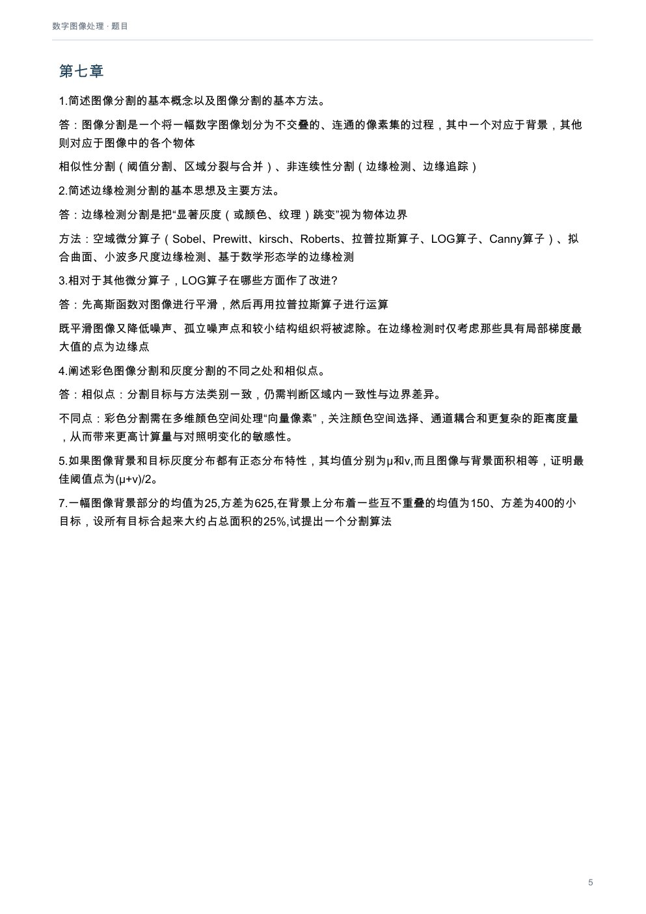
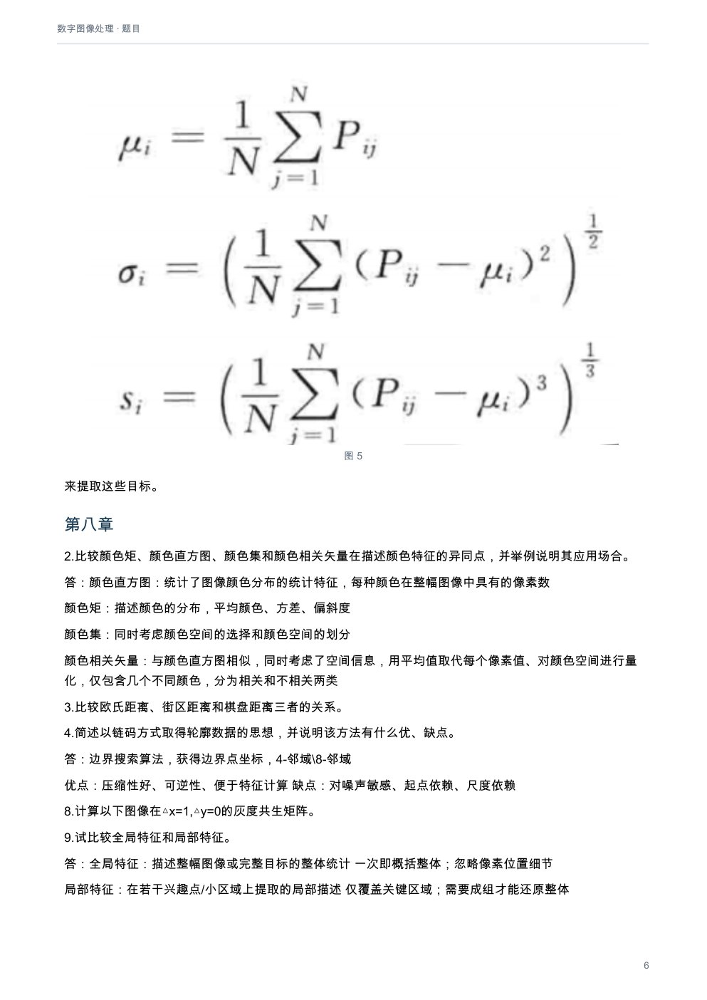

# 数字图像处理：题目

[下载本课程 PDF](../../../assets/downloads/digital-image-processing.pdf)

## 文字版

数字图像处理题目
2025年6月19日    16:40
### 第二章
2.人眼对彩色的感知来源于哪3个度量?彩色来源于哪三基色?
答：色调、饱和度、明度；红、绿、蓝
3.阐述为什么同一场景不同的光照所形成的图像会有明暗之分，而同一光照条件但不同的场景所形成的图像可能会完全不同。
答：因为f(x,y)=i(x,y)r(x,y),i(x,y)表示光源入射到物体表面的光照强度，r(x,y)表示场景中物体反射光的总量，不同光照下光照强度不同，所以会有明暗之分；
虽然光源相同，但也受到物体反射率不同、物体结构不同、颜色信息不同
4.解释色调、亮度和饱和度。
答：色调：是视觉系统对一个区域所呈现颜色的感觉，是决定颜色的基本特性，用于区别颜色的名称和种类。
饱和度：是颜色的纯洁性，用来区别颜色的纯度
明度（亮度）：是视觉系统对可见物体辐射或者发光多少的感知属性，亮度用单位面积上反射或者反射的光的强度表示
5.实际应用中，RGB、CMY、YUV空间分别用于哪些场合?
答：RGB：显示设备（如计算机显示器、电视、手机屏幕、数码相机等）的图像采集与显示，彩色电视、计算机彩色显示器
CMY：主要用于印刷行业，印刷机、彩色打印机
YUV：主要用于视频压缩、视频信号传输和电视广播等场合，电视信号、彩色电视
6.图像的数字化包括哪些步骤?
答：扫描、采样、量化
7.设有一幅陆地卫星拍摄的图像分辨率为2340×3240,共4个波段，采样精度为7位，按每天30幅计，计算每天的数据量(以MB为单位)。
答：2340x3240x4x7x30/8x1e6
8.什么是量化噪声?它是由什么引起的?
答：用有限个离散灰度值表示无穷多个连续灰度值必然会引起误差；由于量化过程中的舍入或截断
9.试比较真彩色图像和索引图像的异同点。
答：相同点：都是计算机常用的数字图像类型、都可以用于显示彩色图像、存储时都可以用矩阵（二维数组）结构表示。
不同点：
10.位图和矢量图在存储方式上有何不同点?
答：位图：以像素为单位存储，描述图像每一个点的颜色
矢量图：只存储图像内容的轮廓部分
11.通过Internet搜索BMP、GIF、TIFF、JPEG的主要应用场合。
答：BMP：Windows系统下的图像处理和存储、软件开发、简单图像数据交换、图像分析等技术场景
GIF：网络动画表情包、小型网页动画、简单色彩图标
TIFF：高质量图像保存与交换，印刷出版、图像扫描、专业摄影、医学成像等专业领域
JPEG：数码照片、互联网图片传输和存储、手机/相机拍照、网站图片、社交媒体、数码相册、电子邮件图片附件
### 第三章
1.请写出图3-4(b)和图3-4(c)所对应的变换公式。
2.假定有64×64大小的图像，灰度为16级，概率分布如下表，试进行直方图均衡化，并画出处理前后的直方图。
3.对下图作3×3的均值滤波和中值滤波处理，写出处理结果并比较。
4.求信号x(t)=sin(t)的傅里叶变换。
5.比较理想高通滤波器和低通滤波器的异同点。
答：相同点：都是0-1开关
不同点：低通保留低频，高通保留高频；
低通的作用是平滑 / 去噪 / 模糊图像、保留整体亮度与轮廓，高通的作用是锐化 / 强化边缘与细节、抑制均值分量
7.比较理想低通滤波器、巴特沃斯低通滤波器、指数低通滤波器和梯形低通滤波器
滤波器     频率响应示意      可调参数        优势               劣势 & 典型伪影
理想      硬切⼝ 0/1     截止半径 D0     分割最干净，计算简单       sinc 振铃最⼤，不可物理实现
巴特沃斯 可调陡坡           D0、阶数 nn    陡度-振铃折中灵活        n 高时核大、残留轻微振铃
指数      指数衰减曲线      D0、指数 α\alpha 几乎无振铃，空域核最紧 无严格阻带，高频残留
梯形      平顶＋线性下降 内外截止 D1,D2      同时控制通带宽和过渡带 仍有 Gibbs，需两参数配合
8.为什么同态滤波可以在压缩图像的动态范围的同时增加图像的对比
答：同态滤波先把图像的乘法亮度模型f(x,y)=i(x,y) r(x,y)通过取对数变成加法lnf=lni+lnr
低频（lni：照明） → 乘系数 a<1，抑制整体亮暗差 ⇒ 动态范围被压缩。
高频（lnr：细节） → 乘系数 b>1，放大局部起伏 ⇒ 对比度被提升。
最后再取指数还原，就得到同时“亮暗差缩小 + 细节变清晰”的结果。
9.使用Sobel算子计算第3题给出的图像的梯度，并画出梯度幅度图。
### 第四章
1.阐述图像编码的两个评价准则。
答：客观保真度准则：直接对重建图像与原图做数学比较，得到可量化误差（均方根误差、均方信噪比、峰值信噪比）
主观保真度准则：统计平均意义下的度量准则
2.信源符号为
aaaaabbbcddddddee
画出其Huffman编码的编码树，并给出各符号的编码和平均码长，及算出熵和编码效率。
3.分析有损预测编码的信息损失发生在哪一个步骤。
答：当残差进入量化器时，多个不同的残差值被映射到同一个量化级，出现不可恢复的合并，这就是信息损失的唯一来源。
6.阐述JPEG编码的原理及其实现的技术。
答：分块、DCT变换、量化、熵编码
### 第七章
1.简述图像分割的基本概念以及图像分割的基本方法。
答：图像分割是一个将一幅数字图像划分为不交叠的、连通的像素集的过程，其中一个对应于背景，其他则对应于图像中的各个物体
相似性分割（阈值分割、区域分裂与合并）、非连续性分割（边缘检测、边缘追踪）
2.简述边缘检测分割的基本思想及主要方法。
答：边缘检测分割是把“显著灰度（或颜色、纹理）跳变”视为物体边界
方法：空域微分算子（Sobel、Prewitt、kirsch、Roberts、拉普拉斯算子、LOG算子、Canny算子）、拟合曲面、小波多尺度边缘检测、基于数学形态学的边缘检测
3.相对于其他微分算子，LOG算子在哪些方面作了改进?
答：先高斯函数对图像进行平滑，然后再用拉普拉斯算子进行运算
既平滑图像又降低噪声、孤立噪声点和较小结构组织将被滤除。在边缘检测时仅考虑那些具有局部梯度最大值的点为边缘点
4.阐述彩色图像分割和灰度分割的不同之处和相似点。
答：相似点：分割目标与方法类别一致，仍需判断区域内一致性与边界差异。
不同点：彩色分割需在多维颜色空间处理“向量像素”，关注颜色空间选择、通道耦合和更复杂的距离度量，从而带来更高计算量与对照明变化的敏感性。
5.如果图像背景和目标灰度分布都有正态分布特性，其均值分别为μ和v,而且图像与背景面积相等，证明最佳阈值点为(μ+v)/2。
7.一幅图像背景部分的均值为25,方差为625,在背景上分布着一些互不重叠的均值为150、方差为400的小目标，设所有目标合起来大约占总面积的25%,试提出一个分割算法
来提取这些目标。
### 第八章
2.比较颜色矩、颜色直方图、颜色集和颜色相关矢量在描述颜色特征的异同点，并举例说明其应用场合。
答：颜色直方图：统计了图像颜色分布的统计特征，每种颜色在整幅图像中具有的像素数
颜色矩：描述颜色的分布，平均颜色、方差、偏斜度
颜色集：同时考虑颜色空间的选择和颜色空间的划分
颜色相关矢量：与颜色直方图相似，同时考虑了空间信息，用平均值取代每个像素值、对颜色空间进行量化，仅包含几个不同颜色，分为相关和不相关两类
3.比较欧氏距离、街区距离和棋盘距离三者的关系。
4.简述以链码方式取得轮廓数据的思想，并说明该方法有什么优、缺点。
答：边界搜索算法，获得边界点坐标，4-邻域\8-邻域
优点：压缩性好、可逆性、便于特征计算 缺点：对噪声敏感、起点依赖、尺度依赖
8.计算以下图像在△x=1,△y=0的灰度共生矩阵。
9.试比较全局特征和局部特征。
答：全局特征：描述整幅图像或完整目标的整体统计          一次即概括整体；忽略像素位置细节
局部特征：在若干兴趣点/小区域上提取的局部描述        仅覆盖关键区域；需要成组才能还原整体

## 排版页面

### 第 1 页

### 第 2 页

### 第 3 页

### 第 4 页

### 第 5 页

### 第 6 页

