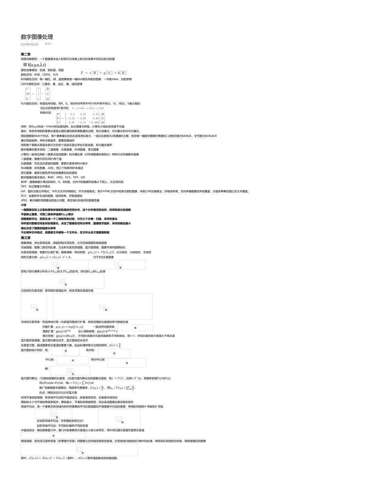
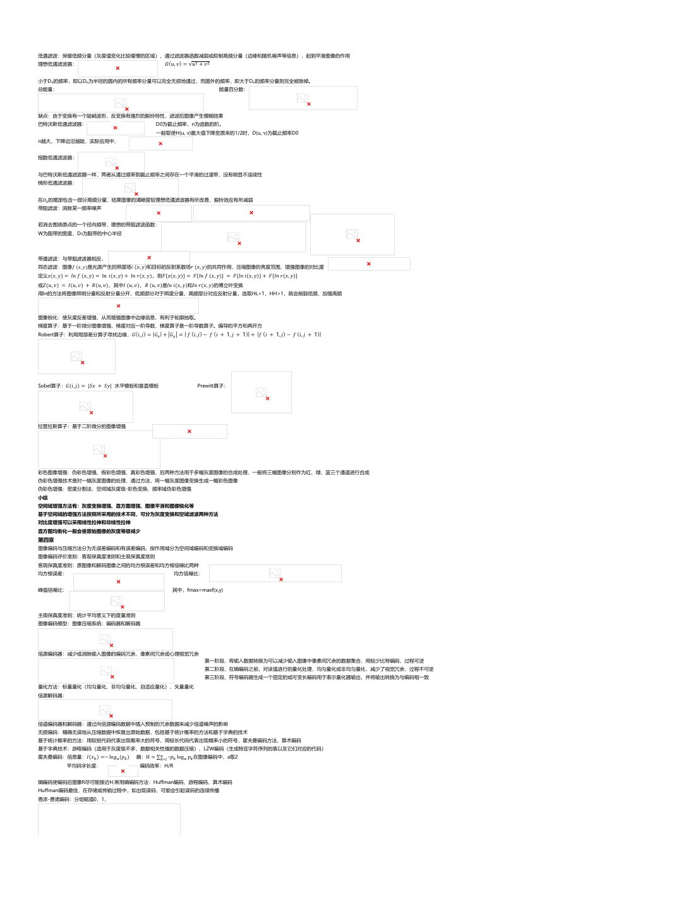
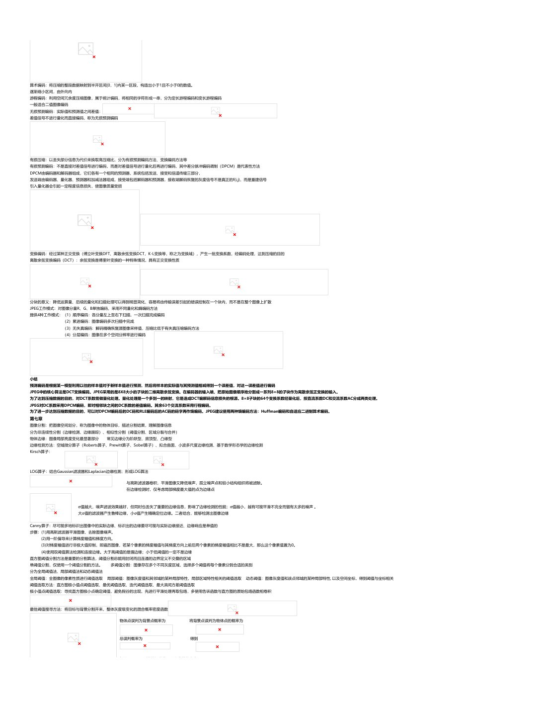
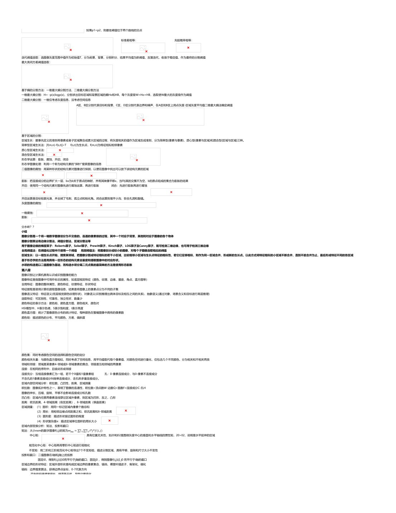
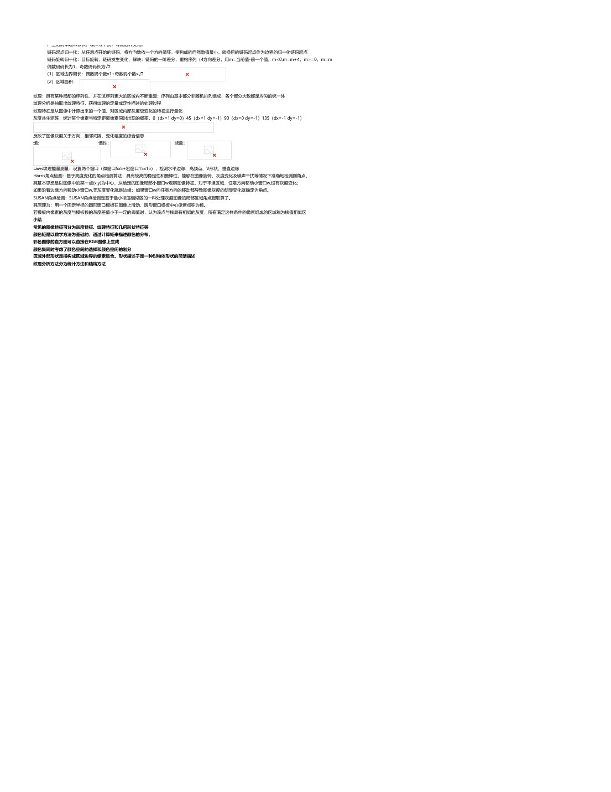

# 数字图像处理：课堂笔记

[下载本课程 PDF](../../../assets/downloads/digital-image-processing.pdf)

## 文字版

数字图像处理
2025年6月19日      16:36

### 第二章
亮度成像模型：一个图像基本由入射到可见场景上的光和场景中目标反射光的量

颜色成像模型：色调、饱和度、明度
颜色空间：RGB、CMYK、YUV
RGB颜色空间：每一幅红、绿、蓝图像都是一幅8bit颜色深度的图像，一共是24bit，加色原理
CMYK颜色空间：三基色：青、品红、黄，减色原理

YUV颜色空间：电视信号传输，将R、G、B改组成亮度信号(Y)和色度信号(U、V)，Y和U、V是分离的
当白光的亮度用Y表示时，
转换关系：

采样：将f(x,y)构成一个MxN的实数矩阵。划分图像为网格，计算在小格处的亮度平均值
量化：将采样得到的像素灰度值从模拟量转换到离散量的过程，有分层量化、均匀量化和非均匀量化、
假定图像取MxN个样点，每个像素量化后的灰度级用Q表示，一般Q总是取为2的整数K次幂，则存储一幅数字图像所需要的二进制位数为MxNxK，字节数为MxNxK/8
量化级数越高、采样点数越多，图像质量越好
用有限个离散灰度值来表示无穷多个连续灰度必然会引起误差，称为量化噪声
数字图像的基本类型：二值图像、灰度图像、RGB图像、索引图像
计算机一般用位映射（像素点组成图像）和向量处理（只存储图像轮廓部分）两种方式存储静态图像
二值图像：像素只存在0和1两个值
灰度图像：仅包含灰度级的图像，像素灰度级用8bit表示
RGB图像：彩色图像，24位，用三个矩阵同时来描述
索引图像：据索引颜色序号找到像素的实际颜色
数字图像的基本格式：BMP、JPEG、PCX、TIFF、GIF
BMP：图像数据计算实际的R、G、B的值，文件中的数据存放是从下到上、从左到右的
TIFF：标记图像文件格式
GIF：图形交换文件格式，不作为文件存储格式，作为传输格式，用于HTML文档中的索引颜色图像，采取LZW压缩算法，存储效率高，支持多幅图像定序或覆盖，交错多屏幕绘图以及文本覆盖。
PCX：绘图软件生成的图像，结构简单，存取速度快
JPEG：解决摄影师图像信息庞大问题，高压缩比和良好的图像质量
小结
一幅图像实际上记录的是物体辐射能量的空间分布，这个分布是空间坐标、时间和波长的函数
平面静止图像，可用二维有界函数f(x,y)表示
将图像数字化，就是生成一个二维矩阵的过程，分为三个步骤：扫描、采样和量化
采样是对图像空间坐标的离散化，决定了图像的空间分辨率，图像细节越多，采样间隔应越小
量化决定了图像的幅度分辨率
不论哪种文件格式，其图像文件都有一个文件头，在文件头后才是图像数据

### 第三章
图像增强：突出有用信息，削弱抑制无用信息，分为空域增强和频域增强
空域增强：图像二维空间处理，方法有灰度变换增强、直方图增强、图像平滑和图像锐化
灰度变换增强：图像对比度扩展，图像清晰，特征明显，𝑔(𝑥, 𝑦) = 𝑇[𝑓(𝑥, 𝑦)]，分为线性、分段线性、非线性
线性灰度交换：𝑔(𝑥, 𝑦) = 𝑓(𝑥, 𝑦) · 𝐶 + 𝑅，                   对于8位灰度图像

若有少部分像素分布在小于fmin和大于fmax的区间，则均按fmin和fmax处理

分段线性灰度变换：某范围灰度值拉伸，其余范围灰度值压缩

非线性灰度变换：有选择地对某一灰度值范围进行扩展，其他范围的灰度值则有可能被压缩
对数扩展：𝑔(𝑥, 𝑦) = 𝑙𝑜𝑔[𝑓(𝑥, 𝑦)]          一般自然对数变换
指数扩展：g(x,y)=bf(x,y)        加入调制参数：g(x,y)=bc[f(x,y)-a]-1
r
幂次变换：g(x,y)=c[f(x,y)] ，不同的r系数对灰度变换具有不同的响应，若r<1，对低灰度的放大程度大于高灰度
直方图变换增强：直方图均衡化技术、直方图规定化技术
!
灰度直方图：描述图像各灰度值的像素个数，纵坐标通常表示出现的频率，𝑝(𝑟) =
"
直方图的统计特征：矩：                                      绝对矩：

中心矩：                              绝对中心矩：

熵：

直方图均衡化：r为原始图像的灰度级、s为直方图均衡化后的图像灰度级，有𝑠 = 𝑇(𝑟)，也有r=T-1(s)，有概率密度Pr(r)与Ps(s)
#
所以Ps(s)ds=Pr(r)dr，得𝑠 = 𝑇(𝑟) = ∫0 Pr(r)dr
!!                       !
推广到离散数字图像时，用频率代替概率，𝑃# (𝑟$ ) =
!
，则𝑠$ = 𝑇(𝑟$ ) = ∑$%=0 !"
优点：得到近似均匀分布直方图
空间平滑滤波增强：有领域平均法和中值滤波法，前者是线性的，后者是非线性的
模板的大小与平滑效果直接相关，模板越大，平滑的效果越明显，但会造成图像边缘信息的损失
领域平均法：将一个像素及其邻域内的所有像素的平均灰度值赋给平滑图像中对应的像素，常用的邻域有4-邻域和8-邻域

非加权邻域平均法：所有模板系统均为1
加权邻域平均法：不同的位置有不同的权值
中值滤波法：确定像素窗口W，窗口内各像素按灰度值从小到大排序后，用中间位置灰度值代替原灰度值

频域增强：首先经过某种变换（如傅里叶变换）将图像从空间域变换到变换域，在变换域对频谱进行操作和处理，再将其反变换到空间域，得到增强后的图像

其中，𝐺(𝑢, 𝑣) = 𝐻(𝑢, 𝑣) · 𝐹(𝑢, 𝑣)（卷积），𝐻(𝑢, 𝑣)是传递函数或滤波器函数、
低通滤波：保留低频分量（灰度值变化比较缓慢的区域），通过滤波器函数减弱或抑制高频分量（边缘和随机噪声等信息），起到平滑图像的作用
理想低通滤波器：                                          𝐷(𝑢, 𝑣) = √𝑢& + 𝑣 &

小于D₀的频率，即以D₀为半径的圆内的所有频率分量可以完全无损地通过，而圆外的频率，即大于D₀的频率分量则完全被除掉。
总能量：                                                                         能量百分数：

缺点：由于变换有一个陡峭波形，反变换有强烈的振铃特性，滤波后图像产生模糊效果

---

频域增强：首先经过某种变换（如傅里叶变换）将图像从空间域变换到变换域，在变换域对频谱进行操作和处理，再将其反变换到空间域，得到增强后的图像

其中，𝐺(𝑢, 𝑣) = 𝐻(𝑢, 𝑣) · 𝐹(𝑢, 𝑣)（卷积），𝐻(𝑢, 𝑣)是传递函数或滤波器函数、
低通滤波：保留低频分量（灰度值变化比较缓慢的区域），通过滤波器函数减弱或抑制高频分量（边缘和随机噪声等信息），起到平滑图像的作用
理想低通滤波器：                                             𝐷(𝑢, 𝑣) = √𝑢& + 𝑣 &

小于D₀的频率，即以D₀为半径的圆内的所有频率分量可以完全无损地通过，而圆外的频率，即大于D₀的频率分量则完全被除掉。
总能量：                                                                        能量百分数：

缺点：由于变换有一个陡峭波形，反变换有强烈的振铃特性，滤波后图像产生模糊效果
巴特沃斯低通滤波器：                                       D0为截止频率，n为函数的阶。
一般取使H(u, v)最大值下降至原来的1/2时，D(u, v)为截止频率D0
n越大，下降边沿越陡，实际应用中，

指数低通滤波器：

与巴特沃斯低通滤波器一样，两者从通过频率到截止频率之间存在一个平滑的过渡带，没有明显不连续性
梯形低通滤波器：

在𝐷! 的尾部包含一部分高频分量，结果图像的清晰度较理想低通滤波器有所改善，振铃效应有所减弱
带阻滤波：消除某一频率噪声

若消去围绕原点的一个径向频带，理想的带阻滤波函数：
W为阻带的宽度，D0为阻带的中心半径

带通滤波：与带阻滤波器相反，
同态滤波：图像𝑓 (𝑥, 𝑦)是光源产生的照度场𝑖 (𝑥, 𝑦)和目标的反射系数场𝑟 (𝑥, 𝑦)的共同作用，压缩图像的亮度范围、增强图像的对比度
定义𝑧(𝑥, 𝑦) = 𝑙𝑛 𝑓 (𝑥, 𝑦) = ln 𝑖(𝑥, 𝑦) + 𝑙𝑛 𝑟(𝑥, 𝑦)，则𝐹{𝑧(𝑥, 𝑦)} = 𝐹{𝑙𝑛 𝑓 (𝑥, 𝑦)} = 𝐹{𝑙𝑛 𝑖(𝑥, 𝑦)} + 𝐹{𝑙𝑛 𝑟(𝑥, 𝑦)}
或𝑍(𝑢, 𝑣) = 𝐼(𝑢, 𝑣) + 𝑅(𝑢, 𝑣)，其中𝐼 (𝑢, 𝑣)，𝑅 (𝑢, 𝑣)是𝑙𝑛 𝑖(𝑥, 𝑦)和𝑙𝑛 𝑟(𝑥, 𝑦)的傅立叶变换
用ln的方法将图像照明分量和反射分量分开，低频部分对于照度分量，高频部分对应反射分量，选取HL<1，HH>1，就会削弱低频，加强高频

图像锐化：使灰度反差增强，从而增强图像中边缘信息，有利于轮廓抽取。
梯度算子：基于一阶微分图像增强，梯度对应一阶导数，梯度算子是一阶导数算子。偏导的平方和再开方
Robert算子：利用局部差分算子寻找边缘，𝐺(𝑖, 𝑗) = |𝐺( | + K𝐺) K = | 𝑓 (𝑖, 𝑗) − 𝑓 (𝑖 + 1, 𝑗 + 1)| + |𝑓 (𝑖 + 1, 𝑗) − 𝑓 (𝑖, 𝑗 + 1)|

Sobel算子：𝐺(𝑖, 𝑗) = |𝑆𝑥 + 𝑆𝑦| 水平模板和垂直模板                              Prewitt算子：

拉普拉斯算子：基于二阶微分的图像增强

彩色图像增强：伪彩色增强、假彩色增强、真彩色增强，后两种方法用于多幅灰度图像的合成处理，一般将三幅图像分别作为红、绿、蓝三个通道进行合成
伪彩色增强技术是对一幅灰度图像的处理，通过方法，将一幅灰度图像变换生成一幅彩色图像
伪彩色增强：密度分割法、空间域灰度级-彩色变换、频率域伪彩色增强
小结
空间域增强方法有：灰度变换增强、直方图增强、图像平滑和图像锐化等
基于空间域的增强方法按照所采用的技术不同，可分为灰度变换和空域滤波两种方法
对比度增强可以采用线性拉伸和非线性拉伸
直方图均衡化一般会使原始图像的灰度等级减少
### 第四章
图像编码与压缩方法分为无误差编码和有误差编码，按作用域分为空间域编码和变换域编码
图像编码评价准则：客观保真度准则和主观保真度准则
客观保真度准则：原图像和解码图像之间的均方根误差和均方根信噪比两种
均方根误差：                                                   均方信噪比：

峰值信噪比：                                                  其中，fmax=maxf(x,y)

主观保真度准则：统计平均意义下的度量准则
图像编码模型：图像压缩系统：编码器和解码器

信源编码器：减少或消除输入图像的编码冗余、像素间冗余或心理视觉冗余
第一阶段，将输入数据转换为可以减少输入图像中像素间冗余的数据集合，用较少比特编码，过程可逆
第二阶段，在熵编码之前，对该值进行的量化处理，均匀量化或非均匀量化，减少了视觉冗余，过程不可逆
第三阶段，符号编码器生成一个固定的或可变长编码用于表示量化器输出，并将输出转换为与编码相一致
量化方法：标量量化（均匀量化、非均匀量化、自适应量化）、矢量量化
信源解码器：

信道编码器和解码器：通过向信源编码数据中插入预制的冗余数据来减少信道噪声的影响
无损编码：精确无误地从压缩数据中恢复出原始数据，包括基于统计概率的方法和基于字典的技术
基于统计概率的方法：用较短代码代表出现概率大的符号，用较长代码代表出现概率小的符号，霍夫曼编码方法、算术编码
基于字典技术：游程编码（适用于灰度级不多，数据相关性强的数据压缩）、LZW编码（生成特定字符序列的表以及它们对应的代码）
霍夫曼编码：信息量：𝐼(𝑥$ ) =− lo𝑔* (𝑝$ )           熵：H = ∑!
$=1 −𝑝$ log * 𝑝$ 在图像编码中，a取2
平均码字长度：                        编码效率：H/R

熵编码使编码后图像R尽可能接近H,常用熵编码方法：Huffman编码、游程编码、算术编码
Huffman编码最佳，在存储或传输过程中，如出现误码，可能会引起误码的连续传播
香浓-费诺编码：分组赋值0，1，

算术编码：将压缩的整段数据映射到半开区间[0，1]内某一区段，构造出小于1且不小于0的数值。
逐渐缩小区间，由外向内

---

熵编码使编码后图像R尽可能接近H,常用熵编码方法：Huffman编码、游程编码、算术编码
Huffman编码最佳，在存储或传输过程中，如出现误码，可能会引起误码的连续传播
香浓-费诺编码：分组赋值0，1，

算术编码：将压缩的整段数据映射到半开区间[0，1]内某一区段，构造出小于1且不小于0的数值。
逐渐缩小区间，由外向内
游程编码：利用空间冗余度压缩图像，属于统计编码，将相同的字符形成一串，分为定长游程编码和变长游程编码
一般适合二值图像编码
无损预测编码：实际值和预测值之间差值：
差值信号不进行量化而直接编码，称为无损预测编码

有损压缩：以丢失部分信息为代价来换取高压缩比，分为有损预测编码方法、变换编码方法等
有损预测编码：不是直接对差值信号进行编码，而是对差值信号进行量化后再进行编码，其中差分脉冲编码调制（DPCM）是代表性方法
DPCM由编码器和解码器组成，它们各有一个相同的预测器，系统包括发送、接受和信道传输三部分，
发送端由编码器、量化器、预测器和加减法器组成，接受端包括解码器和预测器，接收端解码恢复的灰度信号不是真正的f(i,j)，而是重建信号
引入量化器会引起一定程度信息损失，使图像质量受损

变换编码：经过某种正交变换（傅立叶变换DFT、离散余弦变换DCT，K-L变换等，称之为变换域），产生一批变换系数，经编码处理，达到压缩的目的
离散余弦变换编码（DCT）：余弦变换是傅里叶变换的一种特殊情况，具有正交变换性质

分块的意义：降低运算量、后续的量化和扫描处理可以得到明显简化、容易将由传输误差引起的错误控制在一个块内，而不是在整个图像上扩散
JPEG工作模式：对图像分量R、G、B单独编码，采用不同量化和熵编码方法
提供4种工作模式：（1）顺序编码：各分量左上至右下扫描，一次扫描完成编码
（2）累进编码：图像编码多次扫描中完成
（3）无失真编码：解码精确恢复源图像采样值，压缩比低于有失真压缩编码方法
（4）分层编码：图像在多个空间分辨率进行编码

小结
预测编码是根据某一模型利用以往的样本值对于新样本值进行预测，然后将样本的实际值与其预测值相减得到一个误差值，对这一误差值进行编码
JPEG中的核心算法是DCT变换编码。JPEG采用的是8X8大小的子块的二维离散余弦变换。在编码器的输入端，把原始图像顺序地分割成一系列8×8的子块作为离散余弦正变换的输入。
为了达到压缩数据的目的，对DCT系数需做量化处理。量化处理是一个多到一的映射，它是造成DCT编解码信息损失的根源。8×8子块的64个变换系数经量化后，按直流系数DC和交流系数AC分成两类处理。
JPEG对DC系数采用DPCM编码，即对相邻块之间的DC系数的差值编码。其余63个交流系数采用行程编码。
为了进一步达到压缩数据的目的，可以对DPCM编码后的DC码和RLE编码后的AC码的码字再作熵编码。JPEG建议使用两种熵编码方法：Huffman编码和自适应二进制算术编码。
### 第七章
图像分割：把图像空间划分，称为图像中的物体目标，描述分割结果，理解图像信息
分为非连续性分割（边缘检测、边缘跟踪）、相似性分割（阈值分割、区域分裂与合并）
物体边缘：图像局部亮度变化最显著部分        常见边缘分为阶跃型、房顶型、凸缘型
边缘检测方法：空域微分算子（Roberts算子、Prewitt算子、Sobel算子）、拟合曲面、小波多尺度边缘检测、基于数学形态学的边缘检测
Kirsch算子：

LOG算子：结合Gaussian滤波器和Laplacian边缘检测；形成LOG算法

与高斯滤波器卷积，平滑图像又降低噪声，孤立噪声点和较小结构组织将被滤除。
在边缘检测时，仅考虑局部梯度最大值的点为边缘点

σ值越大，噪声滤波效果越好，但同时也丢失了重要的边缘信息，影响了边缘检测的性能；σ值越小，越有可能平滑不完全而留有太多的噪声 。
大σ值的滤波器产生鲁棒边缘，小σ值产生精确定位边缘。二者结合，能够检测出图像边缘

Canny算子：尽可能多地标识出图像中的实际边缘、标识出的边缘要尽可能与实际边缘接近、边缘响应是单值的
步骤：(1)用高斯滤波器平滑图像，去除图像噪声。
(2)用一阶偏导来计算梯度幅值和梯度方向。
(3)对梯度幅值进行非极大值抑制，即遍历图像，若某个像素的梯度幅值与其梯度方向上前后两个像素的梯度幅值相比不是最大，那么这个像素值置为0。
(4)使用双阈值算法检测和连接边缘。大于高阈值的是强边缘；小于低阈值的一定不是边缘
直方图阈值分割方法是重要的分割算法，阈值分割总能用封闭而且连通的边界定义不交叠的区域
单阈值分割，仅使用一个阈值分割的方法。        多阈值分割：图像存在多个不同灰度区域，选择多个阈值将每个像素分到合适的类别
分为全局阈值法、局部阈值法和动态阈值法
全局阈值：全图像的像素性质进行阈值选取       局部阈值：图像灰度值和其邻域的某种局部特性，局部区域特性相关的阈值选取       动态阈值：图像灰度值和该点邻域的某种局部特性, 以及空间坐标，得到阈值与坐标相关
阈值选取方法：直方图极小值点阈值选取、最优阈值选取、迭代阈值选取、最大类间方差阈值选取
极小值点阈值选取：寻找直方图极小点确定阈值，避免假谷的出现，先进行平滑处理再取包络，多使用告诉函数与直方图的原始包络函数相卷积

最佳阈值搜寻方法：将目标与背景分割开来，整体灰度级变化的混合概率密度函数

物体点误判为背景点概率为        将背景点误判为物体点的概率为

总误判概率为              得到

如果p1=p2，则最佳阈值位于两个曲线的交点

标准差相等：            先验概率相等：

迭代阈值选取：选图像灰度范围中值作为初始值T，分为前景、背景，分别积分，结果平均值为新阈值，反复迭代，收敛于稳定值，作为最终的分割阈值
最大类间方差阈值选取：

---

物体点误判为背景点概率为              将背景点误判为物体点的概率为

总误判概率为                     得到

如果p1=p2，则最佳阈值位于两个曲线的交点

标准差相等：             先验概率相等：

迭代阈值选取：选图像灰度范围中值作为初始值T，分为前景、背景，分别积分，结果平均值为新阈值，反复迭代，收敛于稳定值，作为最终的分割阈值
最大类间方差阈值选取：

基于熵的分割方法：一维最大熵分割方法、二维最大熵分割方法
一维最大熵分割：H= -p(x)logp(x)，分别求出目标区域和背景区域的熵Ho和HB，每个灰度级W=Ho+HB，选取使W最大的灰度级作为阈值
二维最大熵分割：一维仅考虑灰度信息，没考虑空间信息
A区、B区分别代表目标和背景，C区、D区分别代表边界和噪声，在A区和B区上用点灰度-区域灰度平均值二维最大熵法确定阈值

基于区域的分割：
区域生长：据事先定义的准则将像素或者子区域聚合成更大区域的过程，将灰度相关的值作为区域生成准则，分为简单型(像素与像素)、质心型(像素与区域)和混合型(区域与区域)三种。
简单型区域生长法：|f(m,n)-f(s,t)|<T       f(s,t)为生长点，f(m,n)为特征相似相邻像素
质心型区域生长法：
混合型区域生长法：
形态学运算：膨胀、腐蚀、开启、闭合
形态学图像处理：利用一个称为结构元素的"探针"搜索图像的信息
二值图像的腐蚀：用某种形状的结构元素对图像进行探测，以便在图像中找出可以放下该结构元素的区域

膨胀：把连接成分的边界扩大一层，bx为b关于原点的映射，并将其映像平移x，当f与其的交集不为空，b的原点组成的集合为膨胀的结果
开启：使用同一个结构元素对图像先进行腐蚀运算，再进行膨胀                                闭合：先进行膨胀再进行腐蚀

开启运算是目标轮廓光滑，并去掉了毛刺、孤立点和锐化角。闭合运算则填平小沟、弥合孔洞和裂缝。
灰度图像的腐蚀：

一维腐蚀：
膨胀：

分水岭？？
小结
图像分割是一个将一幅数字图像划分为不交叠的、连通的像素级的过程，其中一个对应于背景，其他则对应于图像的各个物体
图像分割算法有边缘分割法、阈值分割法、区域分割法等
用于图像边缘的梯度算子：Roberts算子、Sobel算子、Prewitt算子、Kirsch算子、LOG算子及Canny算子，既可检测二维边缘，也可用于检测三维边缘
全局阈值法：在阈值化过程中只使用一个阈值                    局部阈值法：将图像划分成较小的图像，对每个子图像选取相应的阈值
区域生长：以一组生长点开始，搜索其邻域，把图像分割成特征相似的若干小区域，比较相邻小区域与生长点特征的相似性，若它们足够相似，则作为同一区域合并，形成新的生长点。以此方式将特征相似的小区域不断合并，直到不能合并为止，最后形成特征不同的各区域
基于形态学的方法是用具有一定形态的结构元素去量度和提取图像中的对应形状。
水坝的构造是以二值图像为基础，而构造水坝分离二元点集的最简单的方法是使用形态膨胀
### 第八章
图像识别让计算机具有认识或识别图像的能力
图像特征是指图像中可用作标志的属性，如底层视觉特征（颜色、纹理、边缘、星座、角点、直方图等）
全局特征：图像的整体属性，颜色特征、纹理特征、形状特征
特征提取是使用计算机提取图像信息，结果是将图像上的像素点分为不同的子集
图像语义特征：特征语义(低层视觉颜色纹理形状)、对象语义(识别推理出具体目标及相互之间的关系)、抽象语义(通过对象、场景含义和目标进行高层推理)
选取特征：可区别性、可靠性、独立性好、数量少
颜色特征的表示方法：颜色矩、颜色直方图、颜色相关、颜色对
HSI模型中，H表示色调，S表示饱和度，I表示亮度
颜色直方图：统计了图像颜色分布的统计特征，每种颜色在整幅图像中具有的像素数
颜色矩：描述颜色的分布，平均颜色、方差、偏斜度

颜色集：同时考虑颜色空间的选择和颜色空间的划分
颜色相关矢量：与颜色直方图相似，同时考虑了空间信息，用平均值取代每个像素值、对颜色空间进行量化，仅包含几个不同颜色，分为相关和不相关两类
邻域和邻接：领域是某像素4-邻域或8-邻域像素的集合，邻接是互相邻域的两像素
连接：在相同的序列中，且彼此形成邻接
连接充分：互相连接像素汇为一组，若干个0值和1值像素组                               孔：0-像素连接成分，与0-像素不连接成分
不含孔的1像素连接成分叫做单连接成分，含孔称多重连接成分。
区域内部空间域分析：欧拉数、凸凹性、距离、区域测量
欧拉数：图像拓扑特性之一，表明了图像的连通性，欧拉数=顶点数W-边数Q+面数F=连接成分C-孔H
图像的伸长、压缩、旋转、平移不会影响连接成分和孔数
凹凸性：区域内任意两像素连线穿过区域外像素，则区域为凹形，反之，凸形
距离：欧氏距离、4-邻域距离（街区距离）、8-邻域距离（棋盘距离）
区域测量：（1）面积：用同一标记区域内像素个数总和
（2）周长：用相邻边缘点间距离之和，欧氏距离和8-邻域距离
（3）圆形度：描述形状接近圆形的程度
（4）形状复杂度e：描述区域单位面积的周长大小
区域内部变换分析：矩法、投影和截口
矩法：大小nxm的数字图像f(i,j)的矩为𝑚+, = ∑.!=1 ∑%-=1 𝑖 + 𝑗 , 𝑓(𝑖, 𝑗)
中心矩：                                   具有位置无关性，如20和02是围绕灰度中心的垂直和水平轴线的惯性矩，20>02，说明是水平延伸的区域

规范化中心矩：中心矩再用零阶中心矩进行规格化
不变矩：用二阶和三阶规范化中心矩导出7个不变矩组，描述分割区域，具有平移、旋转和尺寸大小不变性
投影和截口：二值图像在i轴和j轴上的投影
固定i0，得到f(i,j)过i0而平行于j轴的截口；固定j0 ，得到图像f(i,j)过 j0 而平行于i轴的截口
区域边界的形状特征：区域外部形状是构成区域边界的像素集合，链码、傅里叶描述子、骨架化、细化
链码：边界搜索算法，获得边界点坐标，0-7代表方向
产生的码串通常很长，噪声等干扰，导致边界变化。
链码起点归一化：从任意点开始的链码，将方向数依一个方向循环，使构成的自然数值最小，转换后的链码起点作为边界的归一化链码起点
链码旋转归一化：目标旋转，链码发生变化，解决：链码的一阶差分，重构序列（4方向差分，用m=当前值-前一个值，m<0,m=m+4；m>=0，m=m
偶数码码长为1，奇数码码长为√2
（1）区域边界周长：偶数码个数x1+奇数码个数x√2
（2）区域面积：

纹理：具有某种局部的序列性，并在该序列更大的区域内不断重复；序列由基本部分非随机排列组成；各个部分大致都是均匀的统一体
纹理分析是抽取出纹理特征，获得纹理的定量或定性描述的处理过程

---

规范化中心矩：中心矩再用零阶中心矩进行规格化
不变矩：用二阶和三阶规范化中心矩导出7个不变矩组，描述分割区域，具有平移、旋转和尺寸大小不变性
投影和截口：二值图像在i轴和j轴上的投影
固定i0，得到f(i,j)过i0而平行于j轴的截口；固定j0 ，得到图像f(i,j)过 j0 而平行于i轴的截口
区域边界的形状特征：区域外部形状是构成区域边界的像素集合，链码、傅里叶描述子、骨架化、细化
链码：边界搜索算法，获得边界点坐标，0-7代表方向
产生的码串通常很长，噪声等干扰，导致边界变化。
链码起点归一化：从任意点开始的链码，将方向数依一个方向循环，使构成的自然数值最小，转换后的链码起点作为边界的归一化链码起点
链码旋转归一化：目标旋转，链码发生变化，解决：链码的一阶差分，重构序列（4方向差分，用m=当前值-前一个值，m<0,m=m+4；m>=0，m=m
偶数码码长为1，奇数码码长为√2
（1）区域边界周长：偶数码个数x1+奇数码个数x√2
（2）区域面积：

纹理：具有某种局部的序列性，并在该序列更大的区域内不断重复；序列由基本部分非随机排列组成；各个部分大致都是均匀的统一体
纹理分析是抽取出纹理特征，获得纹理的定量或定性描述的处理过程
纹理特征是从图像中计算出来的一个值，对区域内部灰度级变化的特征进行量化
灰度共生矩阵：统计某个像素与特定距离像素同时出现的概率，0（dx=1 dy=0）45（dx=1 dy=-1）90（dx=0 dy=-1）135（dx=-1 dy=-1）

反映了图像灰度关于方向、相邻间隔、变化幅度的综合信息
熵：                   惯性：                      能量：

Laws纹理能量测量：设置两个窗口（微窗口5x5+宏窗口15x15），检测水平边缘、高频点、V形状、垂直边缘
Harris角点检测：基于亮度变化的角点检测算法，具有较高的稳定性和鲁棒性，能够在图像旋转、灰度变化及噪声干扰等情况下准确地检测到角点。
其基本思想是以图像中的某一点(x,y)为中心，从给定的图像局部小窗口w观察图像特征。对于平坦区域，任意方向移动小窗口w,没有灰度变化；
如果沿着边缘方向移动小窗口w,无灰度变化就是边缘；如果窗口w向任意方向的移动都导致图像灰度的明显变化就确定为角点。
SUSAN角点检测：SUSAN角点检测是基于最小核值相似区的一种处理灰度图像的局部区域角点提取算子。
其原理为：用一个固定半径的圆形窗口模板在图像上滑动，圆形窗口模板中心像素点称为核。
若模板内像素的灰度与模板核的灰度差值小于一定的阈值时，认为该点与核具有相似的灰度，所有满足这样条件的像素组成的区域称为核值相似区
小结
常见的图像特征可分为灰度特征、纹理特征和几何形状特征等
颜色矩是以数学方法为基础的，通过计算矩来描述颜色的分布。
彩色图像的直方图可以直接在RGB图像上生成
颜色集同时考虑了颜色空间的选择和颜色空间的划分
区域外部形状是指构成区域边界的像素集合。形状描述子是一种对物体形状的简洁描述
纹理分析方法分为统计方法和结构方法

---

## 原版页面

### 第 1 页

### 第 2 页

### 第 3 页

### 第 4 页

### 第 5 页

