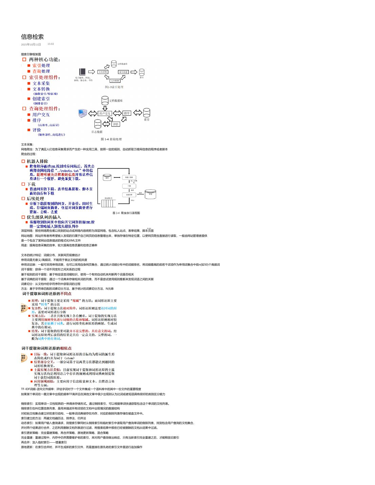
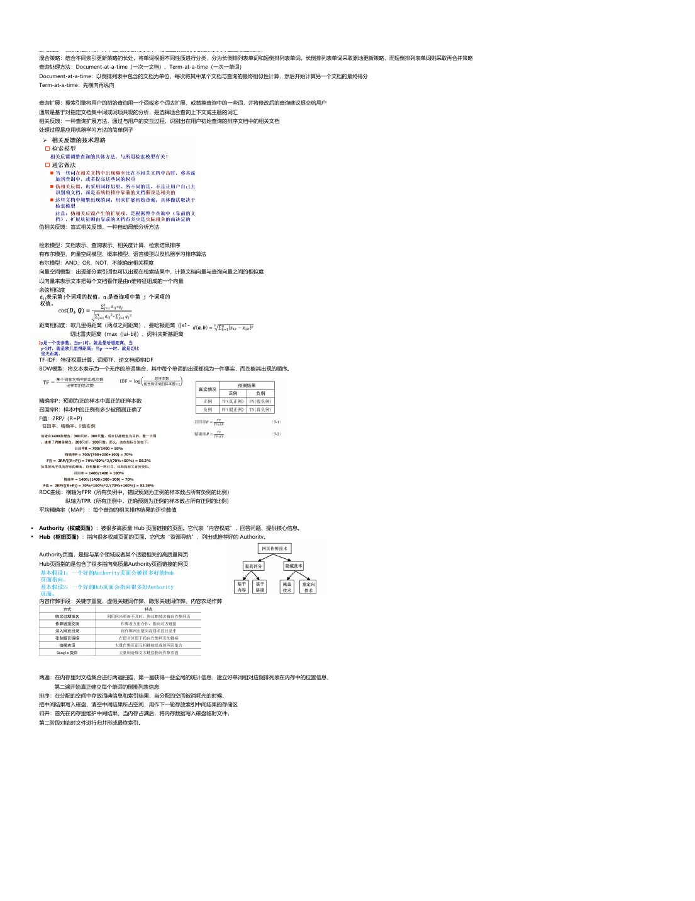

# 信息检索：课程笔记

[下载本课程 PDF](../../../assets/downloads/information-retrieval.pdf)

## 文字版

信息检索
2025年10月11日   15:02

搜索引擎框架图

文本采集：
网络爬虫：为了满足人们信息采集需求而产生的一种实用工具，按照一定的规则，自动抓取万维网信息的程序或者脚本
爬虫的过程：

深层网络：那些网络爬虫难以找到的站点或网络内容统称为深层网络，包含私人站点、表单结果、脚本页面
网站地图：网站所有者将希望被人发现的归属于自己网页的信息整理出来，单独存储在特定位置，以便网页爬虫直接进行读取，一般由网站管理者提供
是一个包含了某网站信息描述的格式化XML文件
用途：提高信息采集的效率，较大提高信息质量和信息正确率

文本的统计特征：词频分布、关联网页规模估计
停用词是无意义/高频词，不能用于表达文档的相关度
停用词去除：一般可采用停用词表，也可以采用自身网页集合，通过统计词频分布中的词频排名，将词频最高的前若干词项作为停用词集合中前n(如50)个高频词
词干提取：获得一个词不同变形之间关系的过程
基于规则的词干提取：基于特定语言词缀知识，使用一个有穷自动机来判断两个词是否相关
基于词典的词干提取：通过一个词典来存储相关词的列表，而不是尝试使用规则推断来发现词语之间的关联
词素切分：从文档中的字符序列中获取词的过程
方法：基于字符串匹配的词素切分方法、基于统计的词素切分方法、N元串

TF-IDF词频-逆向文件频率：评估字词对于一个文件集或一个语料库中的其中一份文件的重要程度
如果某个单词在一篇文章中出现的频率TF高并且在其他文章中很少出现则认为比词或者短语具有很好的类别区分能力

倒排索引：实现单词—文档矩阵的一种具体存储形式。通过倒排索引，可以根据单词快速获取包含这个单词的文档列表。
倒排索引也叫位置信息列表，是用来描述所有词项在文档中出现情况的数据结构
对初始文档集合建立好的索引结构，一般单词词典储存在内存，对应的倒排列表存储在磁盘文件中。
索引建立的方法：两遍文档遍历法、排序法、归并法
动态索引：如果用户输入查询请求，则搜索引擎同时从倒排索引和临时索引中读取用户查询单词的倒排列表，找到包含用户查询的文档集合，
并对两个结果进行合并，之后利用删除文档列表进行过滤，将搜索结果中那些已经被删除的文档从结果中过滤。
索引更新策略：完全重建策略、再合并策略、原地更新策略、混合策略
完全重建：重建过程中，内存中仍然需要维护老的索引，来对用户查询做出响应，只有当新索引完全重建之后，才能释放旧索引
再合并：加入临时索引——增量索引
原地更新：在索引合并时，并不生成新的索引文件，而是直接在原先老的索引文件里进行追加操作
混合策略：结合不同索引更新策略的长处，将单词根据不同性质进行分类，分为长倒排列表单词和短倒排列表单词。长倒排列表单词采取原地更新策略，而短倒排列表单词则采取再合并策略
查询处理方法：Document-at-a-time（一次一文档）、Term-at-a-time（一次一单词）
Document-at-a-time：以倒排列表中包含的文档为单位，每次将其中某个文档与查询的最终相似性计算，然后开始计算另一个文档的最终得分
Term-at-a-time：先横向再纵向

查询扩展：搜索引擎将用户的初始查询用一个词或多个词去扩展，或替换查询中的一些词，并将修改后的查询建议提交给用户
通常是基于对指定文档集中词或词项共现的分析，是选择适合查询上下文或主题的词汇

---

动态索引：如果用户输入查询请求，则搜索引擎同时从倒排索引和临时索引中读取用户查询单词的倒排列表，找到包含用户查询的文档集合，
并对两个结果进行合并，之后利用删除文档列表进行过滤，将搜索结果中那些已经被删除的文档从结果中过滤。
索引更新策略：完全重建策略、再合并策略、原地更新策略、混合策略
完全重建：重建过程中，内存中仍然需要维护老的索引，来对用户查询做出响应，只有当新索引完全重建之后，才能释放旧索引
再合并：加入临时索引——增量索引
原地更新：在索引合并时，并不生成新的索引文件，而是直接在原先老的索引文件里进行追加操作
混合策略：结合不同索引更新策略的长处，将单词根据不同性质进行分类，分为长倒排列表单词和短倒排列表单词。长倒排列表单词采取原地更新策略，而短倒排列表单词则采取再合并策略
查询处理方法：Document-at-a-time（一次一文档）、Term-at-a-time（一次一单词）
Document-at-a-time：以倒排列表中包含的文档为单位，每次将其中某个文档与查询的最终相似性计算，然后开始计算另一个文档的最终得分
Term-at-a-time：先横向再纵向

查询扩展：搜索引擎将用户的初始查询用一个词或多个词去扩展，或替换查询中的一些词，并将修改后的查询建议提交给用户
通常是基于对指定文档集中词或词项共现的分析，是选择适合查询上下文或主题的词汇
相关反馈：一种查询扩展方法，通过与用户的交互过程，识别出在用户初始查询的排序文档中的相关文档
处理过程是应用机器学习方法的简单例子

伪相关反馈：盲式相关反馈，一种自动局部分析方法

检索模型：文档表示、查询表示、相关度计算、检索结果排序
有布尔模型、向量空间模型、概率模型、语言模型以及机器学习排序算法
布尔模型：AND、OR、NOT，不能确定相关程度
向量空间模型：出现部分索引词也可以出现在检索结果中，计算文档向量与查询向量之间的相似度
以向量来表示文本把每个文档看作是由n维特征组成的一个向量
余弦相似度

距离相似度：欧几里得距离（两点之间距离）、曼哈顿距离（|x1-x2|）
切比雪夫距离（max（|ai-bi|）、闵科夫斯基距离

TF-IDF：特征权重计算，词频TF，逆文档频率IDF
BOW模型：将文本表示为一个无序的单词集合，其中每个单词的出现都视为一件事实，而忽略其出现的顺序。

精确率P：预测为正的样本中真正的正样本数
召回率R：样本中的正例有多少被预测正确了
F值：2RP/（R+P）

ROC曲线：横轴为FPR（所有负例中，错误预测为正例的样本数占所有负例的比例）
纵轴为TPR（所有正例中，正确预测为正例的样本数占所有正例的比例）
平均精确率（MAP）：每个查询的相关排序结果的评价数值

•   Authority（权威页面）：被很多高质量 Hub 页面链接的页面。它代表“内容权威”，回答问题、提供核心信息。
•   Hub（枢纽页面）：指向很多权威页面的页面。它代表“资源导航”，列出或推荐好的 Authority。

Authority页面，是指与某个领域或者某个话题相关的高质量网页
Hub页面指的是包含了很多指向高质量Authority页面链接的网页

内容作弊手段：关键字重复、虚假关键词作弊、隐形关键词作弊、内容农场作弊

两遍：在内存里对文档集合进行两遍扫描，第一遍获得一些全局的统计信息，建立好单词相对应倒排列表在内存中的位置信息，
第二遍开始真正建立每个单词的倒排列表信息
排序：在分配的空间中存放词典信息和索引结果，当分配的空间被消耗光的时候，
把中间结果写入磁盘，清空中间结果所占空间，用作下一轮存放索引中间结果的存储区
归并：首先在内存里维护中间结果，当内存占满后，将内存数据写入磁盘临时文件，
第二阶段对临时文件进行归并形成最终索引。

---

## 原版页面

### 第 1 页

### 第 2 页

